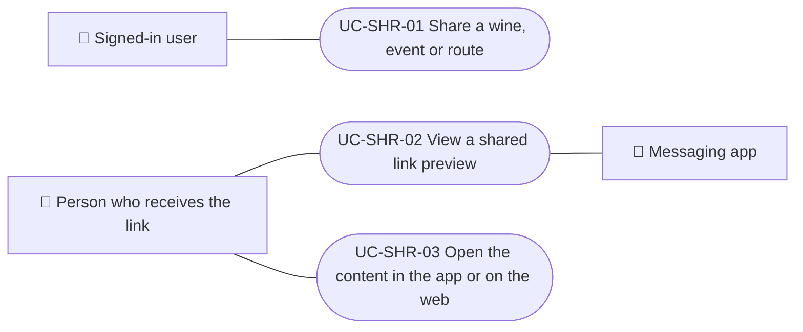

# Use cases

Sharing use cases: building the public link of a wine, event or route, opening the preview page that the recipient sees, and opening the content in the app or on the web. Each case applies to the platforms listed.

| ID | Use case | Platforms | Actors |
|---|---|---|---|
| `UC-SHR-01` | [Share a wine, event or route](uc-shr-01-share-content.md) | Web, APK | Signed-in user |
| `UC-SHR-02` | [View a shared link preview](uc-shr-02-open-shared-link.md) | Web, APK | Person who receives the link, Messaging app |
| `UC-SHR-03` | [Open the content in the app or on the web](uc-shr-03-open-in-app-or-web.md) | Web, APK | Person who receives the link |

## Use case diagram

[View the full “Use cases · Use case diagram” diagram](https://images.vinnot.com/docs/diagrams/v1/en/modules-sharing-use-cases-readme-7eca36335be2.svg)

## Lucidchart mapping

| ID | Lucidchart IDs |
|---|---|
| `UC-SHR-01` | [WEB UC-SHR-01](https://lucid.app/lucidchart/9f11a16b-bb5a-42fc-a9e8-0852b17bd241/edit), [APK UC-SHR-01](https://lucid.app/lucidchart/e095dd25-e8ac-41ba-bf5b-396e1055f217/edit) |
| `UC-SHR-02` | None |
| `UC-SHR-03` | [APK UC-SHR-02](https://lucid.app/lucidchart/e095dd25-e8ac-41ba-bf5b-396e1055f217/edit) |
