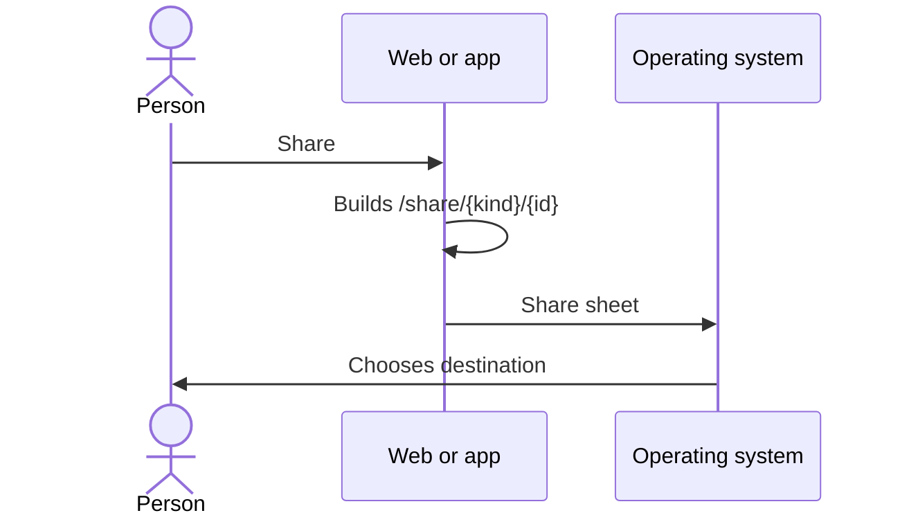

# UC-SHR-01 · Share a wine, event or route

| Field | Value |
|---|---|
| ID | `UC-SHR-01` |
| Module | [Sharing](../README.md) |
| Platforms | Web, APK |
| Actors | Signed-in user |
| Lucidchart IDs | [WEB UC-SHR-01](https://lucid.app/lucidchart/9f11a16b-bb5a-42fc-a9e8-0852b17bd241/edit), [APK UC-SHR-01](https://lucid.app/lucidchart/e095dd25-e8ac-41ba-bf5b-396e1055f217/edit) |
| Requirements | [`RF-WEB-SHR-01`](../requirements.md), [`RF-WEB-SHR-02`](../requirements.md), [`RF-APK-SHR-01`](../requirements.md), [`RF-APK-SHR-02`](../requirements.md) |
| Test cases | [`CP-SHR-01`](../testing.md), [`CP-SHR-15`](../testing.md), [`CP-SHR-02`](../testing.md), [`CP-SHR-03`](../testing.md), [`CP-SHR-04`](../testing.md) |

## Preconditions

- The person is on the details of a wine, an event or a route.

## Postconditions

- The public link was shared or copied.

## Main flow

1. The person chooses “Share”.
2. The client builds the public link `/share/{kind}/{id}` with the Vinnot domain; the kind is `wines`, `events` or `wine-routes`.
3. The client opens the share sheet: the browser's on the web and the system's on the app.
4. The person chooses where to share the link.

## Alternative flows

- 1a. The event or route has no public page yet (an event in draft or cancelled without ever being published, an unpublished route): the client does not offer “Share”.
- 3a. The browser cannot share: the web copies the link and says it was copied.
- 4a. The person cancels: no success notice is shown.
- 3b. Sharing fails: the client shows an error notice.

## Business rules

- The link only carries the content kind and ID, with no tokens or personal data.
- The client only builds links for known kinds and IDs in UUID format.
- The clients only offer “Share” on events and routes that have a public page, with the same rules as the preview.
- On Android the link is passed as text and on iOS as a URL.

## Diagram

[View the full “UC-SHR-01 · Share a wine, event or route” diagram](https://images.vinnot.com/docs/diagrams/v1/en/modules-sharing-use-cases-uc-shr-01-share-content-e64407347588.svg)

Component diagram in Lucidchart: [WEB UC-SHR-01](https://lucid.app/lucidchart/9f11a16b-bb5a-42fc-a9e8-0852b17bd241/edit), [APK UC-SHR-01](https://lucid.app/lucidchart/e095dd25-e8ac-41ba-bf5b-396e1055f217/edit).

## Code

| Layer | Location |
|---|---|
| Web | [`useShareLink.ts`](../../../../../frontend-react/src/presentation/hooks/useShareLink.ts), [`sharing.service.ts`](../../../../../frontend-react/src/application/services/sharing.service.ts), [`sharing.gateway.ts`](../../../../../frontend-react/src/infrastructure/device/sharing.gateway.ts), [`contentLink.ts`](../../../../../frontend-react/src/domain/sharing/contentLink.ts) |
| App | [`useShareLink.ts`](../../../../../frontend-mobile/src/presentation/hooks/useShareLink.ts), [`sharing.service.ts`](../../../../../frontend-mobile/src/application/services/sharing.service.ts), [`sharing.gateway.ts`](../../../../../frontend-mobile/src/infrastructure/device/sharing.gateway.ts), [`contentLink.ts`](../../../../../frontend-mobile/src/domain/sharing/contentLink.ts) |

## Automated tests

- Backend: None
- Web: [`sharing.service.test.ts`](../../../../../frontend-react/src/application/services/sharing.service.test.ts), [`contentLink.test.ts`](../../../../../frontend-react/src/domain/sharing/contentLink.test.ts), [`publicContent.test.ts`](../../../../../frontend-react/src/domain/sharing/publicContent.test.ts)
- App: [`sharing.service.test.ts`](../../../../../frontend-mobile/src/application/services/sharing.service.test.ts), [`sharing.gateway.test.ts`](../../../../../frontend-mobile/src/infrastructure/device/sharing.gateway.test.ts), [`contentLink.test.ts`](../../../../../frontend-mobile/src/domain/sharing/contentLink.test.ts), [`shareability.test.ts`](../../../../../frontend-mobile/src/domain/sharing/shareability.test.ts)
