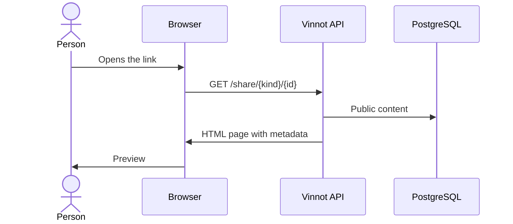

# UC-SHR-02 · View a shared link preview

| Field | Value |
|---|---|
| ID | `UC-SHR-02` |
| Module | [Sharing](../README.md) |
| Platforms | Web, APK |
| Actors | Person who receives the link, Messaging app |
| Lucidchart IDs | None |
| Requirements | [`RF-WEB-SHR-03`](../requirements.md), [`RF-WEB-SHR-04`](../requirements.md), [`RF-WEB-SHR-05`](../requirements.md), [`RF-APK-SHR-03`](../requirements.md), [`RF-APK-SHR-04`](../requirements.md), [`RF-APK-SHR-05`](../requirements.md) |
| Test cases | [`CP-SHR-05`](../testing.md), [`CP-SHR-06`](../testing.md), [`CP-SHR-07`](../testing.md), [`CP-SHR-08`](../testing.md), [`CP-SHR-09`](../testing.md) |

## Preconditions

- Someone shared a Vinnot `/share/...` link.

## Postconditions

- The recipient sees a preview of the content without signing in.

## Main flow

1. The person opens the link in the browser, or the messaging app requests it to build its preview.
2. The API receives `GET /share/{kind}/{id}` without a session and validates the kind and the ID format.
3. The API looks up the public content: an active wine, a published route, or an event published at least once that is not a draft.
4. The API returns a page with title, short description, image, Open Graph and Twitter metadata, and the “Already have the app? Open in Vinnot”, “Continue on the web” and download buttons.

## Alternative flows

- 2a. The kind does not exist or the ID is not a UUID: the API answers 404 without querying the database.
- 3a. The content does not exist or is not public: the API answers 404 with a neutral page saying the link is no longer available.
- 1a. The device is in English or the link ends in `/en`: the page is shown in English.
- 1b. The link is just `/share`: the app's general page with its downloads is shown.

## Business rules

- The page does not expose contacts, registrations or private data.
- The title is cut to 120 characters and the description to 240.
- The image is only taken from the Vinnot image domain; otherwise the logo is used.
- The link preview in messaging apps shows that same photo; without one it shows the Vinnot preview image.
- Cancelled or finished events stay visible.
- The page is not cached and search engines do not index it.
- The Android download only appears when the app is available on Google Play; otherwise it says “Coming soon”.

## Diagram

[View the full “UC-SHR-02 · View a shared link preview” diagram](https://images.vinnot.com/docs/diagrams/v1/en/modules-sharing-use-cases-uc-shr-02-open-shared-link-d2cb004ab6cf.svg)

## Code

| Layer | Location |
|---|---|
| Endpoints | `GET /share/{kind}/{id}`, `GET /share` |
| Backend | [`SharedLinkController.java`](../../../../../backend/src/main/java/com/vinnot/sharing/infrastructure/web/SharedLinkController.java), [`GetSharedContentQueryHandler.java`](../../../../../backend/src/main/java/com/vinnot/sharing/application/query/GetSharedContentQueryHandler.java), [`JdbcSharedContentQueryAdapter.java`](../../../../../backend/src/main/java/com/vinnot/sharing/infrastructure/persistence/JdbcSharedContentQueryAdapter.java), [`SharedLinkHtmlRenderer.java`](../../../../../backend/src/main/java/com/vinnot/sharing/infrastructure/web/SharedLinkHtmlRenderer.java) |

## Automated tests

- Backend: [`SharedLinkControllerTest.java`](../../../../../backend/src/test/java/com/vinnot/sharing/infrastructure/web/SharedLinkControllerTest.java), [`SharedLinkHtmlRendererTest.java`](../../../../../backend/src/test/java/com/vinnot/sharing/infrastructure/web/SharedLinkHtmlRendererTest.java), [`GetSharedContentQueryHandlerTest.java`](../../../../../backend/src/test/java/com/vinnot/sharing/application/query/GetSharedContentQueryHandlerTest.java), [`SharedContentHttpPostgresIntegrationTest.java`](../../../../../backend/src/test/java/com/vinnot/sharing/infrastructure/SharedContentHttpPostgresIntegrationTest.java)
- Web: [`sharing-language.test.ts`](../../../../../frontend-react/tests/unit/sharing-language.test.ts), [`sharing-downloads.test.ts`](../../../../../frontend-react/tests/unit/sharing-downloads.test.ts)
- App: None
