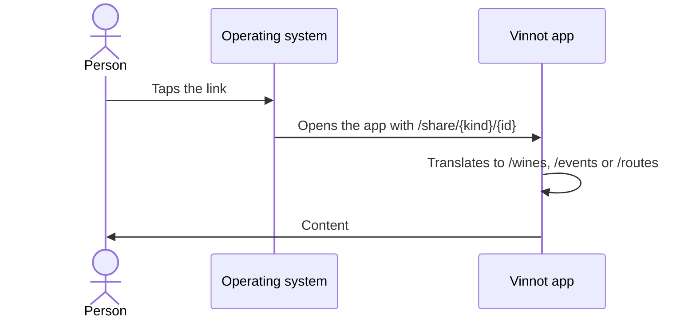

# UC-SHR-03 · Open the content in the app or on the web

| Field | Value |
|---|---|
| ID | `UC-SHR-03` |
| Module | [Sharing](../README.md) |
| Platforms | Web, APK |
| Actors | Person who receives the link |
| Lucidchart IDs | [APK UC-SHR-02](https://lucid.app/lucidchart/e095dd25-e8ac-41ba-bf5b-396e1055f217/edit) |
| Requirements | [`RF-WEB-SHR-06`](../requirements.md), [`RF-WEB-SHR-07`](../requirements.md), [`RF-APK-SHR-06`](../requirements.md), [`RF-APK-SHR-07`](../requirements.md), [`RF-APK-SHR-08`](../requirements.md) |
| Test cases | [`CP-SHR-10`](../testing.md), [`CP-SHR-11`](../testing.md), [`CP-SHR-12`](../testing.md), [`CP-SHR-13`](../testing.md), [`CP-SHR-14`](../testing.md) |

## Preconditions

- The person has a Vinnot `/share/...` link.

## Postconditions

- The person sees the wine, the event or the route in the app or on the web.

## Main flow

1. The person taps the link with the app installed.
2. The system recognizes the associated domain and opens the app.
3. The app translates `/share/{kind}/{id}` to its screen: `/wines/{id}`, `/events/{id}` or `/routes/{id}`.
4. The app shows the content.

## Alternative flows

- 2a. There is no app or the system does not recognize the domain: the preview opens, offering “Open in Vinnot” (`vinnot://{kind}/{id}`) and the downloads.
- 2b. The person chooses “Continue on the web”: the web opens `/{kind}/{id}`.
- 4a. There is no session: the app or the web asks to sign in and then returns to the content.
- 3a. The link is invalid, too long or from another domain: the app opens Home.

## Business rules

- The app only accepts links from `vinnot.com` and `dev.vinnot.com`, without credentials or port.
- After installing the app the link must be opened again; the destination is not remembered during installation.
- The domain association ships in the store build; an OTA update does not add it.

## Diagram

[View the full “UC-SHR-03 · Open the content in the app or on the web” diagram](https://images.vinnot.com/docs/diagrams/v1/en/modules-sharing-use-cases-uc-shr-03-open-in-app-or-web-3faf3dd086f3.svg)

Component diagram in Lucidchart: [APK UC-SHR-02](https://lucid.app/lucidchart/e095dd25-e8ac-41ba-bf5b-396e1055f217/edit).

## Code

| Layer | Location |
|---|---|
| Web | [`ProtectedRoute.tsx`](../../../../../frontend-react/src/presentation/components/auth/ProtectedRoute.tsx) |
| App | [`+native-intent.tsx`](../../../../../frontend-mobile/app/+native-intent.tsx), [`nativeIntent.ts`](../../../../../frontend-mobile/src/domain/navigation/nativeIntent.ts), [`guards.tsx`](../../../../../frontend-mobile/src/presentation/navigation/guards.tsx) |

## Automated tests

- Backend: None
- Web: None
- App: [`nativeIntent.test.ts`](../../../../../frontend-mobile/src/domain/navigation/nativeIntent.test.ts)
