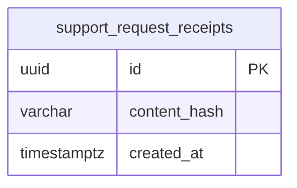

# Support and public information

The Vinnot presentation, searchable help, the contact form and the error and service
screens. Everything works without signing in. The form saves the enquiry, emails the
team and gives the person a reference to follow up.

- Module code: `SUP`.
- Backend: package [`support`](../../../../backend/src/main/java/com/vinnot/support/).
- [Use cases](use-cases/README.md) · [Requirements](requirements.md) ·
  [Architecture](architecture.md) · [Testing](testing.md)

## Actors

| Actor | What they do in this module |
|---|---|
| Visitor or signed-in user | Reads the presentation and help, writes to the team and sees error states |
| Vinnot team | Receives enquiries in the configured mailbox and replies by email |

## Business rules

| Rule | Detail | Where |
|---|---|---|
| No account | Anyone can send an enquiry; with a session, the email is the account's | [`SupportController.java`](../../../../backend/src/main/java/com/vinnot/support/infrastructure/web/SupportController.java) |
| Valid data | Name up to 100 characters without line breaks, valid email up to 254, message up to 4000 and a known reason | [`SupportRequest.java`](../../../../backend/src/main/java/com/vinnot/support/domain/model/SupportRequest.java) |
| No duplicates | Retrying with the same ID and content creates no new enquiry; the same ID with other content gives 400 | [`JdbcSupportRequestAdapter.java`](../../../../backend/src/main/java/com/vinnot/support/infrastructure/JdbcSupportRequestAdapter.java) |
| Acknowledgement | One acknowledgement email per address and day, with only the reference and the reason | [`JdbcSupportRequestAdapter.java`](../../../../backend/src/main/java/com/vinnot/support/infrastructure/JdbcSupportRequestAdapter.java) |
| Configured destination | Without a configured team mailbox no enquiries are accepted (503) | [`JdbcSupportRequestAdapter.java`](../../../../backend/src/main/java/com/vinnot/support/infrastructure/JdbcSupportRequestAdapter.java) |
| Send limit | 5 an hour | [`RateLimitPolicyResolver.java`](../../../../backend/src/main/java/com/vinnot/shared/infrastructure/security/RateLimitPolicyResolver.java) |
| Reference | `VIN-` and the last 12 characters of the ID | [`support.ts`](../../../../frontend-react/src/domain/public/support.ts) |
| Public content | Presentation and help come from a file shared by the web and the app, in Spanish and English | [`public-content.ts`](../../../../frontend-react/src/domain/public/public-content.ts) |
| Error states | Each error shows its state (forbidden, not found, too many requests, no service, delay, offline), never an empty list | [`illustratedState.ts`](../../../../frontend-react/src/presentation/feedback/illustratedState.ts) |

## Where it lives

| Part | Location |
|---|---|
| API | [`SupportController`](../../../../backend/src/main/java/com/vinnot/support/infrastructure/web/SupportController.java) at `POST /support/requests` |
| Web | `/about`, `/help` and `/contact` in [`pages/public`](../../../../frontend-react/src/presentation/pages/public/), and the `/403`, `/404`, `/500`, `/503`, `/429`, `/offline` and `/timeout` pages |
| App | `frontend-mobile/app/about.tsx`, `help.tsx` and `contact.tsx`, with screens in [`features/public`](../../../../frontend-mobile/src/presentation/features/public/), and the matching state routes |

## Data

[View the full “Support and public information · Data” diagram](https://images.vinnot.com/docs/diagrams/v1/en/modules-support-readme-bf790d422337.svg)

`support_request_receipts` only stores the ID and a SHA-256 fingerprint of the content,
never the name, email or message; it also stores each address's daily acknowledgement
marker, as a digest. Rows are deleted after 30 days. The message travels in the
[Notifications](../notifications/README.md) queue and is discarded after 7 days if
undelivered.
