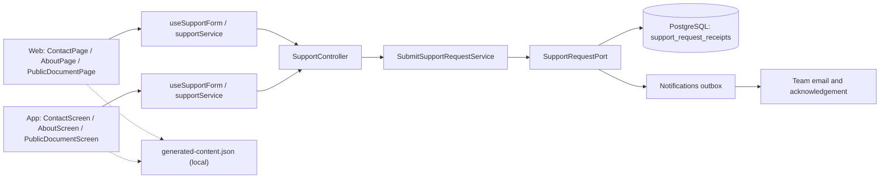
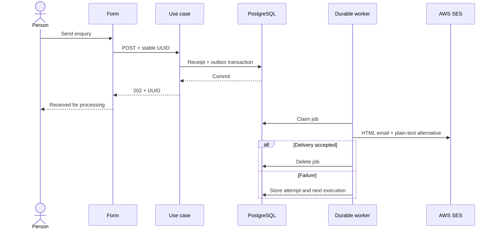

# Architecture

How the module is built in each layer. The backend follows the hexagonal flow
`controller → input port → service → output port → adapter`; the web and the app follow
`screen → hook → service → API client → HTTP transport`. The presentation and help ship
with each client; legal documents are in [Legal](../legal/README.md).



[View the full “Architecture” diagram](https://images.vinnot.com/docs/diagrams/v1/en/modules-support-architecture-cf5e23053c18.svg)

## Backend

### Scope and actors

The `support` module receives support, privacy, reporting, decision-review and
partnership enquiries from web and mobile. An account is not required: people
who lost access must still be able to contact the operator. This is neither an
emergency service nor a ticket-management panel. The team handles the configured
mailbox; public content does not promise a response deadline or automatic
moderation decisions.

### Architecture

`SupportController → SubmitSupportRequestUseCase → SubmitSupportRequestService
→ SupportRequestPort → JdbcSupportRequestAdapter`.

`SupportRequest` is a domain record independent of Spring, HTTP and SQL. It
validates UUID identity, name, email, category and message. The adapter implements
transactional reception and enqueues a `SUPPORT_REQUEST` through the
[notification module](../notifications/architecture.md) in the same transaction.
`SupportRequestTemplate` renders the message and the shared SES adapter delivers
it with Reply-To set to the requester; the use case does not know AWS or the
outbox schema.

### HTTP contract

`POST /api/support/requests` accepts JSON:

```json
{
  "requestId": "22e1e57c-23cc-4d10-aeb4-3c3e8bb3a310",
  "name": "Test person",
  "email": "person@example.org",
  "subject": "support",
  "message": "A question about a Vinnot feature",
  "language": "en"
}
```

| Field | Rule |
|---|---|
| requestId | Client-generated random UUID (version 4) for one logical operation; other versions are refused with `INVALID_SUPPORT_REQUEST` |
| name | Required; at most 100 characters; no CR/LF or NUL |
| email | Valid address; at most 254 characters; no NUL |
| subject | general, support, privacy, report, appeal, partnership, feedback or other |
| message | Required; at most 4000 characters; no NUL; line breaks allowed |
| language | Optional interface language: `en`; anything else, or nothing, is Spanish. Not part of the fingerprint |

A `202` response contains `{"requestId":"…"}`: durable receipt, not email
delivery or resolution. HTTP validation produces `400`; domain rules use the
global error handler. Reusing an identifier with different content produces
`400` `SUPPORT_REQUEST_CONFLICT`. Without SES or a valid recipient,
`SUPPORT_UNAVAILABLE` returns `503`, without accepting an enquiry that would
only be logged. GET is not public and does not expose enquiries.

The rate limiter uses a separate `support` bucket with registration's configured
capacity/period (default 5 per hour). Community reports use their own `report`
policy, so they do not spend that quota. It retains the existing filter's identity
and trusted-proxy mechanism. This is not a CAPTCHA or a guarantee against spam.

### Transaction, idempotency and retention

Migration `V20__support_request_receipts.sql` creates
`support_request_receipts(id, content_hash, created_at)`. The SHA-256 fingerprint
covers the normalized message, including its identifier. This table does not
store email addresses or message text.

1. Validate delivery configuration.
2. Insert a receipt using `ON CONFLICT DO NOTHING`.
3. For an existing receipt, compare fingerprints: equal returns the same receipt
   without another job; different rejects identifier reuse.
4. Enqueue `SUPPORT_REQUEST` with key `support:<UUID>`, recipient and content
   for a new reception, and `SUPPORT_REQUEST_RECEIVED` with key
   `support-received:<UUID>` to the requester's address: the reference and the
   subject in their language, with a generic greeting, never the typed name or
   the message. Anyone can type any address, so each address gets at most one
   acknowledgement per UTC day: a marker row in `support_request_receipts`,
   keyed by a digest of the trimmed, lower-cased address (never the address
   itself), is claimed first; later requests that day are still stored and
   still reach support, without another acknowledgement.
5. Commit both writes in the same transaction.

The primary index serializes concurrent retries of one UUID. Keeping receipts
after delivery prevents another email caused by client retries for 30 days.
Once expired, the UUID has no historical protection. The existing worker resumes
jobs after restart, retries failures and removes delivered jobs. External
delivery is **at least once**: a crash between SES acceptance and local commit
can duplicate an email; exactly-once delivery is not claimed.

Undelivered support emails are discarded after 7 days by the notifications
retention, and an hourly cleanup removes receipts older than 30 days. Mailbox copies and backups have
lifecycles separate from the outbox.

### Delivery and operation

`SUPPORT_RECIPIENT` configures the destination, initially the confirmed product
contact. `app.auth.email.provider=ses`, `app.auth.email.from` and
`app.auth.email.ses-region` reuse the existing email configuration. Credentials
and IAM belong to infrastructure.

Subject and sender are fixed/configured, not user-controlled headers. Name,
reply email, reference and message are retained in plain text and escaped in
the HTML version using `BrandedEmailTemplate`; user HTML and headers are not
interpreted or injected. Normal logs do not record the body. A 202 must not be displayed
as confirmed mailbox delivery. Direct email contact remains available.

### Sequence



[View the full “Sequence” diagram](https://images.vinnot.com/docs/diagrams/v1/en/modules-support-architecture-d855f9359580.svg)

### Verification

Domain tests cover bounds, NUL, categories and header injection. Service tests
require exceptions to prevent successful receipts. MVC tests cover anonymous
POST, contract and validation. PostgreSQL tests cover V20, concurrency, retries
after delivery, atomic rollback and selective expiry. SES uses a controlled
client to check both bodies, HTML escaping, recipient, fixed subject and propagated failures.
These tests do not send real emails.

### Changing the public contact

To change the mailbox, update `SUPPORT_RECIPIENT` in the backend environment
and `contact.email` in `content/public-pages.json`, regenerating both client
copies with `node scripts/sync-public-content.mjs --write`. Review editorial
email mentions within the ES/EN documents too. An already queued enquiry keeps
its destination in its payload; a configuration change does not silently
redirect earlier enquiries.

Acceptance checks the SES provider, a valid destination and a non-empty sender
without line breaks. Credentials, permissions and SES verification are checked
in the deployed integration; durable acceptance does not certify external delivery.

### Display reference

Clients show `VIN-` and the UUID's final 12 hexadecimal digits in uppercase.
`SupportRequestTemplate` includes that code and the full UUID in text and HTML;
HTTP, persistence, outbox and idempotency retain full identity. To handle a code
provided by a user, search the reference in the support notification and resolve
to that notification's UUID. If suffixes collide, disambiguate using request
context; never execute an action using only the suffix as a unique identity.
There is no migration or new ticketing system.

## Web

### Features and access

Vinnot provides an information centre independent of the catalogue and session.
Policies and FAQs are readable without an account. They are versioned product
content, not AI-generated answers. About describes actual product capabilities
without hardcoded unverified statistics or team history.

| Destination | Purpose |
|---|---|
| /legal | Index grouped by service, community and privacy |
| /terms | Current service terms |
| /privacy | Data, providers, retention and requests |
| /cookies | Storage and platform controls |
| /content-policy | Contribution and community guidelines |
| /legal/trust-safety | Safety, authenticity and reports |
| /legal/moderation | Moderation criteria and review |
| /legal/ranking | Search, ratings, proximity and matching |
| /legal/payments | Payments legal page: registration, payments and event cancellations |
| /about | Vinnot's purpose and capabilities |
| /help | FAQs with local search and index |
| /contact | Durable enquiries and direct email |

Bottle sales and premium subscriptions are not active services on these pages.
Cancelling registration does not automatically refund money. Registration
screens link to event conditions before confirmation. Advertising acceptance
is not required, and reading a document does not record acceptance of terms.

The `/privacy#account-deletion` section identifies Vinnot and explains how to request deletion without installing the app: support email or Contact → Privacy. It distinguishes a request, ownership verification, deletion and deactivation, and references the published retention information. It reuses the existing support workflow and never deletes data when the link is opened. The HTML anchor applies to web; mobile displays the same section in its local index.

### Editorial source and localization

`content/public-pages.json` contains version, contact and pages with slug,
category, title, summary and ES/EN sections. Section identifiers remain stable
across languages. `scripts/sync-public-content.mjs --write` creates identical
copies at `src/domain/public/generated-content.json` in both frontends.
Architecture verification checks parity and rejects divergent copies; generated
files are not edited manually.

`public-content.ts` exposes search and paths without React, HTTP or router
dependencies. FAQ search normalizes accents and case, without querying the
backend or changing the document. Unknown slugs render a 404 state rather than
an empty page. Content is rendered as text, not arbitrary HTML. The version
identifies what is being read; it is not evidence of a person's contractual
acceptance.

### Contact workflow

The form follows `useSupportForm → supportService → supportClient`. The domain
validates name, email, category and message. Infrastructure creates the UUID
and transports the request. The service checks that the receipt matches that
UUID. UI code does not call the HTTP client directly.

- Validate fields and backend-aligned limits before sending.
- Disable fields and submit while sending. A ref prevents duplicate execution
  even before the next render.
- Preserve the UUID for unchanged content retried after failure.
- Editing the message starts another operation with a new UUID.
- Failure preserves the full form and does not display confirmation.
- A 202 with a matching reference clears the form and confirms receipt
  **for processing**, not delivery or resolution.
- Direct email is an alternative; opening mailto does not report success.

Categories include support, privacy, reports, decision reviews, partnership and
general enquiries. Attachments and passwords are not requested. See
[Backend](#backend) for delivery,
retention and idempotency.

### States and visual resources

`IllustratedState` presents illustration, title, explanation and caller actions.
`resolveIllustratedState` distinguishes 401, 403, 404, 429, 500, 502/503,
timeout and connection failures without exposing internal messages. The
component neither makes requests nor changes the session.

`QueryErrorState` supports explicit read retries. Valid `Retry-After` metadata
is converted once by transport into `retryAt`. The hook disables the button
until that deadline and clears its timer on unmount. It does not invent a wait
when the server supplies none. Mutations, payments and AI generation are not
automatically retried by this component.

Event, route and wine lists retain filters after failure. Errors are not
represented as empty results; previously loaded content can remain visible.
Cellar distinguishes true empty, filtered no-results and failure. The
403/404/500/503/429/offline/timeout pages provide a way back to public navigation.

Optimized WebP derivatives preserve the original PNG alpha channel. Valid resource photos
take priority. Events, routes and wineries use their semantic illustration when
a URL is missing or fails. A failed fallback terminates in a stable container
with text/actions rather than a download loop. Error artwork is decorative and
does not repeat the heading to assistive readers.

### Behavior-based verification

- Complete ES/EN page and section parity.
- FAQ search with matches, no matches, accents and language changes.
- Valid/invalid contact, 503, mismatched receipt, double click and retry.
- Preserve text on failure; no simulated success.
- Missing/failed illustrations, source changes and terminal fallback.
- Read failures distinct from empty results; classification and 429 delay.
- Public links without sessions and return navigation.

Unit tests cover domain, services and hooks; component tests cover visible
actions. Real provider tests are separate from controlled responses and are
not implied by a UI test.

### Web-specific behavior

Pages use bundled editorial content, server-published terms and HTML section anchors. The sidebar index becomes a
single column on small screens, and each document updates the browser title.
Footer, registration and contact link to real destinations. The legal centre
remains accessible during incomplete onboarding. `RouteErrorBoundary` catches
render failures inside the shell and offers retry or exit; it does not replace
query-error handling.

`/cookies` provides an effective embedded-map control. The local preference
`vinnot.external-maps.v1` defaults to disabled. The application service and
`useExternalMapsPreference` coordinate persistence and consumer/cross-tab
notification. `ExternalMapGate` prevents Google Maps/iframe mounting before
permission and unmounts maps on revocation. It cannot undo data already sent.
Blocked browser storage is reported as a session-only choice. Google social
sign-in mounts after selecting it and is independent of map permission.
There are no fictional marketing/analytics toggles.

Playwright covers pages, ES/EN anchors, search, contact failure/retry, persisted
preferences, failed images and phone-width layout. Preview URL and server both
use port 5174.

### Recovery and publication

The form keeps the draft and blocks retries until the service-supplied
`retryAt`; it does not resend an enquiry automatically. On mobile,
`PublicHeader` returns through history or to the root for a standalone deep
link. The form accommodates the keyboard and exposes accessible field labels.

The web scanning invitation shows the official App Store and Google Play
badges (`public/share-assets/`) linked to the app's published listings.
`VITE_IOS_APP_URL` and `VITE_ANDROID_APP_URL` can replace them with another
concrete HTTPS listing; when they are missing or invalid the published listings
are used (`PUBLISHED_APP_LISTINGS` in `frontend-react/src/shared/config/appDownloads.ts`).
No web camera is enabled.

### Contract agreement and editorial presentation

`PublicHero` shares artwork, typographic hierarchy, wine-colour accents and
fine separators. Ranking uses legal artwork even without an explicit image in
its definition. About has its own composition with capabilities and route/contact
links; it invents neither statistics nor company claims. Contact separates
the introduction and form, prefilling name/email from the session. Authenticated
email is read-only. Changing account remounts the form so private drafts cannot
move to another identity; updating details of the same account preserves the message.

Terms are the exception to local content: `usePublicDocument` reads the same
published snapshot used for acceptance. If it cannot be confirmed, the bundled
copy is identified as informational and offers refresh. It is never accepted
without server verification. Other pages and FAQs remain local, without AI calls.

`TermsReview` presents the complete text and an unchecked checkbox; it does not
track scrolling or interpret it as reading. Registration retains its fields while
reviewing/reloading terms. After social login or login to an account missing
acceptance, `TermsGate` precedes onboarding and session content. The person may
accept or sign out; legal, privacy, help and contact remain accessible.

Layer flow: UI → `useLegalAgreement` → `legalService` → `legalClient` → API.
Infrastructure transports DTOs; the application checks complete documents and
status. Hook state is not persisted as evidence. Entering the surface again
queries the backend. Switching language does not require acceptance of the same
revision again; changing document/language while deciding resets the checkbox.
Request generations discard responses from a previous account. Duplicate submit
is blocked locally and deduplicated in the database.

Failure retains a recoverable screen and exit; it never unlocks content by
default. UI waits for POST confirmation and never automatically retries consent.
Privacy is separate information: the checkbox does not enable cookies, maps,
marketing or device permissions.

[Versioning, HTTP contract, retention and rollout](../legal/architecture.md).

### Friendly support reference

Confirmation displays `VIN-` followed by the UUID's final 12 hexadecimal digits in
uppercase. Copy reference goes through the hook/service and clipboard adapter;
if the browser rejects it, selectable text remains and failure is reported.
Requests and receipts retain the full UUID. The legal contents index distinguishes
its dark heading from accessible, underlined brand-colored links.

## App

### Features and access

Vinnot provides an information centre independent of the catalogue and session.
Policies and FAQs are readable without an account. They are versioned product
content, not AI-generated answers. About describes actual product capabilities
without hardcoded unverified statistics or team history.

| Destination | Purpose |
|---|---|
| /legal | Index grouped by service, community and privacy |
| /terms | Current service terms |
| /privacy | Data, providers, retention and requests |
| /cookies | Storage and platform controls |
| /content-policy | Contribution and community guidelines |
| /legal/trust-safety | Safety, authenticity and reports |
| /legal/moderation | Moderation criteria and review |
| /legal/ranking | Search, ratings, proximity and matching |
| /legal/payments | Registration, reported payments and event cancellations |
| /about | Vinnot's purpose and capabilities |
| /help | FAQs with local search and index |
| /contact | Durable enquiries and direct email |

Bottle sales and premium subscriptions are not active services on these pages.
Cancelling registration does not automatically refund money. Registration
screens link to event conditions before confirmation. Advertising acceptance
is not required, and reading a document does not record acceptance of terms.

The `/privacy#account-deletion` section identifies Vinnot and explains how to request deletion without installing the app: support email or Contact → Privacy. It distinguishes a request, ownership verification, deletion and deactivation, and references the published retention information. It reuses the existing support workflow and never deletes data when the link is opened. The HTML anchor applies to web; mobile displays the same section in its local index.

### Editorial source and localization

`content/public-pages.json` contains version, contact and pages with slug,
category, title, summary and ES/EN sections. Section identifiers remain stable
across languages. `scripts/sync-public-content.mjs --write` creates identical
copies at `src/domain/public/generated-content.json` in both frontends.
Architecture verification checks parity and rejects divergent copies; generated
files are not edited manually.

`public-content.ts` exposes search and paths without React, HTTP or router
dependencies. FAQ search normalizes accents and case, without querying the
backend or changing the document. Unknown slugs render a 404 state rather than
an empty page. Content is rendered as text, not arbitrary HTML. The version
identifies what is being read; it is not evidence of a person's contractual
acceptance.

### Contact workflow

The form follows `useSupportForm → supportService → supportClient`. The domain
validates name, email, category and message. Infrastructure creates the UUID
and transports the request. The service checks that the receipt matches that
UUID. UI code does not call the HTTP client directly.

- Validate fields and backend-aligned limits before sending.
- Disable fields and submit while sending. A ref prevents duplicate execution
  even before the next render.
- Preserve the UUID for unchanged content retried after failure.
- Editing the message starts another operation with a new UUID.
- Failure preserves the full form and does not display confirmation.
- A 202 with a matching reference clears the form and confirms receipt
  **for processing**, not delivery or resolution.
- Direct email is an alternative; opening mailto does not report success.

Categories include support, privacy, reports, decision reviews, partnership and
general enquiries. Attachments and passwords are not requested. See
[Backend](#backend) for delivery,
retention and idempotency.

### States and visual resources

`IllustratedState` presents illustration, title, explanation and caller actions.
`resolveIllustratedState` distinguishes 401, 403, 404, 429, 500, 502/503,
timeout and connection failures without exposing internal messages. The
component neither makes requests nor changes the session.

`QueryErrorState` supports explicit read retries. Valid `Retry-After` metadata
is converted once by transport into `retryAt`. The hook disables the button
until that deadline and clears its timer on unmount. It does not invent a wait
when the server supplies none. Mutations, payments and AI generation are not
automatically retried by this component.

Event, route and wine lists retain filters after failure. Errors are not
represented as empty results; previously loaded content can remain visible.
Cellar distinguishes true empty, filtered no-results and failure. The
403/404/500/503/429/offline/timeout pages provide a way back to public navigation.

Optimized WebP derivatives preserve the original PNG alpha channel. Valid resource photos
take priority. Events, routes and wineries use their semantic illustration when
a URL is missing or fails. A failed fallback terminates in a stable container
with text/actions rather than a download loop. Error artwork is decorative and
does not repeat the heading to assistive readers.

### Behavior-based verification

- Complete ES/EN page and section parity.
- FAQ search with matches, no matches, accents and language changes.
- Valid/invalid contact, 503, mismatched receipt, double click and retry.
- Preserve text on failure; no simulated success.
- Missing/failed illustrations, source changes and terminal fallback.
- Read failures distinct from empty results; classification and 429 delay.
- Public links without sessions and return navigation.

Unit tests cover domain, services and hooks; component tests cover visible
actions. Real provider tests are separate from controlled responses and are
not implied by a UI test.

### Native-specific behavior

Public routes live outside `(app)` and delegate to
`presentation/features/public`. Editorial pages, FAQs and illustrations ship in
the bundle and can be read without a session or network. Current terms are the
exception: they are retrieved from the backend, with an informational bundled
fallback that cannot be used to record acceptance. Updating the other bundled
content requires a compatible mobile update; a backend deployment does not replace it.

The index scrolls the ScrollView to each layout-measured section. Help filtering
makes no requests. Profile links Privacy and Help; registration links terms and
privacy. The header preserves back navigation. The root layout's
`ErrorBoundary` delegates to a minimal fallback independent of business
providers and displays recovery without technical error details.

`/cookies` explains phone storage/permissions and distinguishes browser settings.
It does not offer a switch pretending to modify OS permissions. Camera, photos
and location retain their existing native workflows. Native maps do not depend
on the web Google Maps preference.

Jest tests logic with controlled adapters. Safe-area, keyboard, font scaling
and navigation verification on iOS/Android differ from TypeScript or component
tests and do not certify physical devices.

### Recovery and publication

The form keeps the draft and blocks retries until the service-supplied
`retryAt`; it does not resend an enquiry automatically. On mobile,
`PublicHeader` returns through history or to the root for a standalone deep
link. The form accommodates the keyboard and exposes accessible field labels.

The web scanning invitation shows the official App Store and Google Play
badges (`public/share-assets/`) linked to the app's published listings.
`VITE_IOS_APP_URL` and `VITE_ANDROID_APP_URL` can replace them with another
concrete HTTPS listing; when they are missing or invalid the published listings
are used (`PUBLISHED_APP_LISTINGS` in `frontend-react/src/shared/config/appDownloads.ts`).
No web camera is enabled.

### Contract agreement and editorial presentation

`PublicHero` shares artwork, typographic hierarchy, wine-colour accents and
fine separators. Ranking uses legal artwork even without an explicit image in
its definition. About has its own composition with capabilities and route/contact
links; it invents neither statistics nor company claims. Contact separates
the introduction and form, prefilling name/email from the session. Authenticated
email is read-only. Changing account remounts the form so private drafts cannot
move to another identity; updating details of the same account preserves the message.

Terms are the exception to local content: `usePublicDocument` reads the same
published snapshot used for acceptance. If it cannot be confirmed, the bundled
copy is identified as informational and offers refresh. It is never accepted
without server verification. Other pages and FAQs remain local, without AI calls.

`TermsReview` presents the complete text and an unchecked checkbox; it does not
track scrolling or interpret it as reading. Registration retains its fields while
reviewing/reloading terms. After social login or login to an account missing
acceptance, `TermsGate` precedes onboarding and session content. The person may
accept or sign out; legal, privacy, help and contact remain accessible.

Layer flow: UI → `useLegalAgreement` → `legalService` → `legalClient` → API.
Infrastructure transports DTOs; the application checks complete documents and
status. Hook state is not persisted as evidence. Entering the surface again
queries the backend. Switching language does not require acceptance of the same
revision again; changing document/language while deciding resets the checkbox.
Request generations discard responses from a previous account. Duplicate submit
is blocked locally and deduplicated in the database.

Failure retains a recoverable screen and exit; it never unlocks content by
default. UI waits for POST confirmation and never automatically retries consent.
Privacy is separate information: the checkbox does not enable cookies, maps,
marketing or device permissions.

[Versioning, HTTP contract, retention and rollout](../legal/architecture.md).

### Display reference and contents index

Support receipts display `VIN-` followed by the UUID's last 12 hexadecimal digits
in uppercase. `useSupportReference → supportService → clipboard` copies that text;
clipboard failure offers manual selection without claiming success. Requests,
receipts and idempotency retain the full UUID. The code is presentation, not a
unique identity. Operational email includes both references.

The legal index uses a distinct, larger heading and underlined links with a minimum
48-point touch area. Content, versions and anchors do not change. Native dependency
`expo-clipboard` requires a compatible new build; do not publish this batch only
through OTA to binaries without that module.
