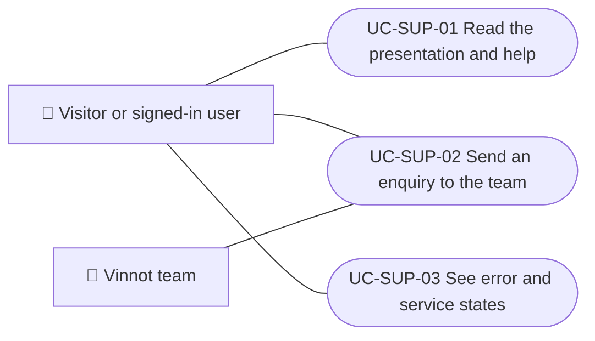

# Use cases

Support and public information use cases: reading the Vinnot presentation and searching help, sending an enquiry to the team, and seeing error and service states. Legal documents and cookies are in Legal. Each case applies to the platforms listed.

| ID | Use case | Platforms | Actors |
|---|---|---|---|
| `UC-SUP-01` | [Read the presentation and help](uc-sup-01-read-public-information.md) | Web, APK | Visitor or signed-in user |
| `UC-SUP-02` | [Send an enquiry to the team](uc-sup-02-contact-support.md) | Web, APK | Visitor or signed-in user, Vinnot team |
| `UC-SUP-03` | [See error and service states](uc-sup-03-service-states.md) | Web, APK | Visitor or signed-in user |

## Use case diagram

[View the full “Use cases · Use case diagram” diagram](https://images.vinnot.com/docs/diagrams/v1/en/modules-support-use-cases-readme-1cae9497f06f.svg)

## Lucidchart mapping

| ID | Lucidchart IDs |
|---|---|
| `UC-SUP-01` | [WEB UC-PUB-01](https://lucid.app/lucidchart/9f11a16b-bb5a-42fc-a9e8-0852b17bd241/edit), [WEB UC-PUB-02](https://lucid.app/lucidchart/9f11a16b-bb5a-42fc-a9e8-0852b17bd241/edit), [APK UC-PUB-01](https://lucid.app/lucidchart/e095dd25-e8ac-41ba-bf5b-396e1055f217/edit) |
| `UC-SUP-02` | [WEB UC-PUB-04](https://lucid.app/lucidchart/9f11a16b-bb5a-42fc-a9e8-0852b17bd241/edit), [WEB UC-PUB-05](https://lucid.app/lucidchart/9f11a16b-bb5a-42fc-a9e8-0852b17bd241/edit), [APK UC-PUB-03](https://lucid.app/lucidchart/e095dd25-e8ac-41ba-bf5b-396e1055f217/edit) |
| `UC-SUP-03` | [WEB UC-PUB-07](https://lucid.app/lucidchart/9f11a16b-bb5a-42fc-a9e8-0852b17bd241/edit), [APK UC-PUB-04](https://lucid.app/lucidchart/e095dd25-e8ac-41ba-bf5b-396e1055f217/edit) |
