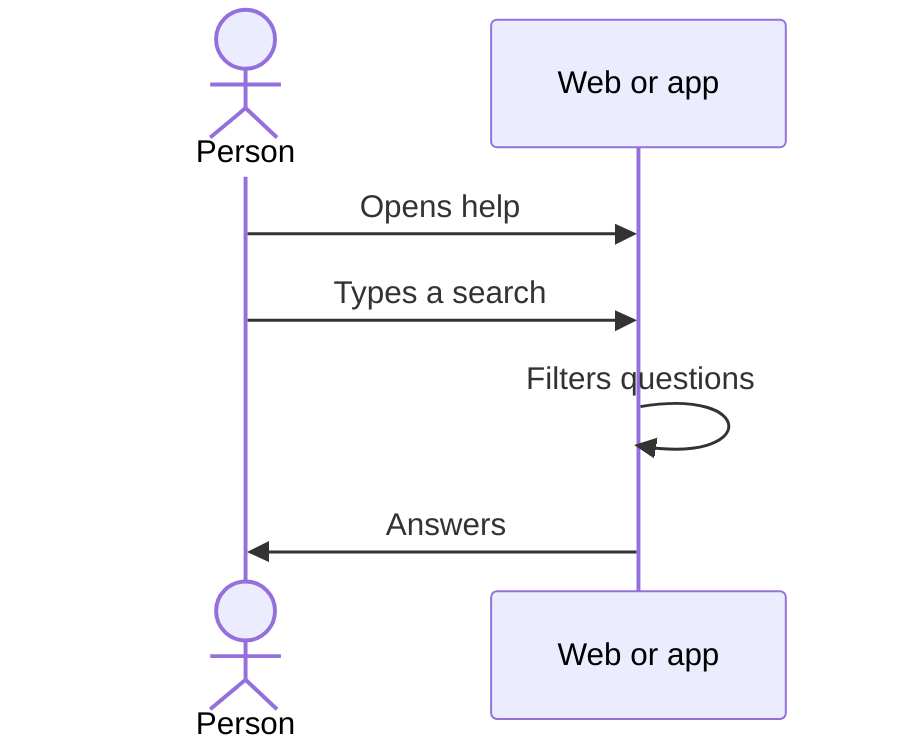

# UC-SUP-01 · Read the presentation and help

| Field | Value |
|---|---|
| ID | `UC-SUP-01` |
| Module | [Support and public information](../README.md) |
| Platforms | Web, APK |
| Actors | Visitor or signed-in user |
| Lucidchart IDs | [WEB UC-PUB-01](https://lucid.app/lucidchart/9f11a16b-bb5a-42fc-a9e8-0852b17bd241/edit), [WEB UC-PUB-02](https://lucid.app/lucidchart/9f11a16b-bb5a-42fc-a9e8-0852b17bd241/edit), [APK UC-PUB-01](https://lucid.app/lucidchart/e095dd25-e8ac-41ba-bf5b-396e1055f217/edit) |
| Requirements | [`RF-WEB-SUP-01`](../requirements.md), [`RF-APK-SUP-01`](../requirements.md) |
| Test cases | [`CP-SUP-01`](../testing.md), [`CP-SUP-02`](../testing.md) |

## Preconditions

- No sign-in is needed.

## Postconditions

- The person read the presentation or found an answer in help.

## Main flow

1. The person opens “About Vinnot” or “Help”.
2. The client shows the content in their language, which ships with the app and is not requested from the API.
3. In help, the person types in the search.
4. The client filters the questions by title and text, ignoring case and accents.
5. The person opens an answer or goes on to contact or the legal documents.

## Alternative flows

- 4a. No question matches: trying another search or writing to the team is suggested.

## Business rules

- Public content comes from a single file shared by the web and the app.
- These pages do not ask to accept the terms.

## Diagram

[View the full “UC-SUP-01 · Read the presentation and help” diagram](https://images.vinnot.com/docs/diagrams/v1/en/modules-support-use-cases-uc-sup-01-read-public-information-f03043b4532b.svg)

Component diagram in Lucidchart: [WEB UC-PUB-01](https://lucid.app/lucidchart/9f11a16b-bb5a-42fc-a9e8-0852b17bd241/edit), [WEB UC-PUB-02](https://lucid.app/lucidchart/9f11a16b-bb5a-42fc-a9e8-0852b17bd241/edit), [APK UC-PUB-01](https://lucid.app/lucidchart/e095dd25-e8ac-41ba-bf5b-396e1055f217/edit).

## Code

| Layer | Location |
|---|---|
| Web | [`AboutPage.tsx`](../../../../../frontend-react/src/presentation/pages/public/AboutPage.tsx), [`PublicDocumentPage.tsx`](../../../../../frontend-react/src/presentation/pages/public/PublicDocumentPage.tsx), [`public-content.ts`](../../../../../frontend-react/src/domain/public/public-content.ts) |
| App | [`AboutScreen.tsx`](../../../../../frontend-mobile/src/presentation/features/public/AboutScreen.tsx), [`PublicDocumentScreen.tsx`](../../../../../frontend-mobile/src/presentation/features/public/PublicDocumentScreen.tsx), [`public-content.ts`](../../../../../frontend-mobile/src/domain/public/public-content.ts) |

## Automated tests

- Backend: None
- Web: [`public-content.test.ts`](../../../../../frontend-react/src/domain/public/public-content.test.ts), [`public-information.spec.ts`](../../../../../frontend-react/tests/e2e/public-information.spec.ts)
- App: [`public-content.test.ts`](../../../../../frontend-mobile/src/domain/public/public-content.test.ts)
