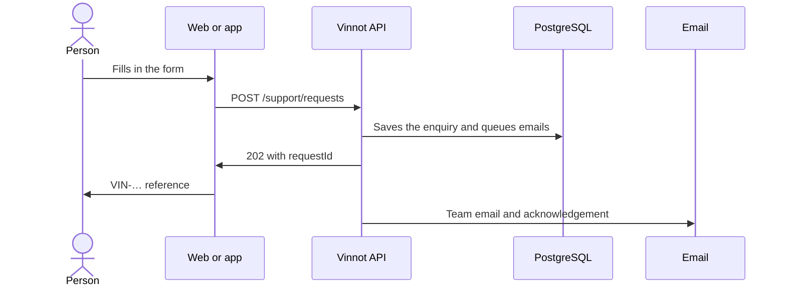

# UC-SUP-02 · Send an enquiry to the team

| Field | Value |
|---|---|
| ID | `UC-SUP-02` |
| Module | [Support and public information](../README.md) |
| Platforms | Web, APK |
| Actors | Visitor or signed-in user, Vinnot team |
| Lucidchart IDs | [WEB UC-PUB-04](https://lucid.app/lucidchart/9f11a16b-bb5a-42fc-a9e8-0852b17bd241/edit), [WEB UC-PUB-05](https://lucid.app/lucidchart/9f11a16b-bb5a-42fc-a9e8-0852b17bd241/edit), [APK UC-PUB-03](https://lucid.app/lucidchart/e095dd25-e8ac-41ba-bf5b-396e1055f217/edit) |
| Requirements | [`RF-WEB-SUP-02`](../requirements.md), [`RF-WEB-SUP-03`](../requirements.md), [`RF-WEB-SUP-04`](../requirements.md), [`RF-APK-SUP-02`](../requirements.md), [`RF-APK-SUP-03`](../requirements.md), [`RF-APK-SUP-04`](../requirements.md) |
| Test cases | [`CP-SUP-03`](../testing.md), [`CP-SUP-04`](../testing.md), [`CP-SUP-05`](../testing.md), [`CP-SUP-06`](../testing.md), [`CP-SUP-07`](../testing.md), [`CP-SUP-08`](../testing.md) |

## Preconditions

- No sign-in is needed; with a session, the email is the account's and cannot be changed.

## Postconditions

- The enquiry was recorded, the team receives an email and the person has a reference.

## Main flow

1. The person opens Contact.
2. They fill in name, email, reason and message; the reasons are support, privacy, report, decision review, partnership and general enquiry.
3. The client generates a request ID and sends `POST /support/requests`.
4. The API validates the data, saves the enquiry and queues an English email for the team, replying straight to the sender.
5. It queues an acknowledgement to the typed email, in the form's language, with only the reference and the reason.
6. The API answers 202 with the ID; the client shows the `VIN-…` reference and lets the person copy it.

## Alternative flows

- 3a. Sending fails: the form keeps what was written and retrying the same content reuses the ID, without duplicating the enquiry.
- 4a. The same ID arrives with different content: the API answers 400.
- 4b. The team email is not configured: the API answers 503.
- 3b. The send limit was exceeded: the API answers 429 and the client says when to retry.
- 5a. That address already got an acknowledgement today: no other is sent.

## Business rules

- Limits: name 100 characters, email 254, message 4000.
- At most one acknowledgement per address and day, so the form cannot be used to email third parties.
- The form asks not to write passwords or card details.
- Undelivered messages are discarded after 7 days.

## Diagram

[View the full “UC-SUP-02 · Send an enquiry to the team” diagram](https://images.vinnot.com/docs/diagrams/v1/en/modules-support-use-cases-uc-sup-02-contact-support-2443ab0c9e4f.svg)

Component diagram in Lucidchart: [WEB UC-PUB-04](https://lucid.app/lucidchart/9f11a16b-bb5a-42fc-a9e8-0852b17bd241/edit), [WEB UC-PUB-05](https://lucid.app/lucidchart/9f11a16b-bb5a-42fc-a9e8-0852b17bd241/edit), [APK UC-PUB-03](https://lucid.app/lucidchart/e095dd25-e8ac-41ba-bf5b-396e1055f217/edit).

## Code

| Layer | Location |
|---|---|
| Endpoints | `POST /support/requests` |
| Backend | [`SupportController.java`](../../../../../backend/src/main/java/com/vinnot/support/infrastructure/web/SupportController.java), [`SubmitSupportRequestService.java`](../../../../../backend/src/main/java/com/vinnot/support/application/service/SubmitSupportRequestService.java), [`SupportRequest.java`](../../../../../backend/src/main/java/com/vinnot/support/domain/model/SupportRequest.java), [`JdbcSupportRequestAdapter.java`](../../../../../backend/src/main/java/com/vinnot/support/infrastructure/JdbcSupportRequestAdapter.java) |
| Web | [`ContactPage.tsx`](../../../../../frontend-react/src/presentation/pages/public/ContactPage.tsx), [`useSupportForm.ts`](../../../../../frontend-react/src/presentation/hooks/useSupportForm.ts), [`useSupportReference.ts`](../../../../../frontend-react/src/presentation/hooks/useSupportReference.ts), [`support.service.ts`](../../../../../frontend-react/src/application/services/support.service.ts), [`support.client.ts`](../../../../../frontend-react/src/infrastructure/api/clients/support.client.ts), [`requestId.ts`](../../../../../frontend-react/src/infrastructure/support/requestId.ts), [`support.ts`](../../../../../frontend-react/src/domain/public/support.ts) |
| App | [`ContactScreen.tsx`](../../../../../frontend-mobile/src/presentation/features/public/ContactScreen.tsx), [`useSupportForm.ts`](../../../../../frontend-mobile/src/presentation/hooks/useSupportForm.ts), [`useSupportReference.ts`](../../../../../frontend-mobile/src/presentation/hooks/useSupportReference.ts), [`support.service.ts`](../../../../../frontend-mobile/src/application/services/support.service.ts), [`support.client.ts`](../../../../../frontend-mobile/src/infrastructure/api/clients/support.client.ts) |

## Automated tests

- Backend: [`SupportRequestTest.java`](../../../../../backend/src/test/java/com/vinnot/support/domain/model/SupportRequestTest.java), [`SubmitSupportRequestServiceTest.java`](../../../../../backend/src/test/java/com/vinnot/support/application/service/SubmitSupportRequestServiceTest.java), [`SupportControllerTest.java`](../../../../../backend/src/test/java/com/vinnot/support/infrastructure/web/SupportControllerTest.java), [`SupportPostgresIntegrationTest.java`](../../../../../backend/src/test/java/com/vinnot/support/infrastructure/SupportPostgresIntegrationTest.java), [`SupportRequestTemplateTest.java`](../../../../../backend/src/test/java/com/vinnot/notification/infrastructure/template/SupportRequestTemplateTest.java), [`SupportRequestReceivedTemplateTest.java`](../../../../../backend/src/test/java/com/vinnot/notification/infrastructure/template/SupportRequestReceivedTemplateTest.java)
- Web: [`useSupportForm.test.ts`](../../../../../frontend-react/src/presentation/hooks/useSupportForm.test.ts), [`useSupportReference.test.ts`](../../../../../frontend-react/src/presentation/hooks/useSupportReference.test.ts), [`support.service.test.ts`](../../../../../frontend-react/src/application/services/support.service.test.ts), [`support-reference.test.ts`](../../../../../frontend-react/src/domain/public/support-reference.test.ts), [`clipboard.test.ts`](../../../../../frontend-react/src/infrastructure/support/clipboard.test.ts)
- App: [`useSupportForm.test.ts`](../../../../../frontend-mobile/src/presentation/hooks/useSupportForm.test.ts), [`useSupportReference.test.ts`](../../../../../frontend-mobile/src/presentation/hooks/useSupportReference.test.ts), [`support.service.test.ts`](../../../../../frontend-mobile/src/application/services/support.service.test.ts), [`support-reference.test.ts`](../../../../../frontend-mobile/src/domain/public/support-reference.test.ts), [`clipboard.test.ts`](../../../../../frontend-mobile/src/infrastructure/support/clipboard.test.ts)
