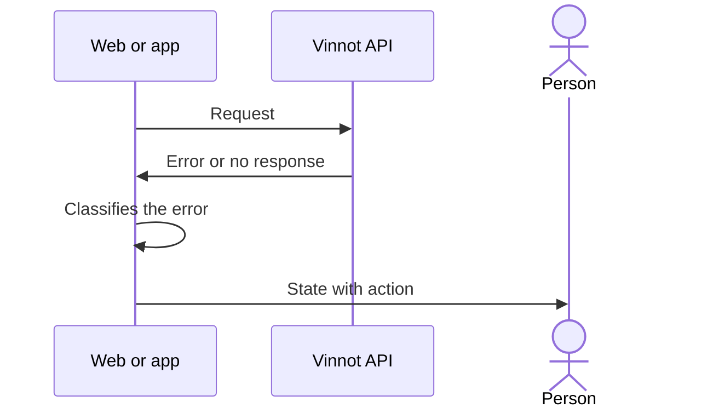

# UC-SUP-03 · See error and service states

| Field | Value |
|---|---|
| ID | `UC-SUP-03` |
| Module | [Support and public information](../README.md) |
| Platforms | Web, APK |
| Actors | Visitor or signed-in user |
| Lucidchart IDs | [WEB UC-PUB-07](https://lucid.app/lucidchart/9f11a16b-bb5a-42fc-a9e8-0852b17bd241/edit), [APK UC-PUB-04](https://lucid.app/lucidchart/e095dd25-e8ac-41ba-bf5b-396e1055f217/edit) |
| Requirements | [`RF-WEB-SUP-05`](../requirements.md), [`RF-APK-SUP-05`](../requirements.md) |
| Test cases | [`CP-SUP-09`](../testing.md), [`CP-SUP-10`](../testing.md) |

## Preconditions

- A screen cannot show its content because of an error or a service state.

## Postconditions

- The person understands what happened and what they can do.

## Main flow

1. A request fails or the person reaches an address that does not exist.
2. The client classifies the error: session expired (401), forbidden (403), not found (404), too many requests (429), service unavailable (502 or 503), delay (504 or timeout), offline or server error.
3. It shows an illustration with a message and the matching action, such as retrying or going home.

## Alternative flows

- 1a. The address does not exist: “not found” is shown.

## Business rules

- An error is never shown as an empty list.
- Each state also has its own address: `/403`, `/500`, `/503`, `/429`, `/offline` and `/timeout`.

## Diagram

[View the full “UC-SUP-03 · See error and service states” diagram](https://images.vinnot.com/docs/diagrams/v1/en/modules-support-use-cases-uc-sup-03-service-states-6a38b9cef2e3.svg)

Component diagram in Lucidchart: [WEB UC-PUB-07](https://lucid.app/lucidchart/9f11a16b-bb5a-42fc-a9e8-0852b17bd241/edit), [APK UC-PUB-04](https://lucid.app/lucidchart/e095dd25-e8ac-41ba-bf5b-396e1055f217/edit).

## Code

| Layer | Location |
|---|---|
| Web | [`ServiceStatePage.tsx`](../../../../../frontend-react/src/presentation/pages/public/ServiceStatePage.tsx), [`NotFoundPage.tsx`](../../../../../frontend-react/src/presentation/pages/public/NotFoundPage.tsx), [`ForbiddenPage.tsx`](../../../../../frontend-react/src/presentation/pages/public/ForbiddenPage.tsx), [`ErrorPage.tsx`](../../../../../frontend-react/src/presentation/pages/public/ErrorPage.tsx), [`illustratedState.ts`](../../../../../frontend-react/src/presentation/feedback/illustratedState.ts), [`QueryErrorState.tsx`](../../../../../frontend-react/src/presentation/components/ui/QueryErrorState.tsx) |
| App | [`illustratedState.ts`](../../../../../frontend-mobile/src/presentation/feedback/illustratedState.ts), [`IllustratedState.tsx`](../../../../../frontend-mobile/src/presentation/components/ui/IllustratedState.tsx) |

## Automated tests

- Backend: None
- Web: [`illustratedState.test.ts`](../../../../../frontend-react/src/presentation/feedback/illustratedState.test.ts)
- App: [`illustratedState.test.ts`](../../../../../frontend-mobile/src/presentation/feedback/illustratedState.test.ts)
