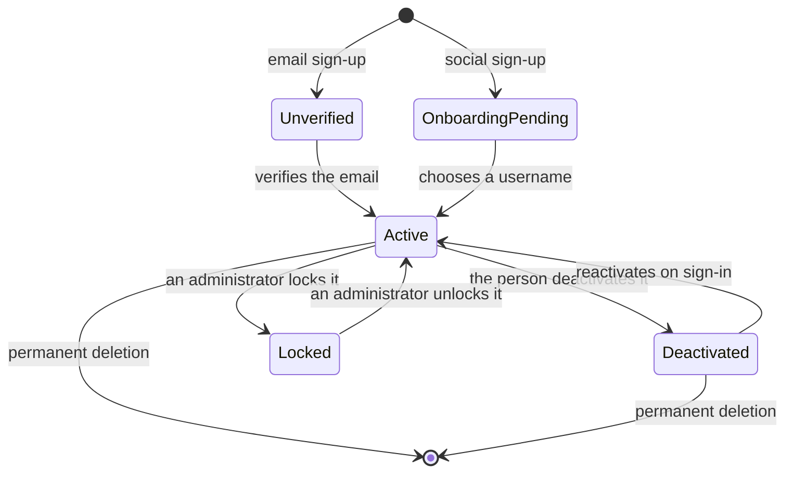
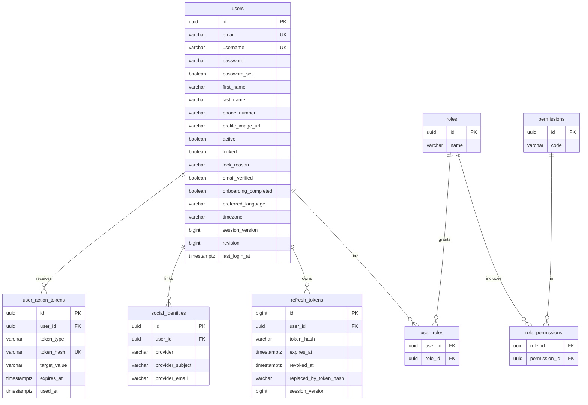

# Users and account

Everything a person does with their account: sign up, verify the email, sign in
with a password or with Google or Apple, keep the session, edit their profile,
change password, email or language, and deactivate or delete the account. In the
app it also covers the welcome screen, home and tab navigation.

- Module code: `USR`.
- Backend: package [`user`](../../../../backend/src/main/java/com/vinnot/user/).
- [Use cases](use-cases/README.md) · [Requirements](requirements.md) ·
  [Architecture](architecture.md) · [Testing](testing.md)

## Actors

| Actor | What they do in this module |
|---|---|
| Visitor | Signs up, verifies the email, signs in and recovers the password |
| Signed-in user | Keeps the session, edits the profile and manages the account |
| Identity provider | Google or Apple hand over a credential that the API validates |
| Email service | Delivers verification, recovery and email change links, and security notices |

Roles (`USER`, `MODERATOR`, `PARTNER`, `ADMIN`) are in
[`Role.java`](../../../../backend/src/main/java/com/vinnot/user/domain/valueobject/Role.java). Every new account starts as
`USER`; an administrator assigns the other roles.

## Business rules

| Rule | Detail | Where |
|---|---|---|
| Username | Trimmed and lowercased; 3 to 40 characters; letters, digits, dot, hyphen and underscore; starts and ends with a letter or digit; unique | [`Username.java`](../../../../backend/src/main/java/com/vinnot/user/domain/valueobject/Username.java) |
| Password | At least 8 characters with an uppercase letter, a lowercase letter and a digit | [`Password.java`](../../../../backend/src/main/java/com/vinnot/user/domain/valueobject/Password.java) |
| Email | Unique; verified with a single-use link | [`User.java`](../../../../backend/src/main/java/com/vinnot/user/domain/model/User.java) |
| Phone | Optional and private; E.164 format (`+` and country code) | [`User.java`](../../../../backend/src/main/java/com/vinnot/user/domain/model/User.java) |
| Language and time zone | `es` or `en` and an IANA identifier; default `es` and `America/Argentina/Buenos_Aires` | [`PreferredLanguage.java`](../../../../backend/src/main/java/com/vinnot/user/domain/valueobject/PreferredLanguage.java) |
| Session | 15-minute access token and 7-day refresh token, rotated on every use | `backend/src/main/resources/application.yml` |
| Revocation | Changing password, email or roles, deactivating or locking increments `sessionVersion` and voids tokens issued before | [`User.java`](../../../../backend/src/main/java/com/vinnot/user/domain/model/User.java) |
| Email links | Verification: 1440 minutes; reset and email change: 60 minutes; single use | [`AccountActionTokenConfiguration.java`](../../../../backend/src/main/java/com/vinnot/user/infrastructure/config/AccountActionTokenConfiguration.java) |
| Last administrator | The last active administrator cannot be deactivated or deleted | [`AdminUserSafety.java`](../../../../backend/src/main/java/com/vinnot/user/application/service/AdminUserSafety.java) |
| Social sign-up | Creates the account with a generated username (`vinnoter-…`) and pending onboarding | [`User.java`](../../../../backend/src/main/java/com/vinnot/user/domain/model/User.java) |
| Own password | `hasPassword` says whether the account has a password its owner chose (registration, change or reset). Accounts created with Google or Apple have none until they use the reset link; a local account that later links a provider keeps its own | [`User.java`](../../../../backend/src/main/java/com/vinnot/user/domain/model/User.java) |
| Points and seal | Completing the profile (photo, first and last name and phone number) earns 5 points once; the profile header shows the seal, the points and the progress (`GET /users/me/points`); a locked or inactive account hides the seal and permanent deletion removes the points | [Points and seals](../gamification/README.md) |

## Account states

[View the full “Account states” diagram](https://images.vinnot.com/docs/diagrams/v1/en/modules-users-readme-e290a68cb535.svg)

`active`, `locked`, `email_verified` and `onboarding_completed` are independent
columns of `users`; the diagram shows the paths the code allows. Locking and
unlocking belong to the administration module.

## Where it lives

| Part | Location |
|---|---|
| API | Controllers [`AuthController`](../../../../backend/src/main/java/com/vinnot/user/infrastructure/web/controller/AuthController.java), [`BrowserAuthController`](../../../../backend/src/main/java/com/vinnot/user/infrastructure/web/controller/BrowserAuthController.java) (web, with a cookie), [`UserController`](../../../../backend/src/main/java/com/vinnot/user/infrastructure/web/controller/UserController.java) and [`ReauthenticationController`](../../../../backend/src/main/java/com/vinnot/user/infrastructure/web/controller/ReauthenticationController.java) |
| Web | Pages in [`pages/public`](../../../../frontend-react/src/presentation/pages/public/) and [`pages/user`](../../../../frontend-react/src/presentation/pages/user/); session in [`AuthProvider`](../../../../frontend-react/src/app/providers/AuthProvider.tsx) |
| App | Screens in `frontend-mobile/app/(auth)`, `frontend-mobile/app/(onboarding)` and `frontend-mobile/app/(app)/(tabs)`; session in [`AuthProvider`](../../../../frontend-mobile/src/presentation/providers/AuthProvider.tsx) |

The profile also shows data from other modules: notification preferences and
push devices ([Notifications](../notifications/README.md)) and the nearby events
area ([Events and tickets](../events/README.md)). Terms acceptance does not appear
in the profile: it is asked for before entering the application
([Legal](../legal/README.md)).

## Data

Module tables, created in `V1__baseline_schema.sql` and `V5` and extended in
`V6`, `V7`, `V15`, `V17`, `V28`, `V39`, `V57` and `V62`. Recovery requests have no table
of their own: they use the shared external-effects outbox.

[View the full “Users and account · Data” diagram](https://images.vinnot.com/docs/diagrams/v1/en/modules-users-readme-67bb728fdda2.svg)

Every foreign key to `users` uses `ON DELETE CASCADE`. The full model is in the
[backend DER](../../backend/data/database-model.md).
