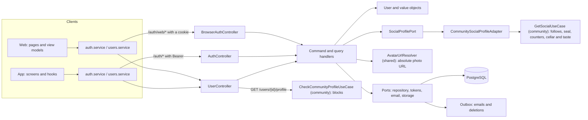
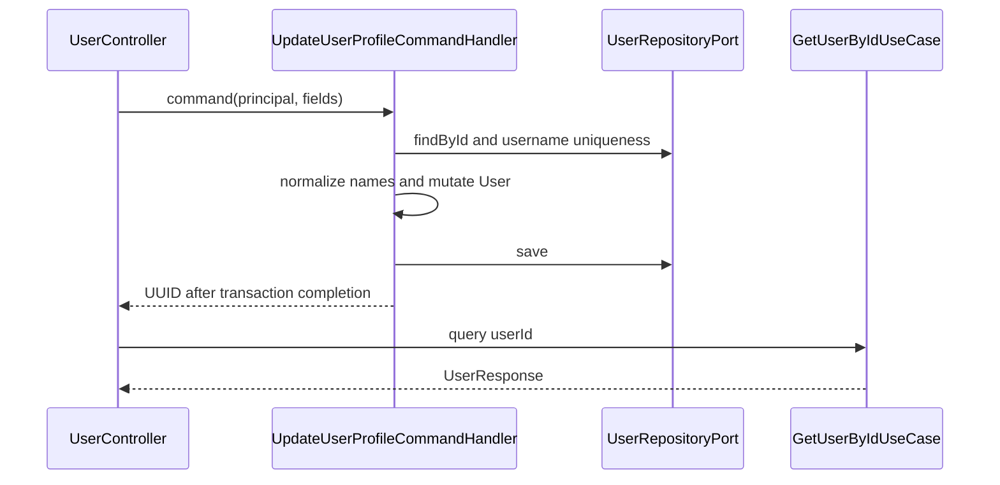

# Architecture

How the module is built in each layer. The backend follows the hexagonal flow
`controller → input port → handler → domain → output port → adapter`; the web and
the app follow `screen → hook → service → API client → HTTP transport`.



[View the full “Architecture” diagram](https://images.vinnot.com/docs/diagrams/v1/en/modules-users-architecture-2508a34e15c6.svg)

The web uses the `/auth/web/*` endpoints, which keep the refresh token in an
HttpOnly cookie; the app uses `/auth/*` with Bearer and keeps tokens in
SecureStore. Both share `UserController` for profile and account.

The public profile is composed across two modules: before the query,
`UserController` asks `CheckCommunityProfileUseCase` to reject with 404 a profile
with a block in either direction; then `GetPublicUserProfileQueryHandler` loads the
account and asks `SocialProfilePort` for the social part, whose adapter
`CommunitySocialProfileAdapter` calls the community input port `GetSocialUseCase`
and translates its response. The users module uses no community domain types or
repositories. The profile's reviews and cellar (`GET /users/{id}/reviews` and
`/cellar`) are served by the community module's `MemberActivityController`.

## Backend

### Scope

The `user` module manages identity, profile, onboarding, account security, and
deletion. Queries project its data and other modules' statistics through ports.
`UserResponse` includes the language and time zone stored on the account (see
[Language and time zone](#language-and-time-zone)).

### Queries

| Endpoint | Access | Result |
|---|---|---|
| `GET /users` | ADMIN | `PageResult<UserResponse>` |
| `GET /users/{id}` | ADMIN | `UserResponse` wrapper |
| `GET /users/{id}/profile` | authenticated | `PublicUserProfileResponse` wrapper; 404 for a missing or inactive account or a block either way |
| `GET /users/{id}/reviews` | authenticated | the member's approved reviews (community module) |
| `GET /users/{id}/cellar` | authenticated | the member's visible cellar (community module) |
| `GET /users/{id}/stats` | ADMIN | `UserStatsResponse` wrapper |
| `GET /users/me/stats` | authenticated | principal's statistics |
| `GET /auth/me` | authenticated | current session/profile |

Public profile includes `id`, `username`, `fullName`, `avatarUrl`, `roles`, and
`createdAt`, followed by the social fields of #541: `bio`, `tier` (the seal key),
`followersCount`, `followingCount`, `reviewsCount`, `cellarCount` (`null` when the
cellar is not visible to the viewer), `cellarVisible`, `following` (the viewer
follows the member), `followsYou`, `affinityPercent` (`null` for oneself or when
either member rated fewer than five wines), `tasteWheel` (`null` below five
rated wines; otherwise `{kind, value, label, score, tone, ratedWines}` rows: up
to eight each of `GRAPE`, `TYPE` and `REGION`, best score first, where `tone` is
a wine type code, `null` for regions; see the
[Community architecture](../community/architecture.md)) and `tasteTraits` (`null` below the same threshold unless the
member completed the taste quiz or adjusted a trait; otherwise
`{structure, families, fromQuiz}`: `structure` holds `{trait, score, wines,
adjusted}` rows for `ACIDITY`, `BODY`, `TANNIN` and `SWEETNESS`, scored 0–100,
where `adjusted` is true when the score is the member's manual value,
`families` holds `{family, percent}` rows for `FRUIT`, `FLORAL`, `HERBAL`,
`SPICE`, `OAK` and `MINERAL`, most shared first, and `fromQuiz` is true when any
shown value came from the taste quiz because real data was missing; quiz scores
report `wines: 0`; see [Community](../community/architecture.md#taste-quiz) and
[Adjustable palate](../community/architecture.md#adjustable-palate)). It excludes email, phone,
account flags, the cellar setting, the taste quiz answers and tokens. `GetPublicUserProfileQueryHandler` loads the account (404 when it is
missing or inactive) and reads the social fields through `SocialProfilePort`,
implemented by `CommunitySocialProfileAdapter` over the community module; the
controller first applies the block check of `CheckCommunityProfileUseCase`.
`UserResponse`, used for own-profile and administration, also contains email,
names, account state, onboarding, `preferredLanguage`, `timezone`, social
providers, `hasPassword`, `bio` and `cellarVisibility`; it never contains
passwords or hashes.
Role names are projected with the `ROLE_` prefix.

### Profile update

`PATCH /users/me` takes its UUID from the principal.
`UpdateUserProfileCommandHandler` loads the user, normalizes a provided username
through `Username`, checks uniqueness when it changes, applies names, and saves.
It returns a UUID; the controller calls `GetUserByIdUseCase` and returns the
projection inside the wrapper.

Social profile fields (#541), both optional (omitted or `null` keeps the value):

- `bio` is trimmed; blank text clears it; more than 160 characters answers 400
  `BIO_TOO_LONG` (validated by `User.updateBio`, stored in `users.bio`).
- `cellarVisibility` is `PUBLIC` (default), `FOLLOWERS` or `PRIVATE`; any other
  value answers 400 `INVALID_CELLAR_VISIBILITY` (`CellarVisibility`, stored in
  `users.cellar_visibility`, V87).

Name rules:

- If `firstName` or `lastName` is supplied, absent fields retain their values and
  present fields are trimmed.
- Otherwise, `name` supports older clients. If it matches the current full name
  or ends with the current last name, that last name is retained; otherwise the
  full input becomes the first name and last name becomes empty.
- `username=null` retains the current value; a provided username passes through
  the value object and uniqueness check.



[View the full “Profile update” diagram](https://images.vinnot.com/docs/diagrams/v1/en/modules-users-architecture-5e29bc76872d.svg)

### Avatar

`POST /users/me/avatar` receives multipart `file` and returns a wrapper containing
`avatarUrl`. The controller passes stream, filename, MIME, and size to the use
case. `UploadUserAvatarCommandHandler` loads the user and delegates storage to
`FileStoragePort`, which validates size, signature, and format and generates a name.

It updates the URL and saves the user. On mutation/persistence failure it
requests cleanup of the new object and propagates the error; after saving it
requests cleanup of the earlier avatar. Concrete composition uses
`TransactionalFileStorageAdapter`: deletion is queued and the worker rechecks
references, rather than physically deleting inside the handler. Earlier
reconciliation preserves cleanup when the request fails. The handler has no
`@Transactional`; repository/outbox own the boundaries. R2 converts to WebP and
retains durable inventory. [Storage and compensation](../../backend/use-cases/uploads-and-reference-data.md).

#### Stored value and the URL clients receive

`users.profile_image_url` keeps the photo as each source leaves it. Every
response that carries a photo passes it through `AvatarUrlResolver` (an
application port in `shared`, implemented by `PublicAvatarUrlResolver`), so
clients always receive an absolute URL (#541):

| Source | Stored value | URL in the response |
| --- | --- | --- |
| Upload with `local` or `s3` storage | `/api/uploads/avatars/<file>` | `app.public-api-base-url` + path, without repeating `/api` (`https://api.vinnot.com/api/uploads/avatars/<file>`) |
| Upload with `r2` storage | `https://images.vinnot.com/...` | unchanged |
| Google or Facebook sign-in | provider link | unchanged |
| No photo | `null` or blank | `null` |

`app.public-api-base-url` reads `APP_PUBLIC_API_BASE_URL` (default
`http://localhost:8080/api`). The resolver serves `GET /auth/me`, the login
session, `GET /users`, `GET /users/{id}`, `PATCH /users/me`, the public profile,
`POST /users/me/avatar`, wine reviews and comments, the followers and following
lists, suggestions, the feed and profile reviews, and in admin
`GET /admin/users` (with the `avatarUrl` field) and `GET /admin/reviews`.

#### Social sign-in photo

The rule lives in `User.enrichFromIdentityProvider` and `ProviderPhoto` (domain):

| Case | Result |
| --- | --- |
| Google supplies `picture` with a size suffix (`=s96-c`, `=s<n>` or `=s<n>-c` at the end) | stored with `=s256-c` |
| The account has no photo | the provider photo is stored |
| The stored photo is a provider link (`googleusercontent.com`, `facebook.com`, `fbcdn.net`, `fbsbx.com`) | replaced on every social sign-in, so a changed Google photo shows |
| The stored photo is a Vinnot upload (`/api/uploads/...` or R2) or another link | never replaced |
| The provider supplies no photo (Apple) | nothing changes |

### Password and email

`POST /users/me/change-password` always requires `currentPassword` and
`newPassword`: both are `@NotBlank`, the new password must be 8–100 characters,
and `ChangePasswordCommandHandler` compares the current value with the persisted
hash before validating and saving the replacement. The change increments sessionVersion: access and refresh credentials issued under the previous generation become invalid. Email change
requires recent identity confirmation (`X-Admin-Reauthentication`, see
[reauthentication](../../backend/architecture/authentication-and-identity.md#admin-reauthentication))
and starts an action token instead of immediately replacing the verified identity.
Confirmation consumes a single-use expiring token and rechecks uniqueness.

`hasPassword` (in `UserResponse` and in the user of session responses) reflects
`users.password_set`: it is true when the stored password was chosen by its owner
(registration, change or reset). An account created by a social sign-in, or an
unverified local account whose password is revoked when a provider proves the email,
stores the hash of a random secret and stays false; resetting the password makes it
true. Linking a provider to a verified local account does not change it. Clients show
the change form when it is true and the link to set a password when it is false.

### Recovery requests

`POST /auth/forgot-password` and `POST /auth/resend-verification` do the same
work for every syntactically valid address, whether or not it belongs to an
account: the handler normalizes the address and `OutboxAccountRecoveryAdapter`
stores one `ACCOUNT_RECOVERY_REQUESTED` row in `external_effects` (payload: the
action and the address; key: `account-recovery:<random UUID>`). Nothing is
looked up and nothing is sent at request time, so the response, its timing and
email provider errors do not reveal whether an account exists. HTTP status,
body and rate limits are unchanged.

`AccountRecoveryEffectHandler` processes the row in the outbox worker's job
transaction. `IssueAccountRecoveryService` looks the account up and applies
`AccountRecoveryAction`: a password reset needs an active, unlocked account and
a verification resend an active, unverified one. An eligible account gets a new
token and its email exactly as before (`AccountActionTokenService`); an unknown
or ineligible address is a silent no-op. The token, its queued email and the
removal of the job commit together, so a retry never issues a second link after
a successful run. A failure rolls back the whole job, token and email
included, and the worker records the attempt in a separate transaction for its
retry backoff.
Every request issues its own link, as before. Because the rows hold an email
address, `AccountRecoveryRetention` deletes those older than one day, processed
or not, and the address is never logged.

### Activity diagram: sign-up, verification and sign-in

Shows in UML activity notation how a local account is created with terms acceptance, the email verification, sign-in and password recovery.

```mermaid
flowchart TD
    start((" ")) --> a1("Enter email, username and password and accept the terms")
    a1 --> b1("POST /auth/register: validate current terms, email and username")
    b1 --> d1{" "}
    d1 -->|"[terms not accepted or email/username taken]"| e1("Return the domain error")
    d1 -->|"[valid]"| b2("Create User and record the legal acceptance")
    b2 --> b3("Send the verification email with a single-use token")
    b3 --> u1("Open the email link")
    u1 --> b4("POST /auth/verify-email: consume the token; welcome on first time")
    b4 --> d4{" "}
    d4 -->|"[remembers the password]"| b6("POST /auth/login: validate credentials")
    d4 -->|"[forgot it]"| r1("POST /auth/forgot-password: queue in the outbox")
    r1 --> r2("Reset with the link: POST /auth/reset-password")
    r2 --> d4
    b6 --> d3{" "}
    d3 -->|"[invalid credentials or locked account]"| e3("AUTH_FAILED or ACCOUNT_LOCKED")
    d3 -->|"[email not verified]"| e4("EMAIL_NOT_VERIFIED: resend verification")
    e4 --> b3
    d3 -->|"[valid]"| b7("Issue the session")
    e1 & e3 & b7 --> stop(((" ")))
    classDef bar fill:#30262c,stroke:#30262c,color:#30262c
    style start fill:#30262c,stroke:#30262c
    style stop fill:#30262c,stroke:#30262c
```



[View the full “Activity diagram: sign-up, verification and sign-in” diagram](https://images.vinnot.com/docs/diagrams/v1/en/modules-users-architecture-a06aa316dd5c.svg)

### Onboarding

`POST /users/me/onboarding` accepts an optional username. If present and nonblank,
it is normalized and checked for uniqueness; the handler then calls
`completeOnboarding()` and saves. Omitting username marks completion without
changing it. Repeating unchanged input retains the flag and creates no second
resource. A subsequent user query supplies the response.

### Language and time zone

`PATCH /users/me/preferences` accepts optional `preferredLanguage` and
`timezone`; an omitted or `null` field keeps the stored value. The
`PreferredLanguage` value object accepts only `es` or `en` (case-insensitive)
and `UserTimezone` only IANA identifiers known to `java.time.ZoneId` (for
example `Europe/Madrid`; raw offsets such as `+03:00` are rejected). Invalid
values return `400` with `INVALID_PREFERRED_LANGUAGE` or `INVALID_TIMEZONE`
and change nothing. Unchanged values skip the write, so clients can sync on
every login without bumping the row revision. The response is the updated
`UserResponse` wrapper. Users without a stored choice read `es` and
`America/Argentina/Buenos_Aires` (V39 defaults). Web and mobile send the active
UI language and device time zone after each login or session restore and when
the user switches language; a failed sync never blocks either flow. These
values are the recipient locale and time zone for notifications.

### Notification preferences

`GET /users/me/notification-preferences` returns the marketing consent
(`granted`, `decidedAt`, `source`) and one row per listed category with its
`kind`, the `email` and `push` values that would be delivered now, and
`editable` (false for transactional categories). `PUT` takes
`{marketingConsent?, source: WEB|MOBILE, categories: [{category, email?, push?}]}`
and returns the same shape. Web shows it as the Notifications tab of the profile
and mobile as a sheet opened from the profile; promotional switches stay
disabled while consent is withdrawn. The public `/unsubscribe?token=` web page
calls `POST /notifications/unsubscribe` only after the user clicks. Rules and
delivery live in [Notifications](../notifications/architecture.md).

### Deletion

`DELETE /users/me` is reversible deactivation: it calls `user.deactivate()`,
persists `active=false`, and removes the user's refresh tokens and push devices. Like permanent
deletion, it calls `AdminUserSafety.requireAnotherActiveAdministrator`: the last
active, unlocked administrator receives 422 `LAST_ADMIN`.

`DELETE /users/me/permanent` is physical deletion and requires recent identity
confirmation (403 `REAUTHENTICATION_REQUIRED` without proof). It runs in one
transaction and, before any Apple revocation, rejects the last active administrator
and anyone who organizes an event that is not cancelled or over with paid or paying
registrations (422 `ORGANIZER_HAS_UPCOMING_PAID_EVENTS`, through `UpcomingPaidEventsPort`):
deleting them would remove the event and the payment account that refunds need. If an Apple identity exists,
the handler requires `appleAuthorizationCode` and `appleClientId`, validates and
revokes the identity through `AppleAuthorizationRevocationPort`, then deletes
the user. Without an Apple identity, the body may be omitted. Relations are
resolved by Flyway CASCADE/SET NULL foreign keys. AccountDeletionIntegrity recomputes ratings, likes and capacity under locks in the same transaction and enqueues managed-avatar/label cleanup. The worker checks references before deletion. Report references use SET NULL; private moderation evidence retains the
90-day-from-closure policy described in [community](../community/architecture.md).
No additional archive of deleted accounts is implemented.

### Statistics

`GetUserStatsQueryHandler` combines three ports within a read-only transaction:

| Source | Projection |
|---|---|
| `ReviewQueryPort.getUserReviewStats` | review count and average rating |
| `CellarQueryPort.countByUserId` | number of cellar entries |
| `EventQueryPort.countRegistrationsByUserId` | number of registrations |

`eventsAttended` represents the registration count supplied by the port, not
proof of physical attendance. `UserStatsResponse` retains aliases
`totalReviews/reviewsCount`, `totalCellarWines/cellarCount`, and snake_case fields.
`total_routes_completed` is `0` in this projection. These counts neither grant
permissions nor mutate queried aggregates.

### Security and concurrency

- only `me` changes own profile;
- admin uses administrative controllers/use cases;
- email uniqueness has a database constraint;
- action tokens are consumed transactionally;
- `User` carries the persisted revision and `UserJpaEntity` uses `@Version`;
  a write with a stale revision returns `409 CONCURRENT_UPDATE` without overwriting concurrent changes;
- responses/logs omit unnecessary PII.

### Security events

`security_events` (V73) records what happened to an account: `LOGIN_SUCCEEDED`,
`LOGIN_FAILED`, `LOGIN_LOCKED`, `REFRESH_REUSE_DETECTED`, `PASSWORD_CHANGED`,
`PASSWORD_RESET`, `EMAIL_CHANGED`, `ROLE_CHANGED`, `ACCOUNT_BANNED`,
`ACCOUNT_UNBANNED`, `ACCOUNT_DELETED` and `ACCOUNT_AUTO_SUSPENDED`.

- The handlers call `SecurityEventRecorder`, which adds the client address and
  user agent from `RequestOriginPort`. Its HTTP adapter reads the current
  request with the rate limiter's address rule, so the application layer never
  touches HTTP. The user agent is cut to 256 characters.
- `JdbcSecurityEventAdapter` writes the row after the action's transaction
  commits, in its own transaction. A rolled back action leaves no event, and a
  failed insert is logged and never fails the action.
- `user_id` is `ON DELETE SET NULL`: deleting an account removes the link to
  the person at once and keeps the unlinked rows as evidence until the purge.
- `PurgeExpiredSecurityEventsCommandHandler` deletes rows older than
  `app.security.events.retention` (`P180D`) once a day, in batches.
- Admin actions record the target account; the row has no actor column.

### Testing

Cover ownership, partial patch, concurrent uniqueness, invalid avatar and
compensation, wrong password, expired/consumed token, repeated onboarding,
soft/permanent delete and session revocation.

### Related endpoints

`GET /users`, `GET /users/{id}`, `GET /users/{id}/profile`, stats,
`PATCH /users/me`, onboarding, avatar, change-password, email-change, notification preferences and
both delete variants. Full catalog is in [API](../../backend/architecture/api.md).

### Implementation traceability

- `user/infrastructure/web/controller/UserController.java`.
- `user/application/command/handler/UpdateUserProfileCommandHandler.java`.
- `user/application/command/handler/CompleteUserOnboardingCommandHandler.java`.
- `user/application/command/handler/UploadUserAvatarCommandHandler.java`.
- `user/application/query/handler/GetUserStatsQueryHandler.java`.
- `user/infrastructure/persistence/adapter/AccountDeletionIntegrity.java`.

Paths relative to `backend/src/main/java/com/vinnot`. See [identity](../../backend/architecture/authentication-and-identity.md), [uploads](../../backend/use-cases/uploads-and-reference-data.md), and [ERD](../../backend/diagrams/relational-model.md).

Physical cleanup is durable and post-commit; see [sessions and external effects](../../backend/architecture/session-and-data-integrity.md).

### Transactional email presentation

Verification, password recovery, new-email confirmation and the notice to the
previous address are notification types of the [notification module](../notifications/architecture.md).
`AccountActionTokenService` and `ConfirmEmailChangeCommandHandler` enqueue them
in the account transaction (for resend verification and forgot password, in
the recovery job described above); the outbox worker delivers them, so an email
provider outage does not fail registration, resend verification, forgot
password or an email change. Their copy lives in `email/account_es.properties`
and `email/account_en.properties`, and every email uses `BrandedEmailTemplate` and `email/branded-message.html`, in
shared infrastructure and backend resources. The shared shell defines banner, logo, illustration,
title, content and footer links to the website, contact and privacy. HTML uses
tables, inline styles, system fonts and small-screen/dark-mode adjustments; each
message retains a plain-text alternative. Account actions include a button and
a visible fallback link with the same token.

Account emails are written in the user's `preferredLanguage` (`es` or `en`),
read when the email is enqueued; the notice to the previous address after an
email change uses the same user's language. The internal support notice remains
English, including its footer; the language of every other type is listed in the
[notification module](../notifications/architecture.md#current-notification-types).
Names, email addresses, wine, status and reason are escaped before HTML insertion; subjects, recipients,
tokens and delivery rules remain unchanged. Placeholder-like user values are
not interpreted again as template instructions.

Assets and informational links use `app.auth.frontend-base-url`, the same
destination as account flows. Existing web-hosted logo PNGs and vineyard art are
reused; no image attachments, scripts or tracking pixels are added. Functional
content and the CTA remain available when images are blocked. The `log` provider
still does not deliver messages. Changes stay in adapters; domain, ports and use
cases do not depend on HTML or SES.

To export every rendered notification with fictional recipients and tokens:

```sh
mvn -q -f backend/pom.xml -Dtest=NotificationEmailPreviewTest \
  -Dvinnot.email.preview.directory=backend/target/email-previews test
```

Requires backend Java/Maven; the test renders the real templates and writes
HTML/text to the given directory. It does not call AWS or send emails. Browser inspection does not certify actual
Gmail, Apple Mail or Outlook; their acceptance is recorded separately.

### Reusable private phone

`PATCH /users/me` accepts optional `phoneNumber`: omission or `null` preserves the value; empty text clears it. Nonempty input must include `+` and its country calling code. The use case invokes the `PhoneNumberNormalizer` port; its libphonenumber adapter validates the numbering plan and returns E.164. Country is not inferred from GPS and the number is not considered SMS-verified.

Additive migration `V28__add_private_user_phone.sql` adds nullable `users.phone_number` and a format constraint. `User` accepts only canonical input or null. Private session/profile and administration responses include it; `PublicUserProfileResponse` does not. Older clients omitting the field do not clear it.

Registration `contactPhone` is an independent snapshot. `saveContactPhone=true` updates the profile in the same transaction as reservation creation and capacity changes; its default is false. Changing or clearing the profile phone does not rewrite previous reservations. UI explains the contact shared with the organizer and offers an unchecked option to remember it for future bookings.

## Web

### Typed confirmation for permanent account deletion

Before requesting deletion, the popup requires `acepto borrar cuenta` in Spanish
or `I agree to delete my account` in English, according to the interface language.
Only surrounding whitespace is ignored; incomplete phrases are not accepted.
Cancelling or reopening clears the input. Deactivation retains its simple
confirmation and does not permanently delete the account.

If the account includes Apple in `socialProviders`, Apple reauthorization follows the typed confirmation.
Repeated submissions are blocked during authorization and the request. An error
does not clear the session or simulate success. On mobile, the dialog uses safe
areas, scrolling and keyboard adjustment; it makes no HTTP calls:
`usePermanentAccountDeletion` orchestrates the existing account hooks. On web,
`ConfirmDialog` supports `typedConfirmation` and the view model preserves account
deletion and session cleanup. The backend contract and rules are unchanged.


### Scope and actors

Visitors register, verify email, sign in or recover access. Authenticated users
complete onboarding and manage their account. Social providers issue credentials;
the backend validates them and issues the Vinnot session. Google/Apple/Facebook
tokens do not replace Vinnot Bearer tokens for product requests.

### Inputs and preconditions

| Operation | Input | Client outcome |
|---|---|---|
| Registration | Username, email, password and name | Registration result and verification workflow |
| Login | Username/email and password | User + in-memory access; refresh in HttpOnly cookie |
| Social | Provider and adapter-acquired credential | User + session; onboarding if incomplete |
| Recovery | Email; later token and new password | Request or password-change confirmation |
| Verification/email | Action-link token | Confirmation or token error |
| Profile | Editable current-user fields | Updated user |
| Password | Current and new password | Confirmation; backend validates credentials |
| Deactivation/deletion | Account-owner confirmation | Account operation followed by logout |

Forms use `domain/user` validators. Backend remains authoritative for uniqueness,
link expiration, account ownership and revocation. Successful registration is
not interpreted as an authenticated session.

### Login and social identity

1. Presentation obtains and validates input.
2. Login calls `authService`; social first acquires credentials through
   `socialAuthService` and its platform adapter.
3. `/auth/web/login` or `/auth/web/social` returns user and access; the browser receives refresh through Set-Cookie, not JSON.
   When the API answers `ACCOUNT_DEACTIVATED`, `useLoginViewModel` asks to confirm the
   reactivation and repeats the same sign-in (password or provider) with `reactivate: true`.
4. The store publishes identity in memory; the cookie retains the ability to restore the session.
5. Incomplete profiles navigate to `complete-profile`; onboarding completion
   updates the user, including the chosen or generated username.

The `auth.store.ts` facade dispatches Redux actions without persisting credentials.
`AuthProvider` observes identity changes and clears QueryClient. Login validates
query/state return intent with `internalReturnPath`: only internal paths, without
double slash, schemes, controls or backslashes, including encoded variants.
Invalid return intent uses the default destination.

### Provider availability

`VITE_FEATURE_SOCIAL_LOGIN=false` hides the entire social block. Facebook is
hidden when `VITE_APP_ENV=production`; outside production it can be disabled using
`VITE_FEATURE_FACEBOOK_LOGIN=false`. The gateway applies the same policy before
loading the SDK, and the layout distributes the remaining providers into two
columns. Password, Google and Apple login are unchanged. The production backend
also keeps Facebook credentials empty; hiding a button is not a substitute for
server validation.

### Restoration and refresh

Without in-memory access, `initSession` calls `/auth/web/refresh` with browser
credentials, then `/auth/me`. The `__Host-vinnot-refresh` cookie is HttpOnly,
Secure, SameSite=Strict, host-only and Path=/. Backend requires an allowed Origin
and `X-Vinnot-Web-Session: 1`. Local HTTP uses `vinnot-refresh` without Secure.
Native contracts are unchanged. `isInitializing` prevents premature redirects.

The old localStorage record is removed on read; only its refresh remains briefly
in memory for migration through rotation. Legacy user/access are not restored.
Interrupted migration followed by a page reload may require signing in again.
Transient errors are not interpreted as invalid credentials.

Transport shares refresh between concurrent eligible requests. It excludes
`/auth/*` and already-retried requests to prevent 401 loops.

### Profile, links and account security

Email change is a request plus action-link confirmation; editing an input does
not verify an address. Recovery validates the token before changing passwords.
Avatar upload is separate from profile-field updates, and the avatar only changes
by uploading a file; the profile has no URL field. Statistics are a remote
resource. The security tab shows the change-password form when `user.hasPassword`
is true and, otherwise, the button that emails the link to set one.

Deactivation and deletion are different operations. The deletion service accepts
Apple authorization information for provider revocation. UI diagnostics must
not record passwords or action-link tokens.

### Access and exit

`ProtectedRoute` preserves pathname/search/hash in `returnUrl` when redirecting
to login. Admin and partner layouts add role requirements. Presentation guards
do not grant authorization over backend resources.

Logout requests backend termination and clears local identity. Cache and
persistence behavior belongs to session components and
[remote state](../../frontend-web/architecture/remote-state-and-transport.md), not forms.
UI separates field errors, rejected credentials and network failures.

### Diagram and verification

See [product sequences](../../frontend-web/diagrams/product-processes.md) for social login and
data recovery. Auth-service tests verify mapping and errors; presentation tests
check navigation and state transitions where present.
The [testing strategy](../../frontend-web/testing/strategy.md) specifies scope and commands
without treating mocked tests as real provider verification.

### Evidence

- [src/presentation/stores/auth.store.ts](../../../../frontend-react/src/presentation/stores/auth.store.ts)
- [src/application/services/auth.service.ts](../../../../frontend-react/src/application/services/auth.service.ts)
- [src/application/services/socialAuth.service.ts](../../../../frontend-react/src/application/services/socialAuth.service.ts)
- [src/presentation/pages/public/useAccountActionViewModels.ts](../../../../frontend-react/src/presentation/pages/public/useAccountActionViewModels.ts)
- [src/presentation/pages/user/useUserProfileViewModel.ts](../../../../frontend-react/src/presentation/pages/user/useUserProfileViewModel.ts)

### Session isolation and late responses

Each login/logout changes sessionGeneration. Login, bootstrap and refresh responses from a previous generation cannot restore identity or overwrite the current session. Logout clears private state/cache without waiting for the remote response. Persistence failure does not prevent in-memory cleanup.

Login, refresh and logout are serialized; Web Locks coordinates tabs when
available. Cross-tab events contain no credentials. Offline logout leaves a
non-secret pending-revocation marker and blocks automatic restoration until
logout is retried or an explicit sign-in succeeds. With blocked storage, local
coordination remains in memory; persistence of this marker and cross-tab
communication cannot be guaranteed under that restriction.

### Confirmation of administrative operations

`REAUTHENTICATION_REQUIRED` (403) opens a password dialog before changing users,
roles, account locks or deleting resources as ADMIN. Access is refreshed first,
then `/auth/reauthenticate` issues a five-minute proof bound to user and current
access token, kept only in memory. The operation retries once with
`X-Admin-Reauthentication`. Cancellation, exit or account change discards the
proof and does not execute the pending operation. When `user.socialProviders`
includes Google or Apple, the dialog offers those buttons (reusing
`AuthSocialButtons` with `providers` and the browser Apple gateway) above the
password form: `useReauthentication` →
`reauthenticationService.confirmWithProvider` → `authClient.reauthenticate`
sends `{provider, token, nonce?}` with a freshly obtained token. A rejected
token keeps the dialog open with `reauthentication.providerFailed`. Password
and recovery remain available.

### Provider presentation

`AuthSocialButtons` shares vector marks with native and keeps each action in an
accessible button. Busy or form-submission states block actions to prevent
concurrent requests. When a client is configured, Google loads its SDK on login
or registration entry and prepares the official circular icon-mode `GoogleLogin` control
without a fixed 400 px width. Login does not open automatically: the first click
on the ready control starts authentication, without a preliminary selection
replacing the logo. Loading shows the mark and an accessible status; the control
stays blocked until ready. Script failures offer Retry; credential errors keep
the ready control and never send empty tokens. Credentials are handed to the
ViewModel, and busy states block actions without unmounting the button. A style
scoped to the official logo container restores its `content-box` under the CSS
reset, preserving the native 18×18 px size and centering. Each provider reserves
40×40 px for its mark, also aligning their labels. Apple
and Facebook retain their callbacks to the social service. Native already starts
Google on the first tap, without this selection stage. Controlled tests do not
replace provider client and authorized-origin configuration.

## App

### Typed confirmation for permanent account deletion

Before requesting deletion, the popup requires `acepto borrar cuenta` in Spanish
or `I agree to delete my account` in English, according to the interface language.
Only surrounding whitespace is ignored; incomplete phrases are not accepted.
Cancelling or reopening clears the input. Deactivation retains its simple
confirmation and does not permanently delete the account.

If the account includes Apple in `socialProviders`, Apple reauthorization follows the typed confirmation.
Repeated submissions are blocked during authorization and the request. An error
does not clear the session or simulate success. On mobile, the dialog uses safe
areas, scrolling and keyboard adjustment; it makes no HTTP calls:
`usePermanentAccountDeletion` orchestrates the existing account hooks. On web,
`ConfirmDialog` supports `typedConfirmation` and the view model preserves account
deletion and session cleanup. The backend contract and rules are unchanged.


### Sensitive confirmation and incoming links

Native retains Bearer and SecureStore; it does not use browser cookies.
Transport discards responses from previous session generations.

The shared reauthentication dialog handles `REAUTHENTICATION_REQUIRED` for
sensitive ADMIN changes. It refreshes access, requests the Vinnot password and
obtains a five-minute proof bound to that credential, kept only in memory.
Cancellation/account change prevents retrying the pending action; a password
error keeps the dialog open. When `user.socialProviders` includes Google (or
Apple on iOS) the dialog offers those buttons (`AuthSocialButtons` with
`providers`) next to the password: `useReauthentication.confirmWithProvider`
acquires a fresh token through `socialAuthService.acquire` and sends it with
`reauthenticationService.confirmWithProvider`. A rejection keeps the dialog
open with `reauthentication.providerFailed`; password recovery stays offered.
Server enforcement also applies to older clients: they must update to complete
sensitive actions using the new dialog.

`useSingleAction` (`presentation/hooks/useSingleAction.ts`) keeps one user
intent pending through reauthentication and its automatic retry, ignoring
repeated taps while it runs. It is used by
`app/(app)/admin/{events,wines,wineries,routes}.tsx` and
`app/(app)/partner/index.tsx`.

`ReauthenticationProvider` owns a single confirmation controller. When an
`AdminDetailSheet` is open, `ReauthenticationHost` renders the form inside that
native modal, avoiding a second modal that iOS could hide and leave a role change
waiting indefinitely. The underlying panel is inactive and hidden from
accessibility while confirming. Cancellation (including Android back) releases
the operation and preserves the selection; password recovery closes the panel
first. Without an active panel, the global modal is used. Backend proof and
authorization requirements remain unchanged.

`app/+native-intent.tsx` delegates validation to
`domain/navigation/nativeIntent.ts` before Expo Router parses the URL. It accepts
up to 4096 characters, requires valid UTF-8 percent encoding and rejects control
characters. Valid links and tokens are preserved without rewriting; invalid input
returns to /. This covers cold and warm launches. It does not replace token
verification, guards or backend authorization.

Integration reference:
[Expo Router native intent](https://docs.expo.dev/router/advanced/native-intent/).


### Scope and actors

Visitors register, verify email, sign in or recover access. Authenticated users
complete onboarding and manage their account. Social providers issue credentials;
the backend validates them and issues the Vinnot session. Google/Apple/Facebook
tokens do not replace Vinnot Bearer tokens for product requests.

### Inputs and preconditions

| Operation | Input | Client outcome |
|---|---|---|
| Registration | Username, email, password and name | Registration result and verification workflow |
| Login | Username/email and password | User + access/refresh tokens |
| Social | Provider and adapter-acquired credential | User + session; onboarding if incomplete |
| Recovery | Email; later token and new password | Request or password-change confirmation |
| Verification/email | Action-link token | Confirmation or token error |
| Profile | Editable current-user fields | Updated user |
| Password | Current and new password | Confirmation; backend validates credentials |
| Deactivation/deletion | Account-owner confirmation | Account operation followed by logout |

Forms use `domain/user` validators. Backend remains authoritative for uniqueness,
link expiration, account ownership and revocation. Successful registration is
not interpreted as an authenticated session.

### Login and social identity

1. Presentation obtains and validates input.
2. Login calls `authService`; social first acquires credentials through
   `socialAuthService` and its platform adapter.
3. The Vinnot response maps to user and tokens.
4. The store publishes identity and persistence retains the session.
5. Incomplete profiles navigate to `complete-profile`; onboarding completion
   updates the user, including the chosen or generated username.

The login thunk resets `appApi` and persists through `authSessionService`.
Persistence is best-effort: a storage failure does not turn a successful login
response into invalid credentials.

### Restoration and refresh

At startup, `initSession` reads persisted user and tokens. With no tokens it
returns anonymous state. With refresh only, it renews before requesting
`/auth/me`. If that request rejects access and refresh exists, it renews and
requests the user again. A normalized transient network, 429 or 5xx error may
retain a previously stored user and access token; this does not replace backend
authorization.

Persistence is encapsulated by `authSessionService` and the SecureStore adapter.
`isInitializing` distinguishes bootstrap from resolved anonymous state.

Transport shares refresh between concurrent eligible requests. It excludes
`/auth/*` and already-retried requests to prevent 401 loops.

### Profile, links and account security

Email change is a request plus action-link confirmation; editing an input does
not verify an address. Recovery checks the link with
`POST /auth/reset-password/validate` before showing the form
(`usePasswordResetLink`): while checking it shows “Checking the link…” and, when the
link is used, expired or invalid, it explains why and offers “Request a new link”.
Avatar upload is separate from profile-field updates. Statistics are a remote
resource. Profile's password action opens the change form when `user.hasPassword`
is true and, otherwise, emails the link to set one.
The “Wines in cellar” card opens the authenticated cellar, even with a zero count.
`StatsRow` receives a presentation callback and has no router or HTTP knowledge.
Profile shows Cellar and Reviews for every account; Events and Routes only when
`hasRole` includes PARTNER or ADMIN. MODERATOR alone does not enable those stats.
Role changes reevaluate visibility without fabricating metrics: counts keep the
semantics of the existing statistics contract.

Deactivation and deletion are different operations. The deletion service accepts
Apple authorization information for provider revocation. UI diagnostics must
not record passwords or action-link tokens.

### Access and exit

`AuthGuard` protects the `(app)` shell and its product screens. `RoleGuard`
adds admin/partner roles. Root public-information routes remain outside these
guards.

Logout requests backend termination and clears local identity. Cache and
persistence behavior belongs to session components and
[remote state](../../frontend-mobile/architecture/remote-state-and-transport.md), not forms.
UI separates field errors, rejected credentials and network failures.

### Diagram and verification

See [product sequences](../../frontend-mobile/diagrams/product-processes.md) for social login and
data recovery. Auth-service tests verify mapping and errors; presentation tests
check navigation and state transitions where present.
The [testing strategy](../../frontend-mobile/testing/strategy.md) specifies scope and commands
without treating mocked tests as real provider verification.

### Evidence

- [src/presentation/store/authSlice.ts](../../../../frontend-mobile/src/presentation/store/authSlice.ts)
- [src/application/services/auth.service.ts](../../../../frontend-mobile/src/application/services/auth.service.ts)
- [src/application/services/authSession.service.ts](../../../../frontend-mobile/src/application/services/authSession.service.ts)
- [src/application/services/users.service.ts](../../../../frontend-mobile/src/application/services/users.service.ts)
- [src/presentation/navigation/guards.tsx](../../../../frontend-mobile/src/presentation/navigation/guards.tsx)

### Session isolation and late responses

Each login/logout changes sessionGeneration. Login, bootstrap and refresh responses from a previous generation cannot restore identity or overwrite the current session. Logout clears private state/cache without waiting for the remote response. Persistence failure does not prevent in-memory cleanup.

SecureStore keeps an atomic JSON snapshot under vinnot.auth.session.v3. Whole operations are serialized. Reads accept legacy keys only when no snapshot exists; an anonymous tombstone prevents legacy credentials from returning if deletion fails. Access/refresh/user fields from different writes are not mixed.


#### Recoverable mobile refresh

`sessionRenewalService` shares one renewal per store/session generation. Before
calling `/auth/refresh`, SecureStore saves a random `rotationId` with the old
refresh token. The optional ID lets the backend recover only that operation's
same, still-valid direct successor after a lost response; it does not extend its
expiry or bypass logout, account status, or session-version checks. Legacy
clients and browser cookies retain their existing contract.

The v3 key uses `AFTER_FIRST_UNLOCK_THIS_DEVICE_ONLY` and reads v2/legacy records
for migration. Failure to save the intent prevents the HTTP call; failure to
save the result retains the intent for another attempt, including after a cold
start. Profile writes preserve tokens and pending operations. Explicit bootstrap
Bearer headers are preserved, and remounting the auth provider does not restart
an already-running or completed bootstrap. No credentials are moved to
AsyncStorage or written to logs.

Late callers holding the parent token reuse the already committed renewal result; logout discards this in-memory result. Failed renewals remain retryable.

### Registration and account presentation

Registration displays enabled providers before the email form, with the separator
“Or register with your email”. Apple remains available on iOS; moving controls does
not change consent, validation or credential acquisition. Profile, account/email,
password, avatar and language sheets share safe areas, keyboard handling and an
explicit Back control; actions remain in their existing hooks.
