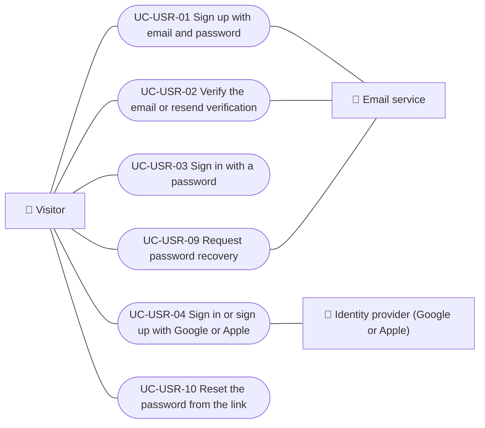
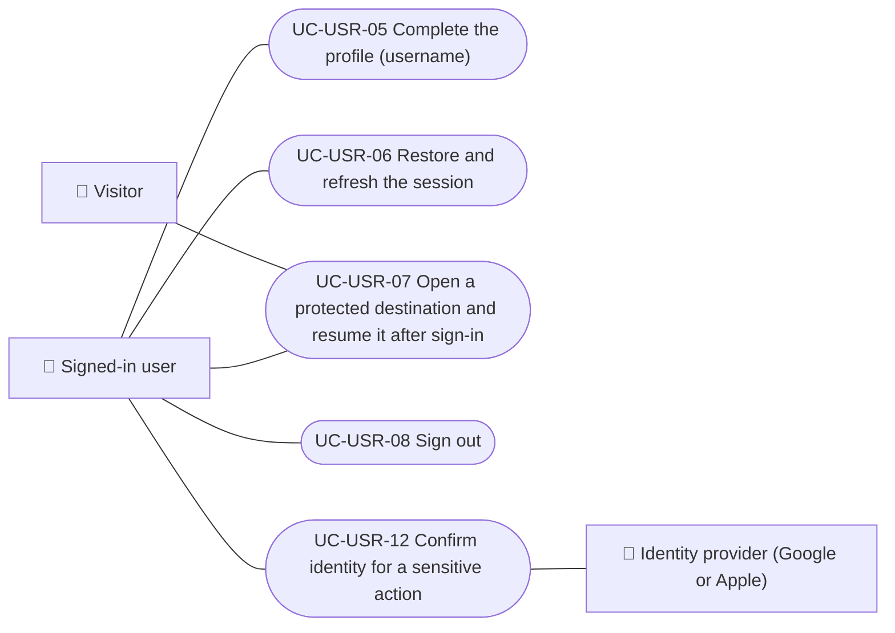
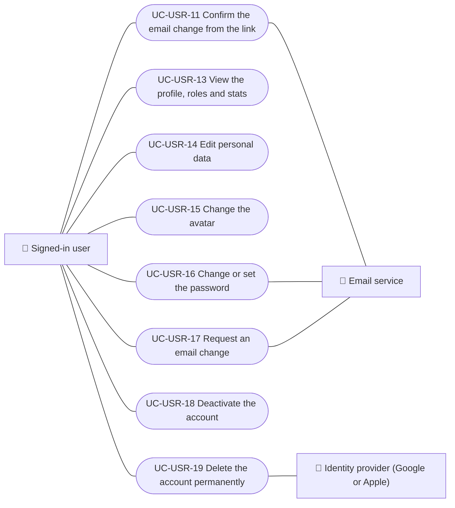
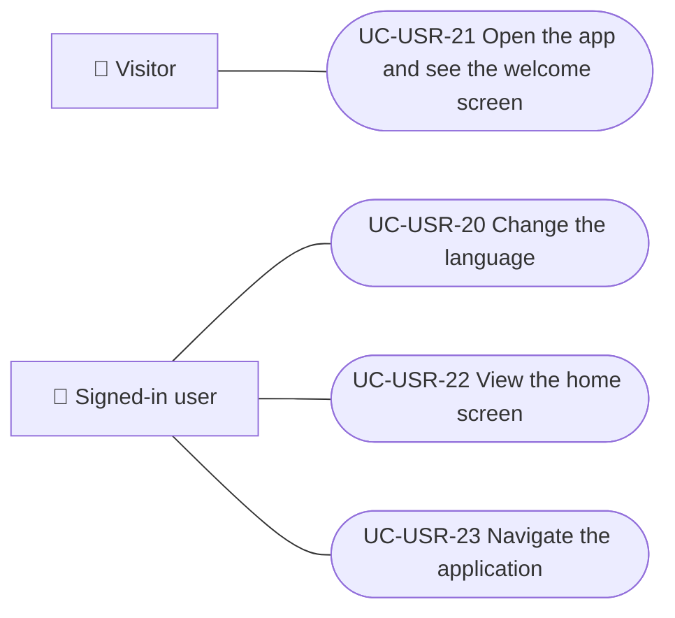

# Use cases

Use cases of the users and account module. Each case applies to the platforms listed.

| ID | Use case | Platforms | Actors |
|---|---|---|---|
| `UC-USR-01` | [Sign up with email and password](uc-usr-01-sign-up.md) | Web, APK | Visitor, Email service |
| `UC-USR-02` | [Verify the email or resend verification](uc-usr-02-verify-email.md) | Web, APK | Visitor, Email service |
| `UC-USR-03` | [Sign in with a password](uc-usr-03-sign-in.md) | Web, APK | Visitor |
| `UC-USR-04` | [Sign in or sign up with Google or Apple](uc-usr-04-social-sign-in.md) | Web, APK | Visitor, Identity provider (Google or Apple) |
| `UC-USR-05` | [Complete the profile (username)](uc-usr-05-complete-profile.md) | Web, APK | Signed-in user |
| `UC-USR-06` | [Restore and refresh the session](uc-usr-06-restore-session.md) | Web, APK | Signed-in user |
| `UC-USR-07` | [Open a protected destination and resume it after sign-in](uc-usr-07-resume-protected-destination.md) | Web, APK | Visitor, Signed-in user |
| `UC-USR-08` | [Sign out](uc-usr-08-sign-out.md) | Web, APK | Signed-in user |
| `UC-USR-09` | [Request password recovery](uc-usr-09-request-password-recovery.md) | Web, APK | Visitor, Email service |
| `UC-USR-10` | [Reset the password from the link](uc-usr-10-reset-password.md) | Web, APK | Visitor |
| `UC-USR-11` | [Confirm the email change from the link](uc-usr-11-confirm-email-change.md) | Web | Signed-in user, Email service |
| `UC-USR-12` | [Confirm identity for a sensitive action](uc-usr-12-reauthenticate.md) | Web, APK | Signed-in user, Identity provider (Google or Apple) |
| `UC-USR-13` | [View the profile, roles and stats](uc-usr-13-view-profile.md) | Web, APK | Signed-in user |
| `UC-USR-14` | [Edit personal data](uc-usr-14-edit-profile.md) | Web, APK | Signed-in user |
| `UC-USR-15` | [Change the avatar](uc-usr-15-change-avatar.md) | Web, APK | Signed-in user |
| `UC-USR-16` | [Change or set the password](uc-usr-16-change-password.md) | Web, APK | Signed-in user, Email service |
| `UC-USR-17` | [Request an email change](uc-usr-17-request-email-change.md) | Web, APK | Signed-in user, Email service |
| `UC-USR-18` | [Deactivate the account](uc-usr-18-deactivate-account.md) | Web, APK | Signed-in user |
| `UC-USR-19` | [Delete the account permanently](uc-usr-19-delete-account.md) | Web, APK | Signed-in user, Identity provider (Google or Apple) |
| `UC-USR-20` | [Change the language](uc-usr-20-change-language.md) | Web, APK | Signed-in user |
| `UC-USR-21` | [Open the app and see the welcome screen](uc-usr-21-welcome.md) | APK | Visitor |
| `UC-USR-22` | [View the home screen](uc-usr-22-home.md) | Web, APK | Signed-in user |
| `UC-USR-23` | [Navigate the application](uc-usr-23-navigate.md) | Web, APK | Signed-in user |

## Use case diagram

### Sign-up and sign-in

[View the full “Sign-up and sign-in” diagram](https://images.vinnot.com/docs/diagrams/v1/en/modules-users-use-cases-readme-5457ea1c0f50.svg)

### Session

[View the full “Session” diagram](https://images.vinnot.com/docs/diagrams/v1/en/modules-users-use-cases-readme-6f2d45da8587.svg)

### Profile and account

[View the full “Profile and account” diagram](https://images.vinnot.com/docs/diagrams/v1/en/modules-users-use-cases-readme-843f216b63dc.svg)

### Navigation

[View the full “Navigation” diagram](https://images.vinnot.com/docs/diagrams/v1/en/modules-users-use-cases-readme-6dd5c966ee0c.svg)

## Lucidchart mapping

| ID | Lucidchart IDs |
|---|---|
| `UC-USR-01` | [WEB UC-AUTH-01](https://lucid.app/lucidchart/9f11a16b-bb5a-42fc-a9e8-0852b17bd241/edit), [APK UC-AUTH-02](https://lucid.app/lucidchart/e095dd25-e8ac-41ba-bf5b-396e1055f217/edit) |
| `UC-USR-02` | [WEB UC-AUTH-02](https://lucid.app/lucidchart/9f11a16b-bb5a-42fc-a9e8-0852b17bd241/edit), [APK UC-AUTH-03](https://lucid.app/lucidchart/e095dd25-e8ac-41ba-bf5b-396e1055f217/edit) |
| `UC-USR-03` | [WEB UC-AUTH-03](https://lucid.app/lucidchart/9f11a16b-bb5a-42fc-a9e8-0852b17bd241/edit), [APK UC-AUTH-04](https://lucid.app/lucidchart/e095dd25-e8ac-41ba-bf5b-396e1055f217/edit) |
| `UC-USR-04` | [WEB UC-AUTH-04](https://lucid.app/lucidchart/9f11a16b-bb5a-42fc-a9e8-0852b17bd241/edit), [APK UC-AUTH-05](https://lucid.app/lucidchart/e095dd25-e8ac-41ba-bf5b-396e1055f217/edit) |
| `UC-USR-05` | [WEB UC-AUTH-05](https://lucid.app/lucidchart/9f11a16b-bb5a-42fc-a9e8-0852b17bd241/edit), [APK UC-AUTH-06](https://lucid.app/lucidchart/e095dd25-e8ac-41ba-bf5b-396e1055f217/edit) |
| `UC-USR-06` | [WEB UC-AUTH-06](https://lucid.app/lucidchart/9f11a16b-bb5a-42fc-a9e8-0852b17bd241/edit), [APK UC-AUTH-07](https://lucid.app/lucidchart/e095dd25-e8ac-41ba-bf5b-396e1055f217/edit) |
| `UC-USR-07` | [WEB UC-AUTH-07](https://lucid.app/lucidchart/9f11a16b-bb5a-42fc-a9e8-0852b17bd241/edit), [APK UC-AUTH-08](https://lucid.app/lucidchart/e095dd25-e8ac-41ba-bf5b-396e1055f217/edit) |
| `UC-USR-08` | [WEB UC-AUTH-08](https://lucid.app/lucidchart/9f11a16b-bb5a-42fc-a9e8-0852b17bd241/edit), [APK UC-AUTH-11](https://lucid.app/lucidchart/e095dd25-e8ac-41ba-bf5b-396e1055f217/edit) |
| `UC-USR-09` | [WEB UC-AUTH-09](https://lucid.app/lucidchart/9f11a16b-bb5a-42fc-a9e8-0852b17bd241/edit), [APK UC-AUTH-09](https://lucid.app/lucidchart/e095dd25-e8ac-41ba-bf5b-396e1055f217/edit) |
| `UC-USR-10` | [WEB UC-AUTH-10](https://lucid.app/lucidchart/9f11a16b-bb5a-42fc-a9e8-0852b17bd241/edit), [APK UC-AUTH-10](https://lucid.app/lucidchart/e095dd25-e8ac-41ba-bf5b-396e1055f217/edit) |
| `UC-USR-11` | [WEB UC-AUTH-11](https://lucid.app/lucidchart/9f11a16b-bb5a-42fc-a9e8-0852b17bd241/edit) |
| `UC-USR-12` | [WEB UC-AUTH-12](https://lucid.app/lucidchart/9f11a16b-bb5a-42fc-a9e8-0852b17bd241/edit) |
| `UC-USR-13` | [WEB UC-ACC-01](https://lucid.app/lucidchart/9f11a16b-bb5a-42fc-a9e8-0852b17bd241/edit), [APK UC-ACC-01](https://lucid.app/lucidchart/e095dd25-e8ac-41ba-bf5b-396e1055f217/edit) |
| `UC-USR-14` | [WEB UC-ACC-02](https://lucid.app/lucidchart/9f11a16b-bb5a-42fc-a9e8-0852b17bd241/edit), [APK UC-ACC-02](https://lucid.app/lucidchart/e095dd25-e8ac-41ba-bf5b-396e1055f217/edit) |
| `UC-USR-15` | [WEB UC-ACC-03](https://lucid.app/lucidchart/9f11a16b-bb5a-42fc-a9e8-0852b17bd241/edit), [APK UC-ACC-03](https://lucid.app/lucidchart/e095dd25-e8ac-41ba-bf5b-396e1055f217/edit) |
| `UC-USR-16` | [WEB UC-ACC-04](https://lucid.app/lucidchart/9f11a16b-bb5a-42fc-a9e8-0852b17bd241/edit), [APK UC-ACC-04](https://lucid.app/lucidchart/e095dd25-e8ac-41ba-bf5b-396e1055f217/edit) |
| `UC-USR-17` | [WEB UC-ACC-05](https://lucid.app/lucidchart/9f11a16b-bb5a-42fc-a9e8-0852b17bd241/edit), [APK UC-ACC-05](https://lucid.app/lucidchart/e095dd25-e8ac-41ba-bf5b-396e1055f217/edit) |
| `UC-USR-18` | [WEB UC-ACC-06](https://lucid.app/lucidchart/9f11a16b-bb5a-42fc-a9e8-0852b17bd241/edit), [APK UC-ACC-06](https://lucid.app/lucidchart/e095dd25-e8ac-41ba-bf5b-396e1055f217/edit) |
| `UC-USR-19` | [WEB UC-ACC-07](https://lucid.app/lucidchart/9f11a16b-bb5a-42fc-a9e8-0852b17bd241/edit), [APK UC-ACC-07](https://lucid.app/lucidchart/e095dd25-e8ac-41ba-bf5b-396e1055f217/edit) |
| `UC-USR-20` | [WEB UC-ACC-08](https://lucid.app/lucidchart/9f11a16b-bb5a-42fc-a9e8-0852b17bd241/edit), [APK UC-ACC-08](https://lucid.app/lucidchart/e095dd25-e8ac-41ba-bf5b-396e1055f217/edit) |
| `UC-USR-21` | [APK UC-AUTH-01](https://lucid.app/lucidchart/e095dd25-e8ac-41ba-bf5b-396e1055f217/edit) |
| `UC-USR-22` | [APK UC-HOME-01](https://lucid.app/lucidchart/e095dd25-e8ac-41ba-bf5b-396e1055f217/edit) |
| `UC-USR-23` | [APK UC-HOME-02](https://lucid.app/lucidchart/e095dd25-e8ac-41ba-bf5b-396e1055f217/edit) |
