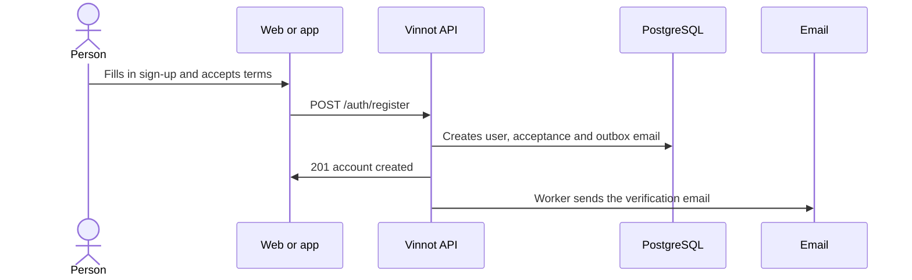

# UC-USR-01 · Sign up with email and password

| Field | Value |
|---|---|
| ID | `UC-USR-01` |
| Module | [Users and account](../README.md) |
| Platforms | Web, APK |
| Actors | Visitor, Email service |
| Lucidchart IDs | [WEB UC-AUTH-01](https://lucid.app/lucidchart/9f11a16b-bb5a-42fc-a9e8-0852b17bd241/edit), [APK UC-AUTH-02](https://lucid.app/lucidchart/e095dd25-e8ac-41ba-bf5b-396e1055f217/edit) |
| Requirements | [`RF-WEB-USR-01`](../requirements.md), [`RF-WEB-USR-02`](../requirements.md), [`RF-WEB-USR-03`](../requirements.md), [`RF-APK-USR-01`](../requirements.md), [`RF-APK-USR-02`](../requirements.md), [`RF-APK-USR-03`](../requirements.md) |
| Test cases | [`CP-USR-01`](../testing.md), [`CP-USR-02`](../testing.md), [`CP-USR-03`](../testing.md), [`CP-USR-04`](../testing.md) |

## Preconditions

- The person is not signed in.
- The current terms are published.

## Postconditions

- An active account with role USER exists, with an unverified email.
- The terms acceptance is recorded with its version.
- The verification email is queued.

## Main flow

1. The person opens sign-up.
2. They enter username, email, first name, last name, password and its confirmation, and accept the terms.
3. The client validates the format and sends the request.
4. The API normalizes the username, checks that username and email are free, creates the account, records the acceptance and queues the verification email in the same transaction.
5. The client shows that the email must be verified.

## Alternative flows

- 4a. Username or email already taken: the account is not created and the field is reported.
- 3a. Invalid data or terms not accepted: the form is not sent.
- 4b. The email provider fails: sign-up still commits; the email is retried from the outbox.

## Business rules

- Username: trimmed and lowercased; 3 to 40 characters; letters, digits, dot, hyphen and underscore; starts and ends with a letter or digit (`Username`).
- Password: at least 8 characters with an uppercase letter, a lowercase letter and a digit (`Password`).
- Email sign-up chooses the username at registration, so it skips onboarding.
- Signing up does not sign in: the email must be verified first.

## Diagram

[View the full “UC-USR-01 · Sign up with email and password” diagram](https://images.vinnot.com/docs/diagrams/v1/en/modules-users-use-cases-uc-usr-01-sign-up-c9510279e81e.svg)

Component diagram in Lucidchart: [WEB UC-AUTH-01](https://lucid.app/lucidchart/9f11a16b-bb5a-42fc-a9e8-0852b17bd241/edit), [APK UC-AUTH-02](https://lucid.app/lucidchart/e095dd25-e8ac-41ba-bf5b-396e1055f217/edit).

## Code

| Layer | Location |
|---|---|
| Endpoints | `POST /auth/register` |
| Backend | [`AuthController.java`](../../../../../backend/src/main/java/com/vinnot/user/infrastructure/web/controller/AuthController.java), [`RegisterUserCommandHandler.java`](../../../../../backend/src/main/java/com/vinnot/user/application/command/handler/RegisterUserCommandHandler.java) |
| Web | [`RegisterPage.tsx`](../../../../../frontend-react/src/presentation/pages/public/RegisterPage.tsx), [`useRegisterViewModel.ts`](../../../../../frontend-react/src/presentation/pages/public/useRegisterViewModel.ts), [`auth.store.ts`](../../../../../frontend-react/src/presentation/stores/auth.store.ts), [`auth.service.ts`](../../../../../frontend-react/src/application/services/auth.service.ts), [`auth.client.ts`](../../../../../frontend-react/src/infrastructure/api/clients/auth.client.ts) |
| App | `frontend-mobile/app/(auth)/register.tsx`, [`RegisterScreenView.tsx`](../../../../../frontend-mobile/src/presentation/features/auth/RegisterScreenView.tsx), [`authSlice.ts`](../../../../../frontend-mobile/src/presentation/store/authSlice.ts), [`auth.service.ts`](../../../../../frontend-mobile/src/application/services/auth.service.ts) |

## Automated tests

- Backend: [`AccountActionCommandHandlersTest.java`](../../../../../backend/src/test/java/com/vinnot/user/application/command/handler/AccountActionCommandHandlersTest.java), [`AccountEmailOutagePostgresIntegrationTest.java`](../../../../../backend/src/test/java/com/vinnot/user/application/AccountEmailOutagePostgresIntegrationTest.java), [`UsernameTest.java`](../../../../../backend/src/test/java/com/vinnot/user/domain/valueobject/UsernameTest.java), [`PasswordTest.java`](../../../../../backend/src/test/java/com/vinnot/user/domain/valueobject/PasswordTest.java), [`EmailTest.java`](../../../../../backend/src/test/java/com/vinnot/user/domain/valueobject/EmailTest.java)
- Web: [`authErrorViewModels.test.tsx`](../../../../../frontend-react/src/presentation/pages/public/authErrorViewModels.test.tsx), [`auth.service.test.ts`](../../../../../frontend-react/src/application/services/auth.service.test.ts), [`user.validators.test.ts`](../../../../../frontend-react/src/domain/user/user.validators.test.ts)
- App: [`registerRoute.test.tsx`](../../../../../frontend-mobile/src/presentation/features/auth/__tests__/registerRoute.test.tsx), [`auth.service.test.ts`](../../../../../frontend-mobile/src/application/services/auth.service.test.ts)
