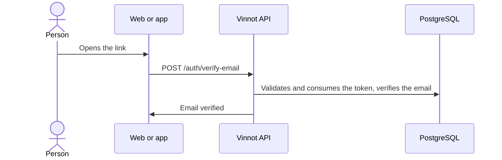

# UC-USR-02 · Verify the email or resend verification

| Field | Value |
|---|---|
| ID | `UC-USR-02` |
| Module | [Users and account](../README.md) |
| Platforms | Web, APK |
| Actors | Visitor, Email service |
| Lucidchart IDs | [WEB UC-AUTH-02](https://lucid.app/lucidchart/9f11a16b-bb5a-42fc-a9e8-0852b17bd241/edit), [APK UC-AUTH-03](https://lucid.app/lucidchart/e095dd25-e8ac-41ba-bf5b-396e1055f217/edit) |
| Requirements | [`RF-WEB-USR-04`](../requirements.md), [`RF-APK-USR-04`](../requirements.md) |
| Test cases | [`CP-USR-05`](../testing.md), [`CP-USR-06`](../testing.md), [`CP-USR-07`](../testing.md) |

## Preconditions

- The account exists and its email is not verified.

## Postconditions

- The email is verified and the token is consumed.
- When resending, a new link is issued if the account is eligible.

## Main flow

1. The person opens the link in the email.
2. The client sends the token to the API.
3. The API validates the token (type, expiry and use), marks the email as verified and consumes the token.
4. The client reports the result and offers to sign in.

## Alternative flows

- 3a. Missing, invalid, used or expired token: it is reported and resending is offered.
- R1. The person asks to resend: the API answers the same whether the account exists or not and queues the request; the worker issues the link only if the account is active and unverified.

## Business rules

- The verification token lasts 1440 minutes and is single-use.
- The resend answer does not reveal whether the email has an account.
- Recovery rows are deleted after one day.

## Diagram

[View the full “UC-USR-02 · Verify the email or resend verification” diagram](https://images.vinnot.com/docs/diagrams/v1/en/modules-users-use-cases-uc-usr-02-verify-email-15a031bd40c0.svg)

Component diagram in Lucidchart: [WEB UC-AUTH-02](https://lucid.app/lucidchart/9f11a16b-bb5a-42fc-a9e8-0852b17bd241/edit), [APK UC-AUTH-03](https://lucid.app/lucidchart/e095dd25-e8ac-41ba-bf5b-396e1055f217/edit).

## Code

| Layer | Location |
|---|---|
| Endpoints | `POST /auth/verify-email`, `POST /auth/resend-verification` |
| Backend | [`AuthController.java`](../../../../../backend/src/main/java/com/vinnot/user/infrastructure/web/controller/AuthController.java), [`VerifyEmailCommandHandler.java`](../../../../../backend/src/main/java/com/vinnot/user/application/command/handler/VerifyEmailCommandHandler.java), [`ResendVerificationCommandHandler.java`](../../../../../backend/src/main/java/com/vinnot/user/application/command/handler/ResendVerificationCommandHandler.java), [`IssueAccountRecoveryService.java`](../../../../../backend/src/main/java/com/vinnot/user/application/service/IssueAccountRecoveryService.java) |
| Web | [`VerifyEmailPage.tsx`](../../../../../frontend-react/src/presentation/pages/public/VerifyEmailPage.tsx), [`RegistrationPendingPage.tsx`](../../../../../frontend-react/src/presentation/pages/public/RegistrationPendingPage.tsx), [`useAccountActionViewModels.ts`](../../../../../frontend-react/src/presentation/pages/public/useAccountActionViewModels.ts) |
| App | `frontend-mobile/app/(auth)/verify-email.tsx`, `frontend-mobile/app/(auth)/register-success.tsx`, [`useAccountActions.ts`](../../../../../frontend-mobile/src/presentation/hooks/useAccountActions.ts), [`AccountActionViews.tsx`](../../../../../frontend-mobile/src/presentation/features/auth/AccountActionViews.tsx) |

## Automated tests

- Backend: [`AccountActionCommandHandlersTest.java`](../../../../../backend/src/test/java/com/vinnot/user/application/command/handler/AccountActionCommandHandlersTest.java), [`AccountRecoveryPostgresIntegrationTest.java`](../../../../../backend/src/test/java/com/vinnot/user/application/AccountRecoveryPostgresIntegrationTest.java), [`IssueAccountRecoveryServiceTest.java`](../../../../../backend/src/test/java/com/vinnot/user/application/service/IssueAccountRecoveryServiceTest.java), [`AccountActionTokenServiceTest.java`](../../../../../backend/src/test/java/com/vinnot/user/application/service/AccountActionTokenServiceTest.java), [`UserActionTokenTest.java`](../../../../../backend/src/test/java/com/vinnot/user/domain/model/UserActionTokenTest.java)
- Web: None
- App: [`auth.service.test.ts`](../../../../../frontend-mobile/src/application/services/auth.service.test.ts)
