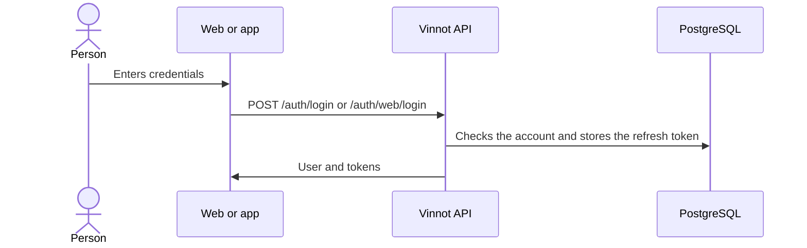

# UC-USR-03 · Sign in with a password

| Field | Value |
|---|---|
| ID | `UC-USR-03` |
| Module | [Users and account](../README.md) |
| Platforms | Web, APK |
| Actors | Visitor |
| Lucidchart IDs | [WEB UC-AUTH-03](https://lucid.app/lucidchart/9f11a16b-bb5a-42fc-a9e8-0852b17bd241/edit), [APK UC-AUTH-04](https://lucid.app/lucidchart/e095dd25-e8ac-41ba-bf5b-396e1055f217/edit) |
| Requirements | [`RF-WEB-USR-05`](../requirements.md), [`RF-WEB-USR-06`](../requirements.md), [`RF-APK-USR-05`](../requirements.md), [`RF-APK-USR-06`](../requirements.md) |
| Test cases | [`CP-USR-08`](../testing.md), [`CP-USR-09`](../testing.md), [`CP-USR-10`](../testing.md), [`CP-USR-11`](../testing.md), [`CP-USR-12`](../testing.md), [`CP-USR-67`](../testing.md) |

## Preconditions

- The account exists.

## Postconditions

- A session exists: a 15-minute access token and a 7-day refresh token.
- On the web the refresh travels in an HttpOnly cookie; in the app it is kept in SecureStore.

## Main flow

1. The person enters their identifier and password. The app accepts username or email; the web asks for email.
2. The client sends the credentials.
3. The API checks credentials, lock, reactivation and email verification, in that order.
4. The API issues the session and records the last sign-in.
5. The client stores the identity and navigates to the destination.

## Alternative flows

- 3a. Wrong credentials: no session is created.
- 3b. Locked account: `ACCOUNT_LOCKED`.
- 3c. Deactivated account: the client asks whether to reactivate the account; on confirmation it retries with `reactivate` and the account is active again.
- 3d. Unverified email: `EMAIL_NOT_VERIFIED` and resending is offered.
- 3e. The person does not confirm the reactivation: no session is created and the account stays deactivated.
- 3f. Five wrong passwords in a row: password sign-in is locked for 15 minutes; every attempt, even with the right password, gets HTTP 423 `ACCOUNT_TEMPORARILY_LOCKED` with `Retry-After`, and the owner receives a security email. Parallel attempts start one lock and send one email; attempts during the lock are not counted.

## Business rules

- Sign-in is rate limited.
- An unknown email or username and a wrong password get the same `AUTH_FAILED` answer, in about the same time.
- Every success, failure and temporary lock is recorded as a security event (kept 180 days).
- While a sign-in is in progress no other submission is accepted.

## Diagram

[View the full “UC-USR-03 · Sign in with a password” diagram](https://images.vinnot.com/docs/diagrams/v1/en/modules-users-use-cases-uc-usr-03-sign-in-f3ed6403ba4d.svg)

Component diagram in Lucidchart: [WEB UC-AUTH-03](https://lucid.app/lucidchart/9f11a16b-bb5a-42fc-a9e8-0852b17bd241/edit), [APK UC-AUTH-04](https://lucid.app/lucidchart/e095dd25-e8ac-41ba-bf5b-396e1055f217/edit).

## Code

| Layer | Location |
|---|---|
| Endpoints | `POST /auth/login (app)`, `POST /auth/web/login (web)` |
| Backend | [`AuthController.java`](../../../../../backend/src/main/java/com/vinnot/user/infrastructure/web/controller/AuthController.java), [`BrowserAuthController.java`](../../../../../backend/src/main/java/com/vinnot/user/infrastructure/web/controller/BrowserAuthController.java), [`LoginCommandHandler.java`](../../../../../backend/src/main/java/com/vinnot/user/application/command/handler/LoginCommandHandler.java) |
| Web | [`LoginPage.tsx`](../../../../../frontend-react/src/presentation/pages/public/LoginPage.tsx), [`useLoginViewModel.ts`](../../../../../frontend-react/src/presentation/pages/public/useLoginViewModel.ts), [`auth.store.ts`](../../../../../frontend-react/src/presentation/stores/auth.store.ts), [`auth.service.ts`](../../../../../frontend-react/src/application/services/auth.service.ts) |
| App | `frontend-mobile/app/(auth)/login.tsx`, [`LoginScreenView.tsx`](../../../../../frontend-mobile/src/presentation/features/auth/LoginScreenView.tsx), [`authSlice.ts`](../../../../../frontend-mobile/src/presentation/store/authSlice.ts) |

## Automated tests

- Backend: [`AccountActionCommandHandlersTest.java`](../../../../../backend/src/test/java/com/vinnot/user/application/command/handler/AccountActionCommandHandlersTest.java), [`BrowserAuthControllerTest.java`](../../../../../backend/src/test/java/com/vinnot/user/infrastructure/web/controller/BrowserAuthControllerTest.java), [`AuthSessionIssuerTest.java`](../../../../../backend/src/test/java/com/vinnot/user/application/service/AuthSessionIssuerTest.java), [`BrowserSessionPolicyTest.java`](../../../../../backend/src/test/java/com/vinnot/user/infrastructure/web/session/BrowserSessionPolicyTest.java), [`RateLimitPolicyResolverTest.java`](../../../../../backend/src/test/java/com/vinnot/shared/infrastructure/security/RateLimitPolicyResolverTest.java)
- Web: [`auth.service.test.ts`](../../../../../frontend-react/src/application/services/auth.service.test.ts), [`auth.client.test.ts`](../../../../../frontend-react/src/infrastructure/api/clients/auth.client.test.ts), [`auth.store.test.ts`](../../../../../frontend-react/src/presentation/stores/auth.store.test.ts), [`authErrorMessage.test.ts`](../../../../../frontend-react/src/presentation/feedback/authErrorMessage.test.ts), [`useLoginViewModel.test.tsx`](../../../../../frontend-react/src/presentation/pages/public/useLoginViewModel.test.tsx)
- App: [`loginRoute.test.tsx`](../../../../../frontend-mobile/src/presentation/features/auth/__tests__/loginRoute.test.tsx), [`auth.service.test.ts`](../../../../../frontend-mobile/src/application/services/auth.service.test.ts), [`authSlice.test.ts`](../../../../../frontend-mobile/src/presentation/store/authSlice.test.ts)
