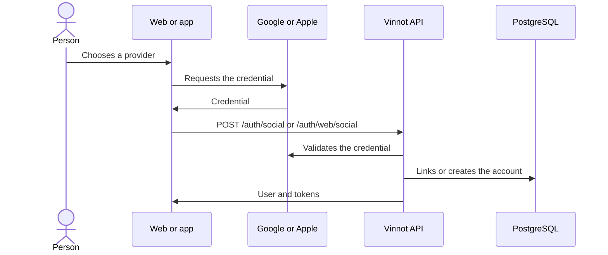

# UC-USR-04 · Sign in or sign up with Google or Apple

| Field | Value |
|---|---|
| ID | `UC-USR-04` |
| Module | [Users and account](../README.md) |
| Platforms | Web, APK |
| Actors | Visitor, Identity provider (Google or Apple) |
| Lucidchart IDs | [WEB UC-AUTH-04](https://lucid.app/lucidchart/9f11a16b-bb5a-42fc-a9e8-0852b17bd241/edit), [APK UC-AUTH-05](https://lucid.app/lucidchart/e095dd25-e8ac-41ba-bf5b-396e1055f217/edit) |
| Requirements | [`RF-WEB-USR-07`](../requirements.md), [`RF-WEB-USR-08`](../requirements.md), [`RF-APK-USR-07`](../requirements.md), [`RF-APK-USR-08`](../requirements.md), [`RF-APK-USR-09`](../requirements.md), [`RF-APK-USR-10`](../requirements.md) |
| Test cases | [`CP-USR-13`](../testing.md), [`CP-USR-14`](../testing.md), [`CP-USR-15`](../testing.md), [`CP-USR-16`](../testing.md) |

## Preconditions

- The provider is enabled and configured in the client and the API.

## Postconditions

- A Vinnot session exists. If the account is new, onboarding stays pending.
- The social identity is linked to the account.

## Main flow

1. The person chooses Google or Apple.
2. The provider SDK returns a credential.
3. The client sends the credential to the API.
4. The API validates the credential with the provider; if the email already has an account it links it, otherwise it creates a new account with a generated username `vinnoter-xxxxxxxx`.
5. The API issues the Vinnot session.

## Alternative flows

- 2a. The person cancels or the SDK fails: no session is created.
- 4a. Credential rejected: no session is created.
- 5a. New account: the client goes to complete the profile (UC-USR-05).

## Business rules

- In the app, Apple only appears on iOS; Android has Google.
- Facebook exists in the code but is disabled in production.
- The provider credential never replaces the Vinnot token.

## Diagram

[View the full “UC-USR-04 · Sign in or sign up with Google or Apple” diagram](https://images.vinnot.com/docs/diagrams/v1/en/modules-users-use-cases-uc-usr-04-social-sign-in-02e04b1f1973.svg)

Component diagram in Lucidchart: [WEB UC-AUTH-04](https://lucid.app/lucidchart/9f11a16b-bb5a-42fc-a9e8-0852b17bd241/edit), [APK UC-AUTH-05](https://lucid.app/lucidchart/e095dd25-e8ac-41ba-bf5b-396e1055f217/edit).

## Code

| Layer | Location |
|---|---|
| Endpoints | `POST /auth/social (app)`, `POST /auth/web/social (web)` |
| Backend | [`AuthController.java`](../../../../../backend/src/main/java/com/vinnot/user/infrastructure/web/controller/AuthController.java), [`BrowserAuthController.java`](../../../../../backend/src/main/java/com/vinnot/user/infrastructure/web/controller/BrowserAuthController.java), [`SocialLoginCommandHandler.java`](../../../../../backend/src/main/java/com/vinnot/user/application/command/handler/SocialLoginCommandHandler.java) |
| Web | [`AuthSocialButtons.tsx`](../../../../../frontend-react/src/presentation/components/auth/AuthSocialButtons.tsx), [`socialAuth.service.ts`](../../../../../frontend-react/src/application/services/socialAuth.service.ts), [`socialIdentity.gateway.ts`](../../../../../frontend-react/src/infrastructure/identity/socialIdentity.gateway.ts) |
| App | [`AuthSocialButtons.tsx`](../../../../../frontend-mobile/src/presentation/features/auth/AuthSocialButtons.tsx), [`socialIdentity.gateway.ts`](../../../../../frontend-mobile/src/infrastructure/identity/socialIdentity.gateway.ts), [`socialAuth.service.ts`](../../../../../frontend-mobile/src/application/services/socialAuth.service.ts) |

## Automated tests

- Backend: [`SocialLoginCommandHandlerTest.java`](../../../../../backend/src/test/java/com/vinnot/user/application/command/handler/SocialLoginCommandHandlerTest.java), [`SocialIdentityTest.java`](../../../../../backend/src/test/java/com/vinnot/user/domain/model/SocialIdentityTest.java), [`SocialIdentityVerifierAdapterTest.java`](../../../../../backend/src/test/java/com/vinnot/user/infrastructure/identity/SocialIdentityVerifierAdapterTest.java), [`SocialIdTokenVerificationTest.java`](../../../../../backend/src/test/java/com/vinnot/user/infrastructure/identity/SocialIdTokenVerificationTest.java)
- Web: [`AuthSocialButtons.test.tsx`](../../../../../frontend-react/src/presentation/components/auth/AuthSocialButtons.test.tsx), [`socialAuth.service.test.ts`](../../../../../frontend-react/src/application/services/socialAuth.service.test.ts)
- App: [`AuthSocialButtons.test.tsx`](../../../../../frontend-mobile/src/presentation/features/auth/AuthSocialButtons.test.tsx), [`socialIdentity.gateway.test.ts`](../../../../../frontend-mobile/src/infrastructure/identity/socialIdentity.gateway.test.ts), [`socialAuth.service.test.ts`](../../../../../frontend-mobile/src/application/services/socialAuth.service.test.ts)
