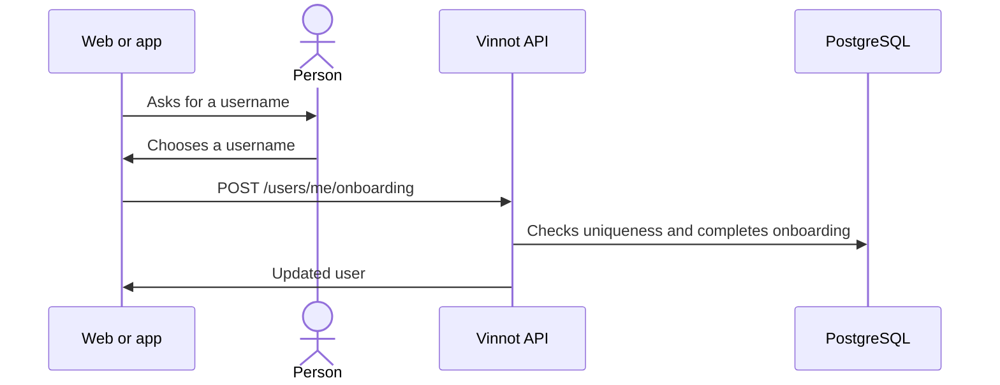

# UC-USR-05 · Complete the profile (username)

| Field | Value |
|---|---|
| ID | `UC-USR-05` |
| Module | [Users and account](../README.md) |
| Platforms | Web, APK |
| Actors | Signed-in user |
| Lucidchart IDs | [WEB UC-AUTH-05](https://lucid.app/lucidchart/9f11a16b-bb5a-42fc-a9e8-0852b17bd241/edit), [APK UC-AUTH-06](https://lucid.app/lucidchart/e095dd25-e8ac-41ba-bf5b-396e1055f217/edit) |
| Requirements | [`RF-WEB-USR-09`](../requirements.md), [`RF-APK-USR-11`](../requirements.md) |
| Test cases | [`CP-USR-17`](../testing.md), [`CP-USR-18`](../testing.md) |

## Preconditions

- The account has onboarding pending (social sign-up).

## Postconditions

- Onboarding is complete, with the chosen or generated username.

## Main flow

1. On entry, the client detects pending onboarding and opens "Complete profile".
2. The person chooses a username.
3. The API normalizes the username, checks that it is free, completes onboarding and saves.
4. The client continues to the original destination.

## Alternative flows

- 3a. Username taken or invalid: it is reported and the screen stays.

## Business rules

- The API also accepts completing onboarding without a username and keeps the generated one.
- Repeating the operation creates nothing new; the flag stays complete.

## Diagram

[View the full “UC-USR-05 · Complete the profile (username)” diagram](https://images.vinnot.com/docs/diagrams/v1/en/modules-users-use-cases-uc-usr-05-complete-profile-cfa0eadb45e2.svg)

Component diagram in Lucidchart: [WEB UC-AUTH-05](https://lucid.app/lucidchart/9f11a16b-bb5a-42fc-a9e8-0852b17bd241/edit), [APK UC-AUTH-06](https://lucid.app/lucidchart/e095dd25-e8ac-41ba-bf5b-396e1055f217/edit).

## Code

| Layer | Location |
|---|---|
| Endpoints | `POST /users/me/onboarding` |
| Backend | [`UserController.java`](../../../../../backend/src/main/java/com/vinnot/user/infrastructure/web/controller/UserController.java), [`CompleteUserOnboardingCommandHandler.java`](../../../../../backend/src/main/java/com/vinnot/user/application/command/handler/CompleteUserOnboardingCommandHandler.java) |
| Web | [`CompleteProfilePage.tsx`](../../../../../frontend-react/src/presentation/pages/user/CompleteProfilePage.tsx), [`useCompleteOnboarding.ts`](../../../../../frontend-react/src/presentation/hooks/queries/user/useCompleteOnboarding.ts), [`App.tsx`](../../../../../frontend-react/src/app/App.tsx) |
| App | `frontend-mobile/app/(app)/complete-profile.tsx`, `frontend-mobile/app/(app)/_layout.tsx` |

## Automated tests

- Backend: [`CompleteUserOnboardingCommandHandlerTest.java`](../../../../../backend/src/test/java/com/vinnot/user/application/command/handler/CompleteUserOnboardingCommandHandlerTest.java)
- Web: None
- App: [`loginRoute.test.tsx`](../../../../../frontend-mobile/src/presentation/features/auth/__tests__/loginRoute.test.tsx), [`authSession.service.test.ts`](../../../../../frontend-mobile/src/application/services/authSession.service.test.ts)
