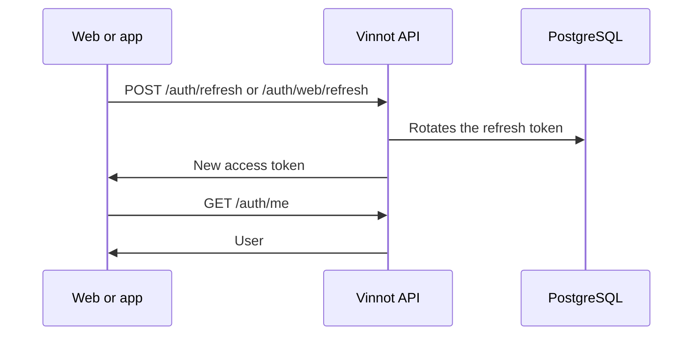

# UC-USR-06 · Restore and refresh the session

| Field | Value |
|---|---|
| ID | `UC-USR-06` |
| Module | [Users and account](../README.md) |
| Platforms | Web, APK |
| Actors | Signed-in user |
| Lucidchart IDs | [WEB UC-AUTH-06](https://lucid.app/lucidchart/9f11a16b-bb5a-42fc-a9e8-0852b17bd241/edit), [APK UC-AUTH-07](https://lucid.app/lucidchart/e095dd25-e8ac-41ba-bf5b-396e1055f217/edit) |
| Requirements | [`RF-WEB-USR-10`](../requirements.md), [`RF-WEB-USR-11`](../requirements.md), [`RF-APK-USR-12`](../requirements.md), [`RF-APK-USR-13`](../requirements.md) |
| Test cases | [`CP-USR-19`](../testing.md), [`CP-USR-20`](../testing.md), [`CP-USR-21`](../testing.md), [`CP-USR-22`](../testing.md) |

## Preconditions

- There was a previous session on the device or browser.

## Postconditions

- The session is restored with new tokens, or the client stays anonymous.

## Main flow

1. When the client opens, the session is marked as initializing and no redirect happens yet.
2. The client asks for a new token: the web with the cookie, the app with the token kept in SecureStore.
3. The API rotates the refresh token and returns an access token.
4. The client calls `GET /auth/me` and publishes the identity.
5. During use, a 401 triggers a single shared renewal and the request is retried once.

## Alternative flows

- 2a. No stored session: the client stays anonymous.
- 3a. Renewal rejected (expired, revoked or locked account): the session is cleared.
- 3b. Network error, 429 or 5xx in the app: the stored identity is kept and renewal is retried later.

## Business rules

- On the web, sign-in, renewal and sign-out are serialized across tabs with Web Locks when the browser allows it.
- A response from a previous session cannot restore or overwrite the current one.
- The app stores the rotation intent before renewing, so it can recover the same successor if the response is lost.

## Diagram

[View the full “UC-USR-06 · Restore and refresh the session” diagram](https://images.vinnot.com/docs/diagrams/v1/en/modules-users-use-cases-uc-usr-06-restore-session-5deebeece29d.svg)

Component diagram in Lucidchart: [WEB UC-AUTH-06](https://lucid.app/lucidchart/9f11a16b-bb5a-42fc-a9e8-0852b17bd241/edit), [APK UC-AUTH-07](https://lucid.app/lucidchart/e095dd25-e8ac-41ba-bf5b-396e1055f217/edit).

## Code

| Layer | Location |
|---|---|
| Endpoints | `POST /auth/refresh (app)`, `POST /auth/web/refresh (web)`, `GET /auth/me` |
| Backend | [`AuthController.java`](../../../../../backend/src/main/java/com/vinnot/user/infrastructure/web/controller/AuthController.java), [`BrowserAuthController.java`](../../../../../backend/src/main/java/com/vinnot/user/infrastructure/web/controller/BrowserAuthController.java), [`RefreshTokenCommandHandler.java`](../../../../../backend/src/main/java/com/vinnot/user/application/command/handler/RefreshTokenCommandHandler.java) |
| Web | [`AuthProvider.tsx`](../../../../../frontend-react/src/app/providers/AuthProvider.tsx), [`http.ts`](../../../../../frontend-react/src/infrastructure/http/http.ts), [`browserSession.ts`](../../../../../frontend-react/src/infrastructure/http/browserSession.ts) |
| App | [`AuthProvider.tsx`](../../../../../frontend-mobile/src/presentation/providers/AuthProvider.tsx), [`authSession.service.ts`](../../../../../frontend-mobile/src/application/services/authSession.service.ts), [`sessionRenewal.service.ts`](../../../../../frontend-mobile/src/application/services/sessionRenewal.service.ts), [`authSession.storage.ts`](../../../../../frontend-mobile/src/infrastructure/storage/authSession.storage.ts) |

## Automated tests

- Backend: [`SessionCommandHandlersTest.java`](../../../../../backend/src/test/java/com/vinnot/user/application/command/handler/SessionCommandHandlersTest.java), [`BrowserAuthControllerTest.java`](../../../../../backend/src/test/java/com/vinnot/user/infrastructure/web/controller/BrowserAuthControllerTest.java), [`RefreshTokenHasherTest.java`](../../../../../backend/src/test/java/com/vinnot/user/application/service/RefreshTokenHasherTest.java), [`JwtAuthenticationFilterTest.java`](../../../../../backend/src/test/java/com/vinnot/shared/infrastructure/security/JwtAuthenticationFilterTest.java), [`SessionAccessHttpPostgresIntegrationTest.java`](../../../../../backend/src/test/java/com/vinnot/shared/infrastructure/SessionAccessHttpPostgresIntegrationTest.java)
- Web: [`AuthProvider.test.tsx`](../../../../../frontend-react/src/app/providers/AuthProvider.test.tsx), [`auth.store.test.ts`](../../../../../frontend-react/src/presentation/stores/auth.store.test.ts), [`browserSession.test.ts`](../../../../../frontend-react/src/infrastructure/http/browserSession.test.ts), [`http.session.test.ts`](../../../../../frontend-react/src/infrastructure/http/http.session.test.ts)
- App: [`authSlice.test.ts`](../../../../../frontend-mobile/src/presentation/store/authSlice.test.ts), [`authSession.service.test.ts`](../../../../../frontend-mobile/src/application/services/authSession.service.test.ts), [`authSession.storage.test.ts`](../../../../../frontend-mobile/src/infrastructure/storage/authSession.storage.test.ts), [`sessionRenewal.service.test.ts`](../../../../../frontend-mobile/src/application/services/sessionRenewal.service.test.ts), [`startupRoutes.test.tsx`](../../../../../frontend-mobile/src/presentation/features/auth/__tests__/startupRoutes.test.tsx)
