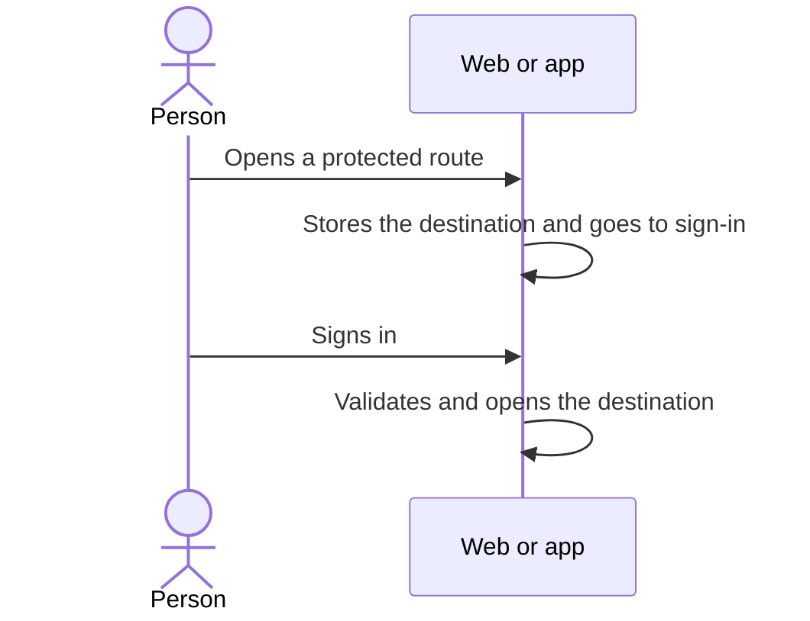

# UC-USR-07 · Open a protected destination and resume it after sign-in

| Field | Value |
|---|---|
| ID | `UC-USR-07` |
| Module | [Users and account](../README.md) |
| Platforms | Web, APK |
| Actors | Visitor, Signed-in user |
| Lucidchart IDs | [WEB UC-AUTH-07](https://lucid.app/lucidchart/9f11a16b-bb5a-42fc-a9e8-0852b17bd241/edit), [APK UC-AUTH-08](https://lucid.app/lucidchart/e095dd25-e8ac-41ba-bf5b-396e1055f217/edit) |
| Requirements | [`RF-WEB-USR-12`](../requirements.md), [`RF-APK-USR-14`](../requirements.md) |
| Test cases | [`CP-USR-23`](../testing.md), [`CP-USR-24`](../testing.md) |

## Preconditions

- The person opens a route that requires a session (by link, deep link or navigation).

## Postconditions

- After sign-in, terms and onboarding, the client opens the requested destination.

## Main flow

1. The guard detects there is no session.
2. The client stores the destination and goes to sign-in (on the web, with `returnUrl`).
3. The person signs in (UC-USR-03 or UC-USR-04).
4. If terms or onboarding are missing, they are completed first.
5. The client validates the destination and opens it.

## Alternative flows

- 5a. Invalid destination (external, with a scheme, double slash or control characters): the default destination is used.

## Business rules

- The UI guard does not authorize: the API checks every resource again.
- The app validates incoming links before handing them to the router (up to 4096 characters, valid UTF-8).

## Diagram

[View the full “UC-USR-07 · Open a protected destination and resume it after sign-in” diagram](https://images.vinnot.com/docs/diagrams/v1/en/modules-users-use-cases-uc-usr-07-resume-protected-destination-a250fe64e0d7.svg)

Component diagram in Lucidchart: [WEB UC-AUTH-07](https://lucid.app/lucidchart/9f11a16b-bb5a-42fc-a9e8-0852b17bd241/edit), [APK UC-AUTH-08](https://lucid.app/lucidchart/e095dd25-e8ac-41ba-bf5b-396e1055f217/edit).

## Code

| Layer | Location |
|---|---|
| Endpoints | (client only; the API answers 401) |
| Backend | [`SecurityConfig.java`](../../../../../backend/src/main/java/com/vinnot/shared/infrastructure/config/SecurityConfig.java) |
| Web | [`ProtectedRoute.tsx`](../../../../../frontend-react/src/presentation/components/auth/ProtectedRoute.tsx), [`useAuthReturnPath.ts`](../../../../../frontend-react/src/presentation/hooks/useAuthReturnPath.ts), [`returnPath.ts`](../../../../../frontend-react/src/domain/user/returnPath.ts) |
| App | [`guards.tsx`](../../../../../frontend-mobile/src/presentation/navigation/guards.tsx), [`returnPath.ts`](../../../../../frontend-mobile/src/domain/navigation/returnPath.ts), [`+native-intent.tsx`](../../../../../frontend-mobile/app/+native-intent.tsx), [`nativeIntent.ts`](../../../../../frontend-mobile/src/domain/navigation/nativeIntent.ts) |

## Automated tests

- Backend: [`SecurityConfigAccessTest.java`](../../../../../backend/src/test/java/com/vinnot/shared/infrastructure/config/SecurityConfigAccessTest.java)
- Web: [`useAuthReturnPath.test.tsx`](../../../../../frontend-react/src/presentation/hooks/useAuthReturnPath.test.tsx), [`returnPath.test.ts`](../../../../../frontend-react/src/domain/user/returnPath.test.ts)
- App: [`guards.test.tsx`](../../../../../frontend-mobile/src/presentation/navigation/guards.test.tsx), [`returnPath.test.ts`](../../../../../frontend-mobile/src/domain/navigation/returnPath.test.ts), [`nativeIntent.test.ts`](../../../../../frontend-mobile/src/domain/navigation/nativeIntent.test.ts), [`loginRoute.test.tsx`](../../../../../frontend-mobile/src/presentation/features/auth/__tests__/loginRoute.test.tsx)
