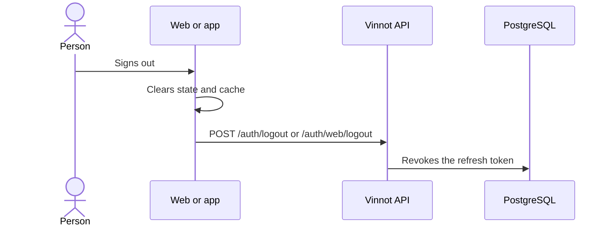

# UC-USR-08 · Sign out

| Field | Value |
|---|---|
| ID | `UC-USR-08` |
| Module | [Users and account](../README.md) |
| Platforms | Web, APK |
| Actors | Signed-in user |
| Lucidchart IDs | [WEB UC-AUTH-08](https://lucid.app/lucidchart/9f11a16b-bb5a-42fc-a9e8-0852b17bd241/edit), [APK UC-AUTH-11](https://lucid.app/lucidchart/e095dd25-e8ac-41ba-bf5b-396e1055f217/edit) |
| Requirements | [`RF-WEB-USR-13`](../requirements.md), [`RF-APK-USR-15`](../requirements.md) |
| Test cases | [`CP-USR-25`](../testing.md), [`CP-USR-26`](../testing.md) |

## Preconditions

- There is an active session.

## Postconditions

- The session is revoked in the API and the client clears identity and private cache.

## Main flow

1. The person chooses to sign out.
2. The client clears private state and cache without waiting for the response.
3. The client asks the API to revoke the session (the app also sends its push token to unregister it).
4. The API revokes the refresh token.

## Alternative flows

- 3a. Offline on the web: a pending-revocation mark blocks automatic restore until the sign-out is retried.

## Business rules

- A failed sign-out is not presented as a confirmed revocation.

## Diagram

[View the full “UC-USR-08 · Sign out” diagram](https://images.vinnot.com/docs/diagrams/v1/en/modules-users-use-cases-uc-usr-08-sign-out-e86898bd1b49.svg)

Component diagram in Lucidchart: [WEB UC-AUTH-08](https://lucid.app/lucidchart/9f11a16b-bb5a-42fc-a9e8-0852b17bd241/edit), [APK UC-AUTH-11](https://lucid.app/lucidchart/e095dd25-e8ac-41ba-bf5b-396e1055f217/edit).

## Code

| Layer | Location |
|---|---|
| Endpoints | `POST /auth/logout (app)`, `POST /auth/web/logout (web)` |
| Backend | [`AuthController.java`](../../../../../backend/src/main/java/com/vinnot/user/infrastructure/web/controller/AuthController.java), [`BrowserAuthController.java`](../../../../../backend/src/main/java/com/vinnot/user/infrastructure/web/controller/BrowserAuthController.java), [`LogoutCommandHandler.java`](../../../../../backend/src/main/java/com/vinnot/user/application/command/handler/LogoutCommandHandler.java) |
| Web | [`AppHeader.tsx`](../../../../../frontend-react/src/presentation/components/layout/AppHeader.tsx), [`auth.store.ts`](../../../../../frontend-react/src/presentation/stores/auth.store.ts) |
| App | [`ProfileScreen.tsx`](../../../../../frontend-mobile/src/presentation/features/profile/ProfileScreen.tsx), [`authSlice.ts`](../../../../../frontend-mobile/src/presentation/store/authSlice.ts) |

## Automated tests

- Backend: [`SessionCommandHandlersTest.java`](../../../../../backend/src/test/java/com/vinnot/user/application/command/handler/SessionCommandHandlersTest.java), [`BrowserAuthControllerTest.java`](../../../../../backend/src/test/java/com/vinnot/user/infrastructure/web/controller/BrowserAuthControllerTest.java)
- Web: [`auth.store.test.ts`](../../../../../frontend-react/src/presentation/stores/auth.store.test.ts), [`auth.client.test.ts`](../../../../../frontend-react/src/infrastructure/api/clients/auth.client.test.ts)
- App: [`profileRoute.test.tsx`](../../../../../frontend-mobile/src/presentation/features/profile/__tests__/profileRoute.test.tsx), [`auth.service.test.ts`](../../../../../frontend-mobile/src/application/services/auth.service.test.ts)
