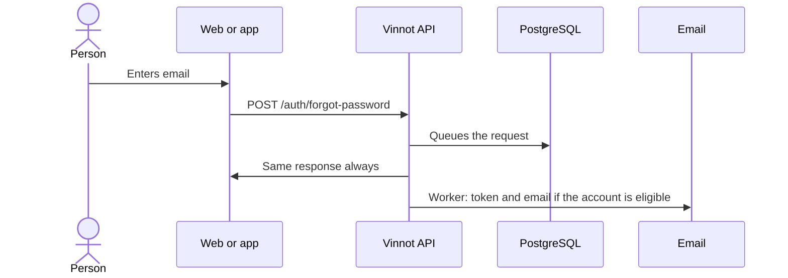

# UC-USR-09 · Request password recovery

| Field | Value |
|---|---|
| ID | `UC-USR-09` |
| Module | [Users and account](../README.md) |
| Platforms | Web, APK |
| Actors | Visitor, Email service |
| Lucidchart IDs | [WEB UC-AUTH-09](https://lucid.app/lucidchart/9f11a16b-bb5a-42fc-a9e8-0852b17bd241/edit), [APK UC-AUTH-09](https://lucid.app/lucidchart/e095dd25-e8ac-41ba-bf5b-396e1055f217/edit) |
| Requirements | [`RF-WEB-USR-14`](../requirements.md), [`RF-APK-USR-16`](../requirements.md) |
| Test cases | [`CP-USR-27`](../testing.md), [`CP-USR-28`](../testing.md) |

## Preconditions

- The person does not remember their password.

## Postconditions

- If the account is active and not locked, it receives a link to reset the password.

## Main flow

1. The person enters their email.
2. The API normalizes the email and queues the request without looking up the account.
3. The client shows the same confirmation in every case.
4. The worker looks up the account and, if eligible, issues the token and queues the email.

## Alternative flows

- 4a. Unknown email or ineligible account: nothing happens.

## Business rules

- Neither the response, its timing nor email provider errors reveal whether the account exists.
- The reset token lasts 60 minutes.
- The email address is never written to logs.

## Diagram

[View the full “UC-USR-09 · Request password recovery” diagram](https://images.vinnot.com/docs/diagrams/v1/en/modules-users-use-cases-uc-usr-09-request-password-recovery-31ebc5a480ea.svg)

Component diagram in Lucidchart: [WEB UC-AUTH-09](https://lucid.app/lucidchart/9f11a16b-bb5a-42fc-a9e8-0852b17bd241/edit), [APK UC-AUTH-09](https://lucid.app/lucidchart/e095dd25-e8ac-41ba-bf5b-396e1055f217/edit).

## Code

| Layer | Location |
|---|---|
| Endpoints | `POST /auth/forgot-password` |
| Backend | [`AuthController.java`](../../../../../backend/src/main/java/com/vinnot/user/infrastructure/web/controller/AuthController.java), [`ForgotPasswordCommandHandler.java`](../../../../../backend/src/main/java/com/vinnot/user/application/command/handler/ForgotPasswordCommandHandler.java), [`IssueAccountRecoveryService.java`](../../../../../backend/src/main/java/com/vinnot/user/application/service/IssueAccountRecoveryService.java) |
| Web | [`ForgotPasswordPage.tsx`](../../../../../frontend-react/src/presentation/pages/public/ForgotPasswordPage.tsx), [`useAccountActionViewModels.ts`](../../../../../frontend-react/src/presentation/pages/public/useAccountActionViewModels.ts) |
| App | `frontend-mobile/app/(auth)/forgot-password.tsx`, [`AccountActionViews.tsx`](../../../../../frontend-mobile/src/presentation/features/auth/AccountActionViews.tsx) |

## Automated tests

- Backend: [`AccountActionCommandHandlersTest.java`](../../../../../backend/src/test/java/com/vinnot/user/application/command/handler/AccountActionCommandHandlersTest.java), [`AccountRecoveryPostgresIntegrationTest.java`](../../../../../backend/src/test/java/com/vinnot/user/application/AccountRecoveryPostgresIntegrationTest.java)
- Web: [`authErrorViewModels.test.tsx`](../../../../../frontend-react/src/presentation/pages/public/authErrorViewModels.test.tsx)
- App: None
