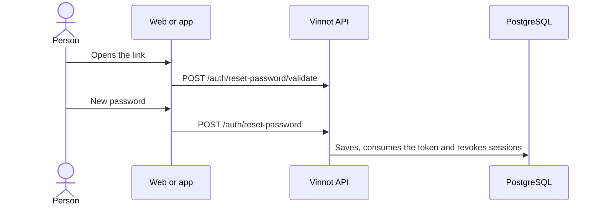

# UC-USR-10 · Reset the password from the link

| Field | Value |
|---|---|
| ID | `UC-USR-10` |
| Module | [Users and account](../README.md) |
| Platforms | Web, APK |
| Actors | Visitor |
| Lucidchart IDs | [WEB UC-AUTH-10](https://lucid.app/lucidchart/9f11a16b-bb5a-42fc-a9e8-0852b17bd241/edit), [APK UC-AUTH-10](https://lucid.app/lucidchart/e095dd25-e8ac-41ba-bf5b-396e1055f217/edit) |
| Requirements | [`RF-WEB-USR-15`](../requirements.md), [`RF-APK-USR-17`](../requirements.md) |
| Test cases | [`CP-USR-29`](../testing.md), [`CP-USR-30`](../testing.md), [`CP-USR-31`](../testing.md) |

## Preconditions

- The person received a reset link.

## Postconditions

- The password changes, the token is consumed and previous sessions are revoked.

## Main flow

1. The person opens the link.
2. The client validates the token before showing the form.
3. The person enters the new password and its confirmation.
4. The API validates the token, applies the password policy, saves and consumes the token.

## Alternative flows

- 2a. The token is invalid, used or expired: the client reports it when the link opens, does not show the form and offers to request a new link.
- 4a. Invalid, used or expired token: the password does not change.

## Business rules

- Changing the password increments `sessionVersion`: tokens issued before stop working.

## Diagram

[View the full “UC-USR-10 · Reset the password from the link” diagram](https://images.vinnot.com/docs/diagrams/v1/en/modules-users-use-cases-uc-usr-10-reset-password-dc2408c9c54c.svg)

Component diagram in Lucidchart: [WEB UC-AUTH-10](https://lucid.app/lucidchart/9f11a16b-bb5a-42fc-a9e8-0852b17bd241/edit), [APK UC-AUTH-10](https://lucid.app/lucidchart/e095dd25-e8ac-41ba-bf5b-396e1055f217/edit).

## Code

| Layer | Location |
|---|---|
| Endpoints | `POST /auth/reset-password/validate`, `POST /auth/reset-password` |
| Backend | [`AuthController.java`](../../../../../backend/src/main/java/com/vinnot/user/infrastructure/web/controller/AuthController.java), [`ResetPasswordCommandHandler.java`](../../../../../backend/src/main/java/com/vinnot/user/application/command/handler/ResetPasswordCommandHandler.java), [`ValidatePasswordResetTokenQueryHandler.java`](../../../../../backend/src/main/java/com/vinnot/user/application/query/handler/ValidatePasswordResetTokenQueryHandler.java) |
| Web | [`ResetPasswordPage.tsx`](../../../../../frontend-react/src/presentation/pages/public/ResetPasswordPage.tsx), [`useAccountActionViewModels.ts`](../../../../../frontend-react/src/presentation/pages/public/useAccountActionViewModels.ts) |
| App | `frontend-mobile/app/(auth)/reset-password.tsx`, [`AccountActionViews.tsx`](../../../../../frontend-mobile/src/presentation/features/auth/AccountActionViews.tsx) |

## Automated tests

- Backend: [`AccountActionCommandHandlersTest.java`](../../../../../backend/src/test/java/com/vinnot/user/application/command/handler/AccountActionCommandHandlersTest.java), [`UserCatalogQueryHandlersTest.java`](../../../../../backend/src/test/java/com/vinnot/user/application/query/handler/UserCatalogQueryHandlersTest.java), [`SessionAccessHttpPostgresIntegrationTest.java`](../../../../../backend/src/test/java/com/vinnot/shared/infrastructure/SessionAccessHttpPostgresIntegrationTest.java)
- Web: None
- App: [`resetPasswordRoute.test.tsx`](../../../../../frontend-mobile/src/presentation/features/auth/__tests__/resetPasswordRoute.test.tsx), [`auth.service.test.ts`](../../../../../frontend-mobile/src/application/services/auth.service.test.ts)
