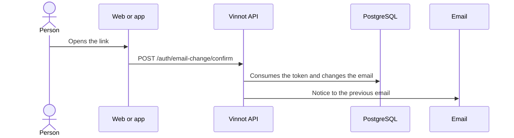

# UC-USR-11 · Confirm the email change from the link

| Field | Value |
|---|---|
| ID | `UC-USR-11` |
| Module | [Users and account](../README.md) |
| Platforms | Web |
| Actors | Signed-in user, Email service |
| Lucidchart IDs | [WEB UC-AUTH-11](https://lucid.app/lucidchart/9f11a16b-bb5a-42fc-a9e8-0852b17bd241/edit) |
| Requirements | [`RF-WEB-USR-16`](../requirements.md) |
| Test cases | [`CP-USR-32`](../testing.md), [`CP-USR-33`](../testing.md) |

## Preconditions

- An email change was requested (UC-USR-17).

## Postconditions

- The new email replaces the previous one as the verified identity; the previous address is notified.

## Main flow

1. The person opens the link sent to the new email.
2. The web sends the token to the API.
3. The API validates the single-use token, checks again that the email is free and changes the email.
4. The API revokes previous sessions and queues the notice to the previous email.

## Alternative flows

- 3a. Invalid, used or expired token, or email already taken: the email does not change.

## Business rules

- Only the web has this screen; links point to the web even when the request was made from the app.
- The email change token lasts 60 minutes.

## Diagram

[View the full “UC-USR-11 · Confirm the email change from the link” diagram](https://images.vinnot.com/docs/diagrams/v1/en/modules-users-use-cases-uc-usr-11-confirm-email-change-3316d4dcb8f3.svg)

Component diagram in Lucidchart: [WEB UC-AUTH-11](https://lucid.app/lucidchart/9f11a16b-bb5a-42fc-a9e8-0852b17bd241/edit).

## Code

| Layer | Location |
|---|---|
| Endpoints | `POST /auth/email-change/confirm` |
| Backend | [`AuthController.java`](../../../../../backend/src/main/java/com/vinnot/user/infrastructure/web/controller/AuthController.java), [`ConfirmEmailChangeCommandHandler.java`](../../../../../backend/src/main/java/com/vinnot/user/application/command/handler/ConfirmEmailChangeCommandHandler.java), [`AccountActionTokenService.java`](../../../../../backend/src/main/java/com/vinnot/user/application/service/AccountActionTokenService.java) |
| Web | [`ConfirmEmailChangePage.tsx`](../../../../../frontend-react/src/presentation/pages/public/ConfirmEmailChangePage.tsx), [`useAccountActionViewModels.ts`](../../../../../frontend-react/src/presentation/pages/public/useAccountActionViewModels.ts) |

## Automated tests

- Backend: [`EmailChangeCommandHandlersTest.java`](../../../../../backend/src/test/java/com/vinnot/user/application/command/handler/EmailChangeCommandHandlersTest.java), [`AccountEmailOutagePostgresIntegrationTest.java`](../../../../../backend/src/test/java/com/vinnot/user/application/AccountEmailOutagePostgresIntegrationTest.java)
- Web: None
- App: None
