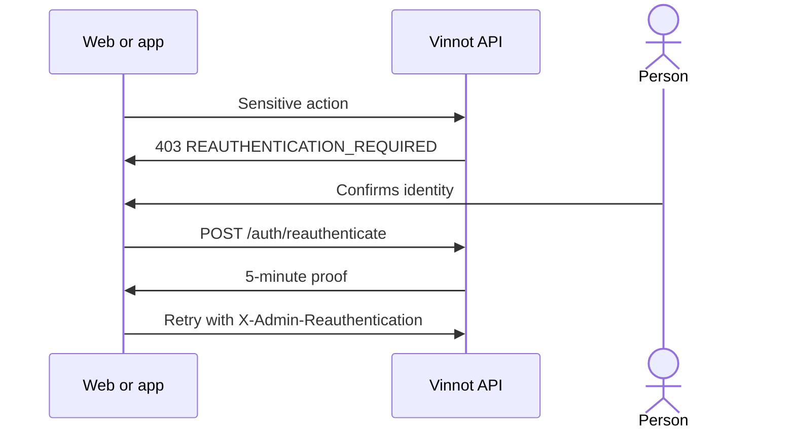

# UC-USR-12 · Confirm identity for a sensitive action

| Field | Value |
|---|---|
| ID | `UC-USR-12` |
| Module | [Users and account](../README.md) |
| Platforms | Web, APK |
| Actors | Signed-in user, Identity provider (Google or Apple) |
| Lucidchart IDs | [WEB UC-AUTH-12](https://lucid.app/lucidchart/9f11a16b-bb5a-42fc-a9e8-0852b17bd241/edit) |
| Requirements | None |
| Test cases | [`CP-USR-34`](../testing.md), [`CP-USR-35`](../testing.md), [`CP-USR-36`](../testing.md) |

## Preconditions

- The person attempts a sensitive action: changing their email, deleting their account or, as ADMIN, changing users, roles or locks, or deleting resources.

## Postconditions

- The pending action runs once with a proof valid for five minutes.

## Main flow

1. The API answers `403 REAUTHENTICATION_REQUIRED`.
2. The client renews the access token and opens the confirmation dialog.
3. The person confirms with their password or, if Google or Apple is linked, with that provider.
4. The API issues a signed proof bound to the user and the current access token.
5. The client retries the action once with the `X-Admin-Reauthentication` header.

## Alternative flows

- 3a. Password or credential rejected: the dialog stays open and offers password recovery.
- 3b. Cancel, leave or switch account: the proof is discarded and the action does not run.

## Business rules

- The proof lives only in memory.
- Deactivating the account does not ask for identity confirmation.

## Diagram

[View the full “UC-USR-12 · Confirm identity for a sensitive action” diagram](https://images.vinnot.com/docs/diagrams/v1/en/modules-users-use-cases-uc-usr-12-reauthenticate-7b5a0d7ac525.svg)

Component diagram in Lucidchart: [WEB UC-AUTH-12](https://lucid.app/lucidchart/9f11a16b-bb5a-42fc-a9e8-0852b17bd241/edit).

## Code

| Layer | Location |
|---|---|
| Endpoints | `POST /auth/reauthenticate` |
| Backend | [`ReauthenticationController.java`](../../../../../backend/src/main/java/com/vinnot/user/infrastructure/web/controller/ReauthenticationController.java), [`ReauthenticateCommandHandler.java`](../../../../../backend/src/main/java/com/vinnot/user/application/command/handler/ReauthenticateCommandHandler.java), [`SignedReauthenticationProofAdapter.java`](../../../../../backend/src/main/java/com/vinnot/user/infrastructure/security/SignedReauthenticationProofAdapter.java), [`AdminSensitiveActionInterceptor.java`](../../../../../backend/src/main/java/com/vinnot/admin/infrastructure/web/AdminSensitiveActionInterceptor.java) |
| Web | [`ReauthenticationDialog.tsx`](../../../../../frontend-react/src/presentation/components/auth/ReauthenticationDialog.tsx), [`useReauthentication.ts`](../../../../../frontend-react/src/presentation/hooks/useReauthentication.ts), [`reauthentication.service.ts`](../../../../../frontend-react/src/application/services/reauthentication.service.ts) |
| App | [`ReauthenticationDialog.tsx`](../../../../../frontend-mobile/src/presentation/features/auth/ReauthenticationDialog.tsx), [`useReauthentication.ts`](../../../../../frontend-mobile/src/presentation/hooks/useReauthentication.ts), [`reauthentication.service.ts`](../../../../../frontend-mobile/src/application/services/reauthentication.service.ts) |

## Automated tests

- Backend: [`ReauthenticateCommandHandlerTest.java`](../../../../../backend/src/test/java/com/vinnot/user/application/command/handler/ReauthenticateCommandHandlerTest.java), [`ReauthenticationControllerTest.java`](../../../../../backend/src/test/java/com/vinnot/user/infrastructure/web/controller/ReauthenticationControllerTest.java), [`SignedReauthenticationProofAdapterTest.java`](../../../../../backend/src/test/java/com/vinnot/user/infrastructure/security/SignedReauthenticationProofAdapterTest.java), [`ProviderReauthenticationHttpPostgresIntegrationTest.java`](../../../../../backend/src/test/java/com/vinnot/user/infrastructure/web/ProviderReauthenticationHttpPostgresIntegrationTest.java), [`AdminSensitiveActionInterceptorTest.java`](../../../../../backend/src/test/java/com/vinnot/admin/infrastructure/web/AdminSensitiveActionInterceptorTest.java)
- Web: [`ReauthenticationDialog.test.tsx`](../../../../../frontend-react/src/presentation/components/auth/ReauthenticationDialog.test.tsx), [`useReauthentication.test.ts`](../../../../../frontend-react/src/presentation/hooks/useReauthentication.test.ts), [`reauthentication.service.test.ts`](../../../../../frontend-react/src/application/services/reauthentication.service.test.ts)
- App: [`ReauthenticationDialog.test.tsx`](../../../../../frontend-mobile/src/presentation/features/auth/ReauthenticationDialog.test.tsx), [`admin-role-reauthentication.test.tsx`](../../../../../frontend-mobile/src/test/integration/admin-role-reauthentication.test.tsx)
