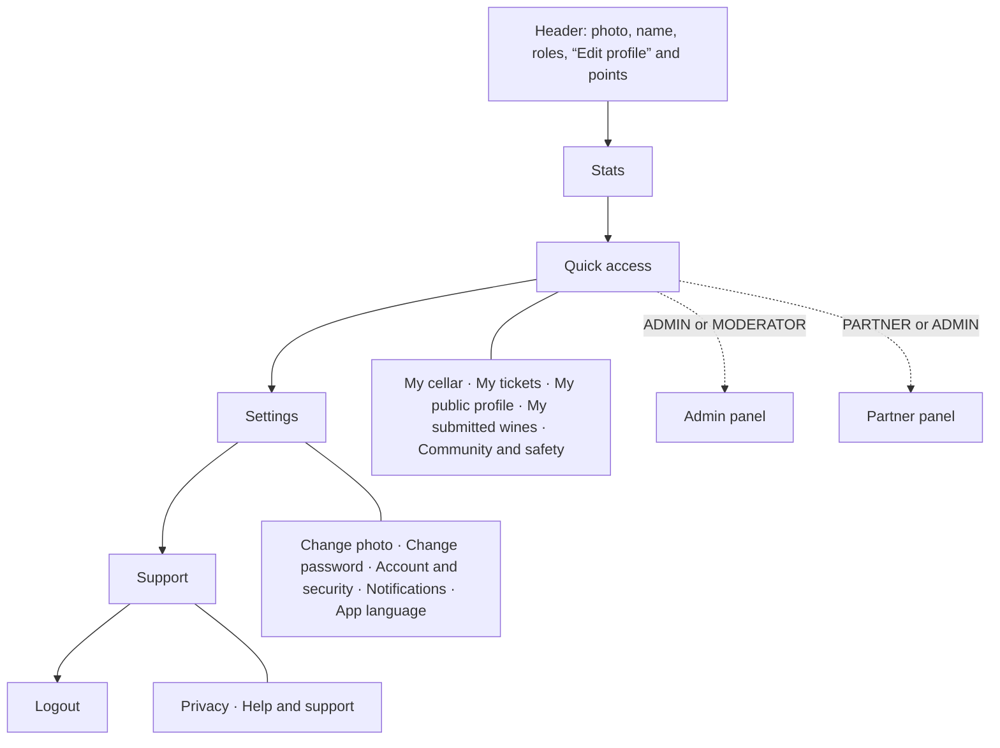
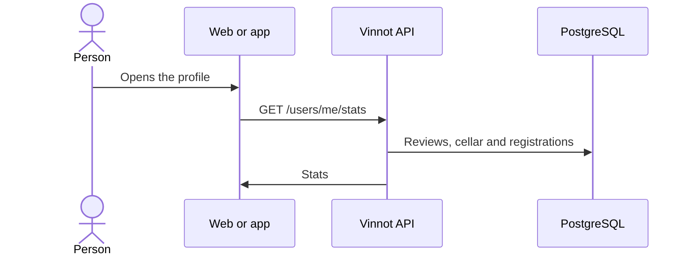

# UC-USR-13 · View the profile, roles and stats

| Field | Value |
|---|---|
| ID | `UC-USR-13` |
| Module | [Users and account](../README.md) |
| Platforms | Web, APK |
| Actors | Signed-in user |
| Lucidchart IDs | [WEB UC-ACC-01](https://lucid.app/lucidchart/9f11a16b-bb5a-42fc-a9e8-0852b17bd241/edit), [APK UC-ACC-01](https://lucid.app/lucidchart/e095dd25-e8ac-41ba-bf5b-396e1055f217/edit) |
| Requirements | [`RF-WEB-USR-17`](../requirements.md), [`RF-WEB-USR-18`](../requirements.md), [`RF-APK-USR-18`](../requirements.md), [`RF-APK-USR-19`](../requirements.md), [`RF-APK-USR-20`](../requirements.md), [`RF-APK-USR-36`](../requirements.md) |
| Test cases | [`CP-USR-37`](../testing.md), [`CP-USR-70`](../testing.md) |

## Preconditions

- There is an active session.

## Postconditions

- Identity, status, roles and stats are shown, without changing anything.

## Main flow

1. The person opens their profile.
2. The client uses the identity from `GET /auth/me` and requests `GET /users/me/stats`.
3. The API adds up reviews and average rating, cellar wines and event registrations through ports of other modules.
4. The client shows the data, in each platform's order (see Business rules).

## Alternative flows

- R1. In the app, the person taps a quick-access item: it opens their cellar, their tickets, their public profile (`/users/{id}`, where their followers and following live), the tracking of their submitted wines, “Community and safety” or, by role, the admin panel or the partner panel.

## Business rules

- In the app, Events and Routes appear only for PARTNER or ADMIN; the cellar card opens the cellar even when empty.
- In the app, the own profile goes from the most used items to settings, top to bottom:
  1. header with photo, name, email, roles, “Edit profile” and points;
  2. “Stats”;
  3. “Quick access”: “My cellar”, “My tickets”, “My public profile”, “My submitted wines” (tracking of wine proposals, [UC-WIN-09](../../wines/use-cases/uc-win-09-track-submissions.md)) and “Community and safety”; ADMIN and MODERATOR also get “Admin panel”, and PARTNER and ADMIN, “Partner panel”;
  4. “Settings”: “Change photo”, “Change password” (“Create password” for an account without its own password, which requests the link by email), “Account and security”, “Notifications” and “App language”;
  5. “Support”: “Privacy” and “Help and support”;
  6. “Logout”.
- On the web, the header shows photo, name, `@username`, roles, sign-up date, points and three counters (reviews, cellar and events); below it come the “Community and safety” link and the tabs “Profile” (personal data and the “Public profile” card, with “View my public profile”, bio and cellar visibility), “Statistics”, “Security”, “Notifications” and “Account”.
- `eventsAttended` counts registrations, not actual attendance.
- Roles are exposed with the `ROLE_` prefix.
- The profile header shows the seal, the points, the tier name and a progress bar to the next tier (`GET /users/me/points`); tapping the seal opens “Your points” with how to earn, recent entries and the full ladder ([Points and seals](../../gamification/README.md)).

## Diagram

Order of the own profile in the app:

[View the full “UC-USR-13 · View the profile, roles and stats” diagram](https://images.vinnot.com/docs/diagrams/v1/en/modules-users-use-cases-uc-usr-13-view-profile-f77ca493356b.svg)

Stats request:

[View the full “UC-USR-13 · View the profile, roles and stats” diagram](https://images.vinnot.com/docs/diagrams/v1/en/modules-users-use-cases-uc-usr-13-view-profile-6243bed0eb68.svg)

Component diagram in Lucidchart: [WEB UC-ACC-01](https://lucid.app/lucidchart/9f11a16b-bb5a-42fc-a9e8-0852b17bd241/edit), [APK UC-ACC-01](https://lucid.app/lucidchart/e095dd25-e8ac-41ba-bf5b-396e1055f217/edit).

## Code

| Layer | Location |
|---|---|
| Endpoints | `GET /auth/me`, `GET /users/me/stats` |
| Backend | [`AuthController.java`](../../../../../backend/src/main/java/com/vinnot/user/infrastructure/web/controller/AuthController.java), [`UserController.java`](../../../../../backend/src/main/java/com/vinnot/user/infrastructure/web/controller/UserController.java), [`GetUserStatsQueryHandler.java`](../../../../../backend/src/main/java/com/vinnot/user/application/query/handler/GetUserStatsQueryHandler.java) |
| Web | [`UserProfilePage.tsx`](../../../../../frontend-react/src/presentation/pages/user/UserProfilePage.tsx), [`UserProfileStatsTab.tsx`](../../../../../frontend-react/src/presentation/pages/user/UserProfileStatsTab.tsx), [`useUserStats.ts`](../../../../../frontend-react/src/presentation/hooks/queries/user/useUserStats.ts) |
| App | [`ProfileScreen.tsx`](../../../../../frontend-mobile/src/presentation/features/profile/ProfileScreen.tsx), [`ProfileHero.tsx`](../../../../../frontend-mobile/src/presentation/features/user/ProfileHero.tsx), [`StatsRow.tsx`](../../../../../frontend-mobile/src/presentation/features/user/StatsRow.tsx) |

## Automated tests

- Backend: [`UserCatalogQueryHandlersTest.java`](../../../../../backend/src/test/java/com/vinnot/user/application/query/handler/UserCatalogQueryHandlersTest.java)
- Web: [`users.service.test.ts`](../../../../../frontend-react/src/application/services/users.service.test.ts)
- App: [`StatsRow.test.tsx`](../../../../../frontend-mobile/src/presentation/features/user/StatsRow.test.tsx), [`profileRoute.test.tsx`](../../../../../frontend-mobile/src/presentation/features/profile/__tests__/profileRoute.test.tsx)
