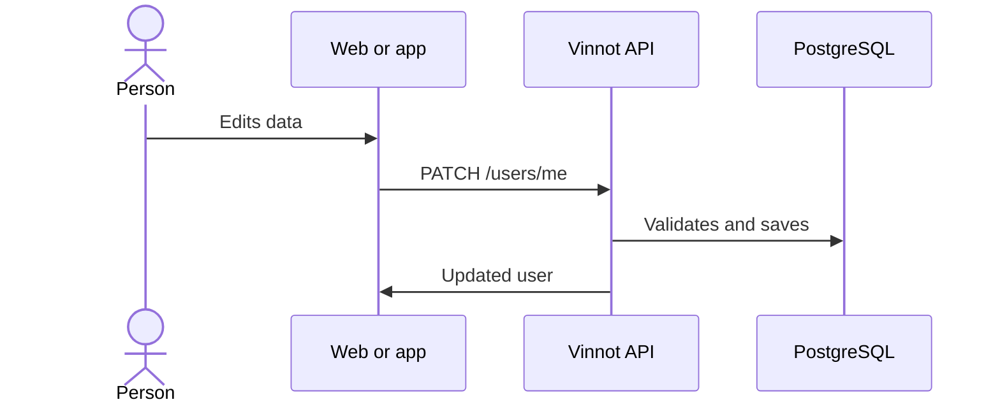

# UC-USR-14 · Edit personal data

| Field | Value |
|---|---|
| ID | `UC-USR-14` |
| Module | [Users and account](../README.md) |
| Platforms | Web, APK |
| Actors | Signed-in user |
| Lucidchart IDs | [WEB UC-ACC-02](https://lucid.app/lucidchart/9f11a16b-bb5a-42fc-a9e8-0852b17bd241/edit), [APK UC-ACC-02](https://lucid.app/lucidchart/e095dd25-e8ac-41ba-bf5b-396e1055f217/edit) |
| Requirements | [`RF-WEB-USR-19`](../requirements.md), [`RF-APK-USR-21`](../requirements.md) |
| Test cases | [`CP-USR-38`](../testing.md), [`CP-USR-39`](../testing.md), [`CP-USR-40`](../testing.md), [`CP-USR-41`](../testing.md) |

## Preconditions

- There is an active session.

## Postconditions

- Username, names and phone are saved.

## Main flow

1. The person edits username, first name, last name or phone.
2. The client validates and sends `PATCH /users/me`.
3. The API normalizes the username and checks it is free if it changed, normalizes the phone to E.164 and saves.
4. The client shows the updated profile.

## Alternative flows

- 3a. Username taken or invalid: nothing is saved.
- 3b. Phone without `+` and country code, or invalid: nothing is saved.
- 3c. Another write saved first: `409 CONCURRENT_UPDATE`, without overwriting it.

## Business rules

- An absent or `null` field keeps its value; an empty phone removes it.
- The email is not changed here (UC-USR-17).
- The phone is private: it does not appear in the public profile.

## Diagram

[View the full “UC-USR-14 · Edit personal data” diagram](https://images.vinnot.com/docs/diagrams/v1/en/modules-users-use-cases-uc-usr-14-edit-profile-16606c515663.svg)

Component diagram in Lucidchart: [WEB UC-ACC-02](https://lucid.app/lucidchart/9f11a16b-bb5a-42fc-a9e8-0852b17bd241/edit), [APK UC-ACC-02](https://lucid.app/lucidchart/e095dd25-e8ac-41ba-bf5b-396e1055f217/edit).

## Code

| Layer | Location |
|---|---|
| Endpoints | `PATCH /users/me` |
| Backend | [`UserController.java`](../../../../../backend/src/main/java/com/vinnot/user/infrastructure/web/controller/UserController.java), [`UpdateUserProfileCommandHandler.java`](../../../../../backend/src/main/java/com/vinnot/user/application/command/handler/UpdateUserProfileCommandHandler.java) |
| Web | [`UserProfileProfileTab.tsx`](../../../../../frontend-react/src/presentation/pages/user/UserProfileProfileTab.tsx), [`useUserProfileViewModel.ts`](../../../../../frontend-react/src/presentation/pages/user/useUserProfileViewModel.ts), [`useUpdateProfile.ts`](../../../../../frontend-react/src/presentation/hooks/queries/user/useUpdateProfile.ts) |
| App | [`EditProfileSheet.tsx`](../../../../../frontend-mobile/src/presentation/features/user/EditProfileSheet.tsx) |

## Automated tests

- Backend: [`UpdateUserProfileCommandHandlerTest.java`](../../../../../backend/src/test/java/com/vinnot/user/application/command/handler/UpdateUserProfileCommandHandlerTest.java), [`UserTest.java`](../../../../../backend/src/test/java/com/vinnot/user/domain/model/UserTest.java), [`UserPersistenceMapperTest.java`](../../../../../backend/src/test/java/com/vinnot/user/infrastructure/persistence/mapper/UserPersistenceMapperTest.java)
- Web: [`contactPhone.test.ts`](../../../../../frontend-react/src/domain/user/contactPhone.test.ts), [`user.validators.test.ts`](../../../../../frontend-react/src/domain/user/user.validators.test.ts)
- App: [`contactPhone.test.ts`](../../../../../frontend-mobile/src/domain/user/contactPhone.test.ts)
