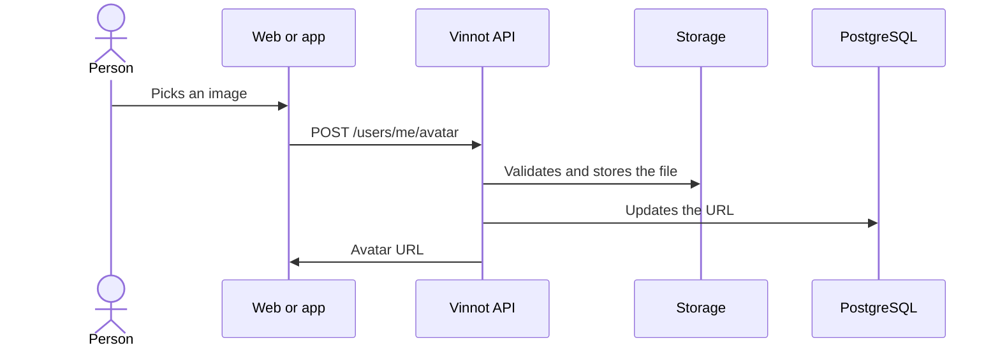

# UC-USR-15 · Change the avatar

| Field | Value |
|---|---|
| ID | `UC-USR-15` |
| Module | [Users and account](../README.md) |
| Platforms | Web, APK |
| Actors | Signed-in user |
| Lucidchart IDs | [WEB UC-ACC-03](https://lucid.app/lucidchart/9f11a16b-bb5a-42fc-a9e8-0852b17bd241/edit), [APK UC-ACC-03](https://lucid.app/lucidchart/e095dd25-e8ac-41ba-bf5b-396e1055f217/edit) |
| Requirements | [`RF-WEB-USR-20`](../requirements.md), [`RF-APK-USR-22`](../requirements.md) |
| Test cases | [`CP-USR-42`](../testing.md), [`CP-USR-43`](../testing.md), [`CP-USR-44`](../testing.md), [`CP-USR-45`](../testing.md) |

## Preconditions

- There is an active session.

## Postconditions

- The new avatar is saved and the previous one is scheduled for deletion.

## Main flow

1. The person picks an image: on the web a file (a URL cannot be entered), in the app the camera or the gallery.
2. The person adjusts the photo in a square frame with a round mask (drags and zooms it) and confirms with **Use photo**; the client crops that area on the device (#516).
3. The client uploads the cropped image with `POST /users/me/avatar`.
4. The API validates size, signature and format, stores the file and updates the user's URL.
5. After saving, the API schedules deletion of the previous avatar.
6. The client shows the new avatar.

## Alternative flows

- 1a. In the app, the person denies permission or cancels: the current avatar is kept.
- 2a. The person cancels the adjust step: nothing is uploaded and the current avatar is kept.
- 4a. Invalid file: nothing is saved.
- 4b. Persistence fails: removal of the new file is requested and the error is reported.

## Business rules

- User images are stored in R2 as WebP.
- Deletions are queued and the worker checks references again before deleting.

## Diagram

[View the full “UC-USR-15 · Change the avatar” diagram](https://images.vinnot.com/docs/diagrams/v1/en/modules-users-use-cases-uc-usr-15-change-avatar-b6799ac2eded.svg)

Component diagram in Lucidchart: [WEB UC-ACC-03](https://lucid.app/lucidchart/9f11a16b-bb5a-42fc-a9e8-0852b17bd241/edit), [APK UC-ACC-03](https://lucid.app/lucidchart/e095dd25-e8ac-41ba-bf5b-396e1055f217/edit).

## Code

| Layer | Location |
|---|---|
| Endpoints | `POST /users/me/avatar` |
| Backend | [`UserController.java`](../../../../../backend/src/main/java/com/vinnot/user/infrastructure/web/controller/UserController.java), [`UploadUserAvatarCommandHandler.java`](../../../../../backend/src/main/java/com/vinnot/user/application/command/handler/UploadUserAvatarCommandHandler.java) |
| Web | [`useUserProfileViewModel.ts`](../../../../../frontend-react/src/presentation/pages/user/useUserProfileViewModel.ts), [`useUploadAvatar.ts`](../../../../../frontend-react/src/presentation/hooks/queries/user/useUploadAvatar.ts) |
| App | [`AvatarPickerSheet.tsx`](../../../../../frontend-mobile/src/presentation/features/user/AvatarPickerSheet.tsx), [`avatarSelection.service.ts`](../../../../../frontend-mobile/src/application/services/avatarSelection.service.ts), [`imagePicker.gateway.ts`](../../../../../frontend-mobile/src/infrastructure/device/imagePicker.gateway.ts) |

## Automated tests

- Backend: [`UploadUserAvatarCommandHandlerTest.java`](../../../../../backend/src/test/java/com/vinnot/user/application/command/handler/UploadUserAvatarCommandHandlerTest.java)
- Web: [`users.service.test.ts`](../../../../../frontend-react/src/application/services/users.service.test.ts)
- App: [`avatarSelection.service.test.ts`](../../../../../frontend-mobile/src/application/services/avatarSelection.service.test.ts), [`imagePicker.gateway.test.ts`](../../../../../frontend-mobile/src/infrastructure/device/imagePicker.gateway.test.ts)
