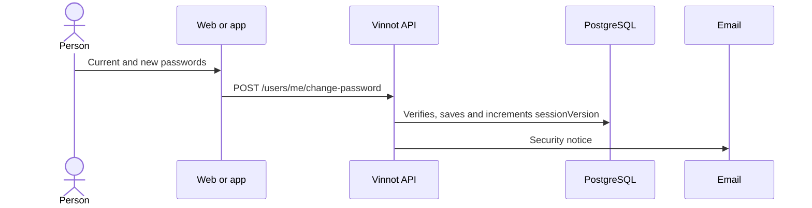

# UC-USR-16 · Change or set the password

| Field | Value |
|---|---|
| ID | `UC-USR-16` |
| Module | [Users and account](../README.md) |
| Platforms | Web, APK |
| Actors | Signed-in user, Email service |
| Lucidchart IDs | [WEB UC-ACC-04](https://lucid.app/lucidchart/9f11a16b-bb5a-42fc-a9e8-0852b17bd241/edit), [APK UC-ACC-04](https://lucid.app/lucidchart/e095dd25-e8ac-41ba-bf5b-396e1055f217/edit) |
| Requirements | [`RF-WEB-USR-21`](../requirements.md), [`RF-APK-USR-23`](../requirements.md) |
| Test cases | [`CP-USR-46`](../testing.md), [`CP-USR-47`](../testing.md), [`CP-USR-48`](../testing.md), [`CP-USR-68`](../testing.md) |

## Preconditions

- There is an active session.

## Postconditions

- The password changes and sessions issued before are revoked; an email notice is sent.

## Main flow

1. The person enters the current password, the new one and its confirmation.
2. The API compares the current password with the stored one, validates the new one and saves.
3. The API increments `sessionVersion` and queues the security notice.

## Alternative flows

- 2a. Wrong current password: nothing changes.
- 1a. The account has no password of its own (`hasPassword` false, for example an account created with Google or Apple): instead of the form, an email link to set the password is offered (it uses `/auth/forgot-password`).
- 1b. The account linked Google or Apple but has its own password (`hasPassword` true): the change form is shown, as for any local account.

## Business rules

- The new password is 8 to 100 characters long and follows the `Password` policy.

## Diagram

[View the full “UC-USR-16 · Change or set the password” diagram](https://images.vinnot.com/docs/diagrams/v1/en/modules-users-use-cases-uc-usr-16-change-password-978fc6bfe4b9.svg)

Component diagram in Lucidchart: [WEB UC-ACC-04](https://lucid.app/lucidchart/9f11a16b-bb5a-42fc-a9e8-0852b17bd241/edit), [APK UC-ACC-04](https://lucid.app/lucidchart/e095dd25-e8ac-41ba-bf5b-396e1055f217/edit).

## Code

| Layer | Location |
|---|---|
| Endpoints | `POST /users/me/change-password`, `POST /auth/forgot-password` |
| Backend | [`UserController.java`](../../../../../backend/src/main/java/com/vinnot/user/infrastructure/web/controller/UserController.java), [`ChangePasswordCommandHandler.java`](../../../../../backend/src/main/java/com/vinnot/user/application/command/handler/ChangePasswordCommandHandler.java), [`AccountSecurityNoticeService.java`](../../../../../backend/src/main/java/com/vinnot/user/application/service/AccountSecurityNoticeService.java) |
| Web | [`UserProfileSecurityTab.tsx`](../../../../../frontend-react/src/presentation/pages/user/UserProfileSecurityTab.tsx), [`useChangePassword.ts`](../../../../../frontend-react/src/presentation/hooks/queries/user/useChangePassword.ts), [`useRequestPasswordSetup.ts`](../../../../../frontend-react/src/presentation/hooks/queries/user/useRequestPasswordSetup.ts) |
| App | [`ProfileScreen.tsx`](../../../../../frontend-mobile/src/presentation/features/profile/ProfileScreen.tsx), [`ChangePasswordSheet.tsx`](../../../../../frontend-mobile/src/presentation/features/user/ChangePasswordSheet.tsx) |

## Automated tests

- Backend: [`ChangePasswordCommandHandlerTest.java`](../../../../../backend/src/test/java/com/vinnot/user/application/command/handler/ChangePasswordCommandHandlerTest.java), [`AccountSecurityNoticeServiceTest.java`](../../../../../backend/src/test/java/com/vinnot/user/application/service/AccountSecurityNoticeServiceTest.java), [`UserTest.java`](../../../../../backend/src/test/java/com/vinnot/user/domain/model/UserTest.java), [`UserPasswordSetMigrationPostgresIntegrationTest.java`](../../../../../backend/src/test/java/com/vinnot/user/infrastructure/persistence/UserPasswordSetMigrationPostgresIntegrationTest.java)
- Web: [`UserProfileTabs.test.tsx`](../../../../../frontend-react/src/presentation/pages/user/UserProfileTabs.test.tsx), [`user.mappers.test.ts`](../../../../../frontend-react/src/domain/user/user.mappers.test.ts)
- App: [`profileRoute.test.tsx`](../../../../../frontend-mobile/src/presentation/features/profile/__tests__/profileRoute.test.tsx)
