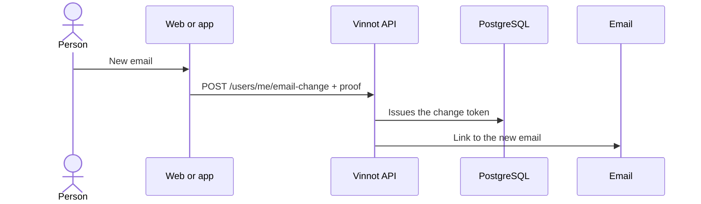

# UC-USR-17 · Request an email change

| Field | Value |
|---|---|
| ID | `UC-USR-17` |
| Module | [Users and account](../README.md) |
| Platforms | Web, APK |
| Actors | Signed-in user, Email service |
| Lucidchart IDs | [WEB UC-ACC-05](https://lucid.app/lucidchart/9f11a16b-bb5a-42fc-a9e8-0852b17bd241/edit), [APK UC-ACC-05](https://lucid.app/lucidchart/e095dd25-e8ac-41ba-bf5b-396e1055f217/edit) |
| Requirements | [`RF-WEB-USR-22`](../requirements.md), [`RF-APK-USR-24`](../requirements.md) |
| Test cases | [`CP-USR-49`](../testing.md), [`CP-USR-50`](../testing.md) |

## Preconditions

- There is an active session.

## Postconditions

- A confirmation link is sent to the new email; the current email stays valid until confirmation.

## Main flow

1. The person enters the new email.
2. The API asks to confirm identity (UC-USR-12).
3. The API validates that the email is valid, different and free, issues the token and queues the email.
4. The client reports that confirmation is needed from the new email (UC-USR-11).

## Alternative flows

- 3a. Invalid email, same as the current one or already registered: nothing is sent.

## Business rules

- Updating the field does not verify the email: the identity changes only on confirmation.

## Diagram

[View the full “UC-USR-17 · Request an email change” diagram](https://images.vinnot.com/docs/diagrams/v1/en/modules-users-use-cases-uc-usr-17-request-email-change-f98a8608e3e8.svg)

Component diagram in Lucidchart: [WEB UC-ACC-05](https://lucid.app/lucidchart/9f11a16b-bb5a-42fc-a9e8-0852b17bd241/edit), [APK UC-ACC-05](https://lucid.app/lucidchart/e095dd25-e8ac-41ba-bf5b-396e1055f217/edit).

## Code

| Layer | Location |
|---|---|
| Endpoints | `POST /users/me/email-change` |
| Backend | [`UserController.java`](../../../../../backend/src/main/java/com/vinnot/user/infrastructure/web/controller/UserController.java), [`RequestEmailChangeCommandHandler.java`](../../../../../backend/src/main/java/com/vinnot/user/application/command/handler/RequestEmailChangeCommandHandler.java) |
| Web | [`useUserProfileViewModel.ts`](../../../../../frontend-react/src/presentation/pages/user/useUserProfileViewModel.ts), [`useRequestEmailChange.ts`](../../../../../frontend-react/src/presentation/hooks/queries/user/useRequestEmailChange.ts), [`emailChangeErrorMessage.ts`](../../../../../frontend-react/src/presentation/feedback/emailChangeErrorMessage.ts) |
| App | [`ProfileScreen.tsx`](../../../../../frontend-mobile/src/presentation/features/profile/ProfileScreen.tsx), [`AccountSheet.tsx`](../../../../../frontend-mobile/src/presentation/features/user/AccountSheet.tsx) |

## Automated tests

- Backend: [`EmailChangeCommandHandlersTest.java`](../../../../../backend/src/test/java/com/vinnot/user/application/command/handler/EmailChangeCommandHandlersTest.java)
- Web: [`emailChangeErrorMessage.test.ts`](../../../../../frontend-react/src/presentation/feedback/emailChangeErrorMessage.test.ts), [`users.service.test.ts`](../../../../../frontend-react/src/application/services/users.service.test.ts)
- App: [`profileRoute.test.tsx`](../../../../../frontend-mobile/src/presentation/features/profile/__tests__/profileRoute.test.tsx)
