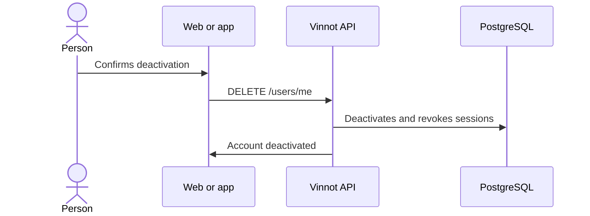

# UC-USR-18 · Deactivate the account

| Field | Value |
|---|---|
| ID | `UC-USR-18` |
| Module | [Users and account](../README.md) |
| Platforms | Web, APK |
| Actors | Signed-in user |
| Lucidchart IDs | [WEB UC-ACC-06](https://lucid.app/lucidchart/9f11a16b-bb5a-42fc-a9e8-0852b17bd241/edit), [APK UC-ACC-06](https://lucid.app/lucidchart/e095dd25-e8ac-41ba-bf5b-396e1055f217/edit) |
| Requirements | [`RF-WEB-USR-23`](../requirements.md), [`RF-APK-USR-25`](../requirements.md) |
| Test cases | [`CP-USR-51`](../testing.md), [`CP-USR-52`](../testing.md), [`CP-USR-53`](../testing.md) |

## Preconditions

- There is an active session.

## Postconditions

- The account is inactive, its sessions and push devices are removed and a notice is sent.

## Main flow

1. The person chooses to deactivate and confirms.
2. The API checks that it is not the last active administrator.
3. The API deactivates the account and removes refresh tokens and push devices.
4. The client signs out.

## Alternative flows

- 2a. It is the last active administrator: `422 LAST_ADMIN`.
- R1. The person signs in again: on the web or in the app they can reactivate the account (UC-USR-03, 3c).

## Business rules

- Deactivating is reversible and deletes no data.

## Diagram

[View the full “UC-USR-18 · Deactivate the account” diagram](https://images.vinnot.com/docs/diagrams/v1/en/modules-users-use-cases-uc-usr-18-deactivate-account-be795961bf9e.svg)

Component diagram in Lucidchart: [WEB UC-ACC-06](https://lucid.app/lucidchart/9f11a16b-bb5a-42fc-a9e8-0852b17bd241/edit), [APK UC-ACC-06](https://lucid.app/lucidchart/e095dd25-e8ac-41ba-bf5b-396e1055f217/edit).

## Code

| Layer | Location |
|---|---|
| Endpoints | `DELETE /users/me` |
| Backend | [`UserController.java`](../../../../../backend/src/main/java/com/vinnot/user/infrastructure/web/controller/UserController.java), [`DeactivateOwnAccountCommandHandler.java`](../../../../../backend/src/main/java/com/vinnot/user/application/command/handler/DeactivateOwnAccountCommandHandler.java), [`AdminUserSafety.java`](../../../../../backend/src/main/java/com/vinnot/user/application/service/AdminUserSafety.java) |
| Web | [`useUserProfileViewModel.ts`](../../../../../frontend-react/src/presentation/pages/user/useUserProfileViewModel.ts), [`useDeactivateAccount.ts`](../../../../../frontend-react/src/presentation/hooks/queries/user/useDeactivateAccount.ts) |
| App | [`ProfileScreen.tsx`](../../../../../frontend-mobile/src/presentation/features/profile/ProfileScreen.tsx) |

## Automated tests

- Backend: [`DeactivateOwnAccountCommandHandlerTest.java`](../../../../../backend/src/test/java/com/vinnot/user/application/command/handler/DeactivateOwnAccountCommandHandlerTest.java), [`AdminUserSafetyTest.java`](../../../../../backend/src/test/java/com/vinnot/user/application/service/AdminUserSafetyTest.java), [`AccountActionCommandHandlersTest.java`](../../../../../backend/src/test/java/com/vinnot/user/application/command/handler/AccountActionCommandHandlersTest.java)
- Web: [`useLoginViewModel.test.tsx`](../../../../../frontend-react/src/presentation/pages/public/useLoginViewModel.test.tsx)
- App: [`profileRoute.test.tsx`](../../../../../frontend-mobile/src/presentation/features/profile/__tests__/profileRoute.test.tsx), [`loginRoute.test.tsx`](../../../../../frontend-mobile/src/presentation/features/auth/__tests__/loginRoute.test.tsx)
