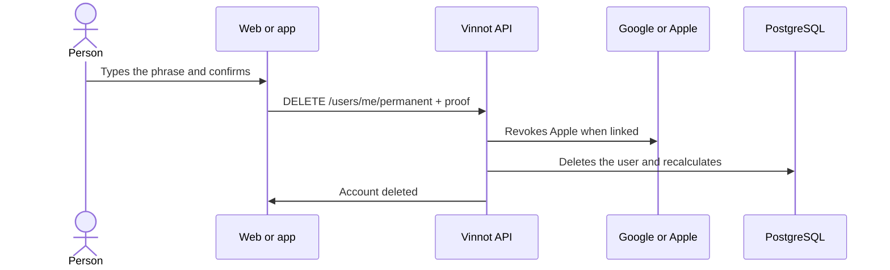

# UC-USR-19 · Delete the account permanently

| Field | Value |
|---|---|
| ID | `UC-USR-19` |
| Module | [Users and account](../README.md) |
| Platforms | Web, APK |
| Actors | Signed-in user, Identity provider (Google or Apple) |
| Lucidchart IDs | [WEB UC-ACC-07](https://lucid.app/lucidchart/9f11a16b-bb5a-42fc-a9e8-0852b17bd241/edit), [APK UC-ACC-07](https://lucid.app/lucidchart/e095dd25-e8ac-41ba-bf5b-396e1055f217/edit) |
| Requirements | [`RF-WEB-USR-24`](../requirements.md), [`RF-WEB-USR-25`](../requirements.md), [`RF-WEB-USR-26`](../requirements.md), [`RF-APK-USR-26`](../requirements.md), [`RF-APK-USR-27`](../requirements.md), [`RF-APK-USR-28`](../requirements.md) |
| Test cases | [`CP-USR-54`](../testing.md), [`CP-USR-55`](../testing.md), [`CP-USR-56`](../testing.md), [`CP-USR-57`](../testing.md), [`CP-USR-69`](../testing.md) |

## Preconditions

- There is an active session.

## Postconditions

- The account and its data are deleted; relations are resolved by the foreign keys and ratings, likes and capacity are recalculated.

## Main flow

1. The person chooses to delete and types the exact phrase ("acepto borrar cuenta" or "I agree to delete my account").
2. If Apple is linked, they authorize again with Apple.
3. The API asks to confirm identity (UC-USR-12).
4. In a single transaction, the API rejects the last administrator, revokes Apple when linked and deletes the user.
5. The client signs out and clears local data.

## Alternative flows

- 1a. The phrase does not match (only leading and trailing spaces are ignored): it cannot be sent.
- 4a. Apple authorization is missing or revocation fails: `APPLE_REAUTH_REQUIRED` and the account is not deleted.
- 4b. It is the last active administrator: `422 LAST_ADMIN`.
- 4c. They organize an event that is not cancelled or over and has paid or paying registrations: `422 ORGANIZER_HAS_UPCOMING_PAID_EVENTS`; web and app ask them to cancel those events first and the account is not deleted.

## Business rules

- Closing the dialog resets the phrase.
- Image cleanup is queued and the worker checks references before deleting.
- Private moderation evidence is kept for 90 days after closing.
- The account's points are deleted; the likes it gave are not taken back from the people who received them ([Points and seals](../../gamification/README.md)).
- Deleting an account does not delete its payments: payment attempts, observations and refunds where the person was buyer or organizer are kept as the financial history of the operation, with no link to the account (V77); their Mercado Pago payment account is deleted ([Payments](../../payments/architecture.md)). That is why an organizer cannot delete the account while they have upcoming events with paid or paying tickets: cancelling the event refunds every credited payment, which is no longer possible without the payment account.

## Diagram

[View the full “UC-USR-19 · Delete the account permanently” diagram](https://images.vinnot.com/docs/diagrams/v1/en/modules-users-use-cases-uc-usr-19-delete-account-e0ddf0a1fde7.svg)

Component diagram in Lucidchart: [WEB UC-ACC-07](https://lucid.app/lucidchart/9f11a16b-bb5a-42fc-a9e8-0852b17bd241/edit), [APK UC-ACC-07](https://lucid.app/lucidchart/e095dd25-e8ac-41ba-bf5b-396e1055f217/edit).

## Code

| Layer | Location |
|---|---|
| Endpoints | `DELETE /users/me/permanent` |
| Backend | [`UserController.java`](../../../../../backend/src/main/java/com/vinnot/user/infrastructure/web/controller/UserController.java), [`DeleteOwnAccountCommandHandler.java`](../../../../../backend/src/main/java/com/vinnot/user/application/command/handler/DeleteOwnAccountCommandHandler.java), [`AccountDeletionIntegrity.java`](../../../../../backend/src/main/java/com/vinnot/user/infrastructure/persistence/adapter/AccountDeletionIntegrity.java) |
| Web | [`useUserProfileViewModel.ts`](../../../../../frontend-react/src/presentation/pages/user/useUserProfileViewModel.ts), [`useDeleteAccount.ts`](../../../../../frontend-react/src/presentation/hooks/queries/user/useDeleteAccount.ts) |
| App | [`DeleteAccountDialog.tsx`](../../../../../frontend-mobile/src/presentation/features/user/DeleteAccountDialog.tsx), [`usePermanentAccountDeletion.ts`](../../../../../frontend-mobile/src/presentation/features/user/usePermanentAccountDeletion.ts) |

## Automated tests

- Backend: [`DeleteOwnAccountCommandHandlerTest.java`](../../../../../backend/src/test/java/com/vinnot/user/application/command/handler/DeleteOwnAccountCommandHandlerTest.java), [`AppleAuthorizationRevocationAdapterTest.java`](../../../../../backend/src/test/java/com/vinnot/user/infrastructure/identity/AppleAuthorizationRevocationAdapterTest.java)
- Web: [`socialAuth.service.test.ts`](../../../../../frontend-react/src/application/services/socialAuth.service.test.ts)
- App: [`DeleteAccountDialog.test.tsx`](../../../../../frontend-mobile/src/presentation/features/user/DeleteAccountDialog.test.tsx), [`usePermanentAccountDeletion.test.tsx`](../../../../../frontend-mobile/src/presentation/features/user/usePermanentAccountDeletion.test.tsx)
