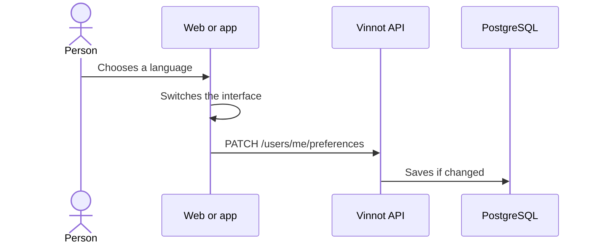

# UC-USR-20 · Change the language

| Field | Value |
|---|---|
| ID | `UC-USR-20` |
| Module | [Users and account](../README.md) |
| Platforms | Web, APK |
| Actors | Signed-in user |
| Lucidchart IDs | [WEB UC-ACC-08](https://lucid.app/lucidchart/9f11a16b-bb5a-42fc-a9e8-0852b17bd241/edit), [APK UC-ACC-08](https://lucid.app/lucidchart/e095dd25-e8ac-41ba-bf5b-396e1055f217/edit) |
| Requirements | [`RF-WEB-USR-27`](../requirements.md), [`RF-APK-USR-29`](../requirements.md) |
| Test cases | [`CP-USR-58`](../testing.md), [`CP-USR-59`](../testing.md), [`CP-USR-60`](../testing.md) |

## Preconditions

- None to change the interface language; syncing with the account requires a session.

## Postconditions

- The interface switches language and, with a session, the account stores the language and the device time zone.

## Main flow

1. The person chooses Spanish or English.
2. The client switches the language and stores it locally.
3. With a session, the client sends `PATCH /users/me/preferences` with language and time zone.
4. The API validates and saves only if something changed.

## Alternative flows

- 3a. Syncing fails: the interface still switches; it never blocks use.
- 4a. Invalid language or zone: `400 INVALID_PREFERRED_LANGUAGE` or `INVALID_TIMEZONE`.

## Business rules

- Languages: `es` or `en`; time zone: an IANA identifier. With no saved choice: `es` and `America/Argentina/Buenos_Aires`.
- The client also syncs after every sign-in or session restore.
- That language and zone are the ones account notifications use.
- Free text from the catalog and users is not translated.

## Diagram

[View the full “UC-USR-20 · Change the language” diagram](https://images.vinnot.com/docs/diagrams/v1/en/modules-users-use-cases-uc-usr-20-change-language-d33342f65d20.svg)

Component diagram in Lucidchart: [WEB UC-ACC-08](https://lucid.app/lucidchart/9f11a16b-bb5a-42fc-a9e8-0852b17bd241/edit), [APK UC-ACC-08](https://lucid.app/lucidchart/e095dd25-e8ac-41ba-bf5b-396e1055f217/edit).

## Code

| Layer | Location |
|---|---|
| Endpoints | `PATCH /users/me/preferences` |
| Backend | [`UserController.java`](../../../../../backend/src/main/java/com/vinnot/user/infrastructure/web/controller/UserController.java), [`UpdateUserPreferencesCommandHandler.java`](../../../../../backend/src/main/java/com/vinnot/user/application/command/handler/UpdateUserPreferencesCommandHandler.java) |
| Web | [`AppHeader.tsx`](../../../../../frontend-react/src/presentation/components/layout/AppHeader.tsx), [`AccountLocaleSync.tsx`](../../../../../frontend-react/src/app/providers/AccountLocaleSync.tsx), [`useAccountLocaleSync.ts`](../../../../../frontend-react/src/presentation/hooks/useAccountLocaleSync.ts) |
| App | [`LanguageSheet.tsx`](../../../../../frontend-mobile/src/presentation/features/user/LanguageSheet.tsx), [`LanguagePreferenceProvider.tsx`](../../../../../frontend-mobile/src/presentation/providers/LanguagePreferenceProvider.tsx), [`AccountLocaleSync.tsx`](../../../../../frontend-mobile/src/presentation/providers/AccountLocaleSync.tsx) |

## Automated tests

- Backend: [`UpdateUserPreferencesCommandHandlerTest.java`](../../../../../backend/src/test/java/com/vinnot/user/application/command/handler/UpdateUserPreferencesCommandHandlerTest.java), [`UserPreferencesHttpPostgresIntegrationTest.java`](../../../../../backend/src/test/java/com/vinnot/user/infrastructure/web/UserPreferencesHttpPostgresIntegrationTest.java), [`PreferredLanguageTest.java`](../../../../../backend/src/test/java/com/vinnot/user/domain/valueobject/PreferredLanguageTest.java), [`UserTimezoneTest.java`](../../../../../backend/src/test/java/com/vinnot/user/domain/valueobject/UserTimezoneTest.java)
- Web: [`useAccountLocaleSync.test.tsx`](../../../../../frontend-react/src/presentation/hooks/useAccountLocaleSync.test.tsx), [`i18n.test.ts`](../../../../../frontend-react/src/shared/i18n/i18n.test.ts)
- App: [`useAccountLocaleSync.test.tsx`](../../../../../frontend-mobile/src/presentation/hooks/useAccountLocaleSync.test.tsx), [`LanguagePreferenceProvider.test.tsx`](../../../../../frontend-mobile/src/presentation/providers/LanguagePreferenceProvider.test.tsx)
