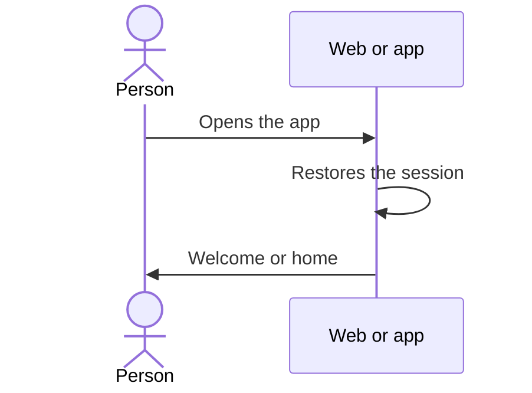

# UC-USR-21 · Open the app and see the welcome screen

| Field | Value |
|---|---|
| ID | `UC-USR-21` |
| Module | [Users and account](../README.md) |
| Platforms | APK |
| Actors | Visitor |
| Lucidchart IDs | [APK UC-AUTH-01](https://lucid.app/lucidchart/e095dd25-e8ac-41ba-bf5b-396e1055f217/edit) |
| Requirements | [`RF-APK-USR-30`](../requirements.md) |
| Test cases | [`CP-USR-61`](../testing.md) |

## Preconditions

- The app is installed.

## Postconditions

- The person sees the welcome screen or, with a session, the home screen.

## Main flow

1. The app shows the launch screen while it restores the session (UC-USR-06).
2. Without a session, it opens the welcome screen with sign-in and sign-up.
3. With a session, it opens the home screen.

## Alternative flows

None.

## Business rules

- The decision waits for the restore to finish; it does not redirect earlier.

## Diagram

[View the full “UC-USR-21 · Open the app and see the welcome screen” diagram](https://images.vinnot.com/docs/diagrams/v1/en/modules-users-use-cases-uc-usr-21-welcome-cfd773c1b33e.svg)

Component diagram in Lucidchart: [APK UC-AUTH-01](https://lucid.app/lucidchart/e095dd25-e8ac-41ba-bf5b-396e1055f217/edit).

## Code

| Layer | Location |
|---|---|
| App | [`index.tsx`](../../../../../frontend-mobile/app/index.tsx), [`VinnotLaunchScreen.tsx`](../../../../../frontend-mobile/src/presentation/features/auth/VinnotLaunchScreen.tsx), `frontend-mobile/app/(onboarding)/welcome.tsx` |

## Automated tests

- Backend: None
- Web: None
- App: [`welcomeRoute.test.tsx`](../../../../../frontend-mobile/src/presentation/features/auth/__tests__/welcomeRoute.test.tsx), [`startupRoutes.test.tsx`](../../../../../frontend-mobile/src/presentation/features/auth/__tests__/startupRoutes.test.tsx)
