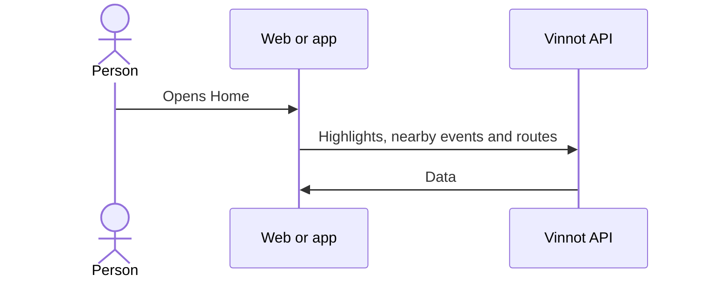

# UC-USR-22 · View the home screen

| Field | Value |
|---|---|
| ID | `UC-USR-22` |
| Module | [Users and account](../README.md) |
| Platforms | Web, APK |
| Actors | Signed-in user |
| Lucidchart IDs | [APK UC-HOME-01](https://lucid.app/lucidchart/e095dd25-e8ac-41ba-bf5b-396e1055f217/edit) |
| Requirements | [`RF-WEB-USR-28`](../requirements.md), [`RF-APK-USR-31`](../requirements.md), [`RF-APK-USR-32`](../requirements.md), [`RF-APK-USR-33`](../requirements.md), [`RF-APK-USR-34`](../requirements.md) |
| Test cases | [`CP-USR-62`](../testing.md), [`CP-USR-63`](../testing.md), [`CP-USR-64`](../testing.md) |

## Preconditions

- There is an active session, with terms accepted and onboarding complete.

## Postconditions

- The home screen shows discovery shortcuts.

## Main flow

1. The person opens Home.
2. The app requests featured wines (up to four), nearby events (up to three, with location) and route previews (up to three).
3. The person opens a type, a grape, the scanner, the cellar, an event or a route.

## Alternative flows

- 2a. No location permission: nearby events are not shown.
- R1. Pull to refresh reloads the sections.

## Business rules

- On the web, the home page presents Vinnot and offers to explore types, grapes, wines, events and routes; the four cards under “Everything you need to discover wines” open Wines, the scanner, Events and Wine routes, and opening a protected feature leads to sign-in.
- When signed in, on the web and the app the home page closes with “From people you follow” (the latest reviews of the people they follow, with “See all”) and “People to follow” ([Community](../../community/README.md)).
- The data comes from the wines, events and routes modules.
- On the app, popular grapes are painted with a gradient of their wine's color ([`grapeColors.ts`](../../../../../frontend-mobile/src/presentation/features/home/grapeColors.ts)), with white text when the pill is dark; a grape with no palette uses the neutral pill. The four cards of “Everything you need for wine discovery” open Wines, the scanner, Events and Routes.

## Diagram

[View the full “UC-USR-22 · View the home screen” diagram](https://images.vinnot.com/docs/diagrams/v1/en/modules-users-use-cases-uc-usr-22-home-39669c7a8ea9.svg)

Component diagram in Lucidchart: [APK UC-HOME-01](https://lucid.app/lucidchart/e095dd25-e8ac-41ba-bf5b-396e1055f217/edit).

## Code

| Layer | Location |
|---|---|
| Web | [`HomePage.tsx`](../../../../../frontend-react/src/presentation/pages/public/HomePage.tsx), [`useHomeViewModel.ts`](../../../../../frontend-react/src/presentation/pages/public/useHomeViewModel.ts) |
| App | `frontend-mobile/app/(app)/(tabs)/home.tsx`, [`HomeScreenView.tsx`](../../../../../frontend-mobile/src/presentation/features/home/HomeScreenView.tsx) |

## Automated tests

- Backend: None
- Web: None
- App: [`home-highlights.test.tsx`](../../../../../frontend-mobile/src/test/integration/home-highlights.test.tsx)
