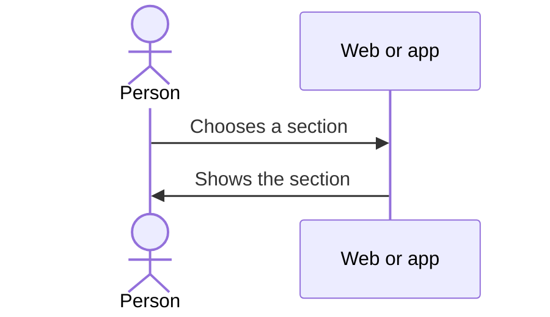

# UC-USR-23 · Navigate the application

| Field | Value |
|---|---|
| ID | `UC-USR-23` |
| Module | [Users and account](../README.md) |
| Platforms | Web, APK |
| Actors | Signed-in user |
| Lucidchart IDs | [APK UC-HOME-02](https://lucid.app/lucidchart/e095dd25-e8ac-41ba-bf5b-396e1055f217/edit) |
| Requirements | [`RF-WEB-USR-29`](../requirements.md), [`RF-WEB-USR-30`](../requirements.md), [`RF-APK-USR-35`](../requirements.md) |
| Test cases | [`CP-USR-65`](../testing.md), [`CP-USR-66`](../testing.md) |

## Preconditions

- There is an active session.

## Postconditions

- The person reaches the chosen section.

## Main flow

1. In the app, the bottom bar offers Home, Wines, Events, Routes and Profile.
2. On the web, the header, menu and footer offer the product sections, profile, cellar, language and public pages.
3. The person chooses a section.

## Alternative flows

- 3a. Tapping Wines again in the app returns to the catalog, without leaving a previous detail open.

## Business rules

- Administration and partner actions appear according to the role.
- On the web, changing page scrolls back to the top.

## Diagram

[View the full “UC-USR-23 · Navigate the application” diagram](https://images.vinnot.com/docs/diagrams/v1/en/modules-users-use-cases-uc-usr-23-navigate-aecd924198d5.svg)

Component diagram in Lucidchart: [APK UC-HOME-02](https://lucid.app/lucidchart/e095dd25-e8ac-41ba-bf5b-396e1055f217/edit).

## Code

| Layer | Location |
|---|---|
| Web | [`AppHeader.tsx`](../../../../../frontend-react/src/presentation/components/layout/AppHeader.tsx), [`App.tsx`](../../../../../frontend-react/src/app/App.tsx) |
| App | `frontend-mobile/app/(app)/(tabs)/_layout.tsx`, [`tabNavigation.ts`](../../../../../frontend-mobile/src/presentation/navigation/tabNavigation.ts) |

## Automated tests

- Backend: None
- Web: None
- App: [`tabNavigation.test.tsx`](../../../../../frontend-mobile/src/presentation/navigation/tabNavigation.test.tsx), [`discoveryNavigation.test.ts`](../../../../../frontend-mobile/src/presentation/navigation/__tests__/discoveryNavigation.test.ts)
