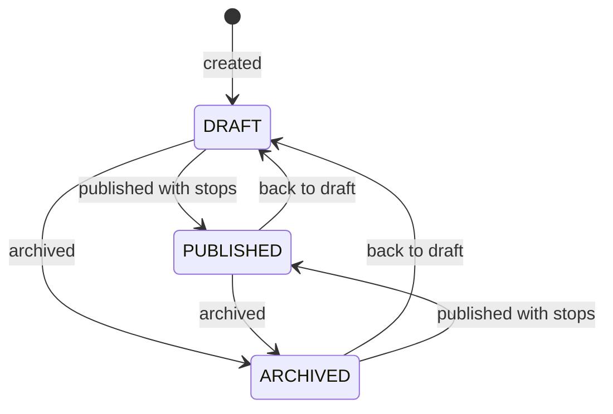
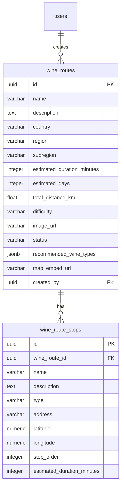

# Wine routes

Curated tourism itineraries: a route has a region, length, duration, distance,
recommended wine types, a cover and an ordered list of stops. Signed-in people browse
the catalog, open a route, navigate its stops in maps and share or report it. Routes
are loaded by tourism operators and the Vinnot team; managing them from the panel is
in [Administration](../admin/README.md).

- Module code: `RTE`.
- Backend: package [`wineroute`](../../../../backend/src/main/java/com/vinnot/wineroute/).
- [Use cases](use-cases/README.md) · [Requirements](requirements.md) ·
  [Architecture](architecture.md) · [Testing](testing.md)

## Actors

| Actor | What they do in this module |
|---|---|
| Signed-in user | Browses and filters routes, opens the details, navigates stops, shares and reports |
| Tourism operator, moderator or administrator | Creates routes and adds stops to their own |
| Google Maps | Computes distance and duration between stops with coordinates |

## Business rules

| Rule | Detail | Where |
|---|---|---|
| Visibility | Every read requires a session; third parties only see published routes, while the creator and the team also see drafts and archived ones | [`GetWineRouteByIdQueryHandler.java`](../../../../backend/src/main/java/com/vinnot/wineroute/application/query/handler/GetWineRouteByIdQueryHandler.java) |
| Creation | Name and creator are required; every route starts in `DRAFT` | [`WineRoute.java`](../../../../backend/src/main/java/com/vinnot/wineroute/domain/model/WineRoute.java) |
| Publication | A route without stops cannot be published (`CANNOT_PUBLISH`) | [`WineRoute.java`](../../../../backend/src/main/java/com/vinnot/wineroute/domain/model/WineRoute.java) |
| Stop order | Removing a stop renumbers the rest from 1 with no gaps | [`WineRoute.java`](../../../../backend/src/main/java/com/vinnot/wineroute/domain/model/WineRoute.java) |
| Length | `SHORT`, `MEDIUM` or `LONG` | [`RouteDifficulty.java`](../../../../backend/src/main/java/com/vinnot/wineroute/domain/valueobject/RouteDifficulty.java) |
| Distance | With two or more stops with coordinates it is computed with maps; if that fails, the supplied value is kept | [`CreateWineRouteCommandHandler.java`](../../../../backend/src/main/java/com/vinnot/wineroute/application/command/handler/CreateWineRouteCommandHandler.java) |
| Ownership | Adding stops to someone else's route requires the global permission (`WINE_ROUTE_OWNERSHIP`) | [`AddRouteStopCommandHandler.java`](../../../../backend/src/main/java/com/vinnot/wineroute/application/command/handler/AddRouteStopCommandHandler.java) |
| Stop wineries | Winery stops are linked by exact name to active wineries; when nothing matches, the route still shows | [`WineryQueryAdapter.java`](../../../../backend/src/main/java/com/vinnot/wineroute/infrastructure/persistence/adapter/WineryQueryAdapter.java) |

## Route states

[View the full “Route states” diagram](https://images.vinnot.com/docs/diagrams/v1/en/modules-wine-routes-readme-4333df831fda.svg)

## Where it lives

| Part | Location |
|---|---|
| API | [`WineRouteController`](../../../../backend/src/main/java/com/vinnot/wineroute/infrastructure/web/controller/WineRouteController.java) under `/wine-routes` and `WineRouteAdminController` under `/admin/routes` |
| Web | [`pages/wine-routes`](../../../../frontend-react/src/presentation/pages/wine-routes/) at `/wine-routes` and `/wine-routes/:id` |
| App | Routes tab in `frontend-mobile/app/(app)/(tabs)/routes` and screens in [`features/wineRoute`](../../../../frontend-mobile/src/presentation/features/wineRoute/) |

## Data

[View the full “Wine routes · Data” diagram](https://images.vinnot.com/docs/diagrams/v1/en/modules-wine-routes-readme-f56796cfdc60.svg)

Stops are deleted in cascade with their route, and routes with the user who created them.
The `difficulty` column stores the route length.
