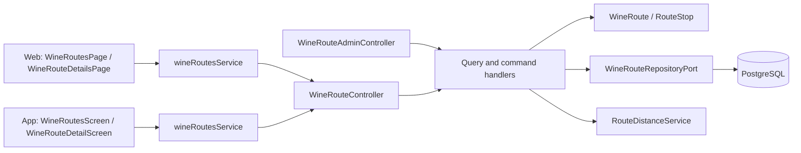
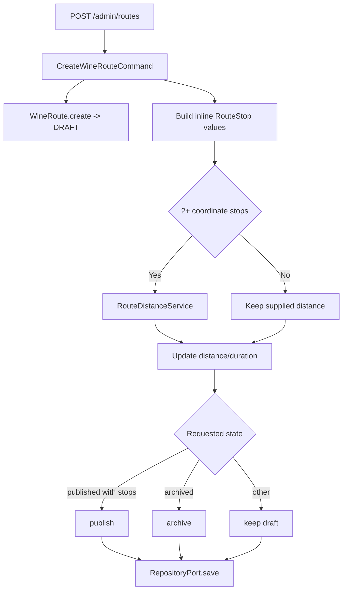
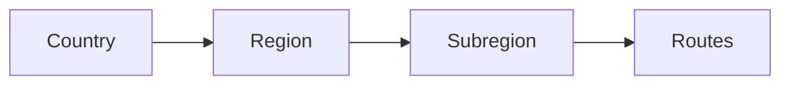

# Architecture

How the module is built in each layer. The backend follows the hexagonal flow
`controller → input port → handler → domain → output port → adapter`;
the web and the app follow `screen → hook → service → API client → HTTP transport`.
The winery of each stop comes from [Wineries](../wineries/README.md).

[View the full “Architecture” diagram](https://images.vinnot.com/docs/diagrams/v1/en/modules-wine-routes-architecture-fddd3d05ff40.svg)

## Backend

### Goal

A wine route is a curated tourism itinerary, not merely a list of wineries. The
aggregate retains regional identity, length, duration, distance,
recommendations, map, state and an ordered stop sequence.

### Domain

`WineRoute` is the aggregate root; `RouteStop` is an internal entity. Value
objects are `RouteStatus` (`DRAFT`, `PUBLISHED`, `ARCHIVED`) and
`RouteDifficulty`.

Main rules:

- name and creator are required;
- creation starts in `DRAFT`;
- each stop has ID, name, order, type, address, coordinates and duration;
- domain-exposed lists are immutable;
- `removeStop` always calls `reorderStops`, sorts by `stopOrder`, and assigns
  contiguous positions from 1; `UpdateWineRouteCommandHandler` builds a
  replacement list preserving explicit positive orders and using index + 1 for nonpositive values; editors reorder drafts with contiguous positions;
- an empty route cannot be published;
- ownership is enforced for own-resource changes; admin may operate globally;
- archive and return-to-draft are explicit transitions.

### Lists and administrative updates

Public and administrative queries fetch a route page and one grouped stop
query for that page's IDs. `getStopCounts` computes `stopCount` and
`wineryCount` without hydrating each collection or running one query per route.
The administrative list includes drafts and archived routes.

PATCH preserves omitted fields. `clearFields` removes optional fields;
`stops: []` and `recommendedWineTypes: []` clear their collections. Removing
all stops from a published route requires changing it to draft in the same
operation. Valid difficulties are `SHORT`, `MEDIUM` and `LONG`; lowercase
enum names are normalized. Unknown statuses or difficulties are rejected.

### Creation

[View the full “Creation” diagram](https://images.vinnot.com/docs/diagrams/v1/en/modules-wine-routes-architecture-8afbc5318545.svg)

`RouteDistanceService` is a shared port. The Google Maps adapter may fail or be
unconfigured; the handler preserves manual values when no calculation exists.

### Adding a stop

`POST /wine-routes/{routeId}/stops`:

1. loads route;
2. allows admin or creator;
3. creates `RouteStop` and validates coordinates only when both are present;
4. adds it to the aggregate;
5. persists the complete route;
6. returns stop ID.

The handler constructs `Coordinates` only when both latitude and longitude are
present. It appends the requested stop and saves the route; distance calculation
belongs to route create/update, not this add-stop command.

### Public search

`SearchWineRoutesQueryHandler` delegates text, country, region and difficulty
filters plus pagination to `WineRouteRepositoryPort`. Every filter is optional and
they combine: `GET /wine-routes?difficulty=` takes a `RouteDifficulty` value
(`SHORT`, `MEDIUM` or `LONG`), an unknown value answers 400 `INVALID_REQUEST`, and
without it the results are the same as before. The public adapter returns published
routes; `SearchAllWineRoutesQueryHandler` exists for administration and does not
apply the same state filter.

Detail by UUID loads through `findById` and requires PUBLISHED for third parties;
the creator and ADMIN/MODERATOR retain private reads. It maps ordered stops to `RouteStopResponse` inside a read-only transaction,
preventing lazy loading during serialization.

Winery enrichment collects unique winery-stop names, ignoring case, and performs
one exact-name query over active wineries. The adapter loads country, region and
contacts together; it does not use paginated catalogue search or compute a total
for every stop. Response order follows stop order, missing names are omitted,
and the route remains available if optional enrichment fails. List filters and
catalogue search retain their separate implementation.

### Filter hierarchy

`/hierarchy`, `/countries`, `/countries/{country}/regions` and
`.../subregions` derive values from published routes, with exact text matching. The hierarchy supports
cascading filters without downloading the entire catalog.

[View the full “Filter hierarchy” diagram](https://images.vinnot.com/docs/diagrams/v1/en/modules-wine-routes-architecture-45178d59f19a.svg)

Path values must be URL-segment encoded and normalized in persistence; frontend
does not concatenate SQL or assume text is an ID.

### Administration

`/admin/routes` can list every state, create, edit, add stops, publish, archive
and delete. It reuses module commands/queries. `UpdateWineRouteCommandHandler`
centralizes field changes, stop replacement, distance/duration recalculation and
state transition.

Admin publication still invokes `WineRoute.publish`; it never bypasses the
at-least-one-stop rule.

### Security and failures

- Every read requires a session (`SecurityConfig` protects `GET /wine-routes/**`); third parties only see published routes.
- Create: `WINE_ROUTE_CREATE` permission (ADMIN and MODERATOR). Public creation ignores stops and status and leaves the route in `DRAFT`.
- Adding stops to an own route: `WINE_ROUTE_UPDATE_OWN` with creator validation; when it is not theirs, `422` `WINE_ROUTE_OWNERSHIP`.
- Global editing: `WINE_ROUTE_UPDATE` or the `/admin/routes` controller (ADMIN and MODERATOR).
- Deleting from administration: ADMIN only, with recent reauthentication.
- Missing route, stop or winery: `404`. Publishing without stops: `400` `CANNOT_PUBLISH`.
- Without Google Maps the supplied distance is kept, without corrupting the route.

### Tests

- `WineRouteTest` and `RouteStopTest`: states, empty publication, order and immutable collections.
- `WineRouteMutationHandlersTest` and `WineRouteOwnershipTest`: creation, editing, stops, ownership and distance.
- `GetWineRouteByIdQueryHandlerTest` and `WineRouteQueryHandlersTest`: private reads, lists and hierarchy.
- `AdminRoleAccessTest`, `SecurityConfigAccessTest` and `SessionAccessHttpPostgresIntegrationTest`: permissions and session.

### References

- `backend/src/main/java/com/vinnot/wineroute`
- `shared/application/port/RouteDistanceService.java`
- [Wineries and regions](../wineries/architecture.md)

## Web

### List and details

`/wine-routes` and `/wine-routes/:id` require a session. `WineRoutesPage` →
`useWineRoutesViewModel` requests pages of 20 with `useWineRoutes` and sends the text
(with a 350 ms delay), length (`difficulty`), country and region to the API; the filters
and the page live in the URL, so reload and back keep them. Countries and regions come
from the reference catalogs. `WineRouteDetailsPage` →
`useWineRouteDetailsViewModel` shows the cover, the route data (`RouteInfoSidebar`), the
stops in `RouteStopTimeline` and the embedded map. `wineRoutesService` maps the
`wineRoutesClient` DTOs to the domain (`domain/route`). The mapper keeps the duration in
minutes (`estimatedDuration`) apart from days (`estimatedDays`) and leaves the length `null`
when it is missing or unknown; `routeLengthLabel` shows the minutes, or “N days”, or “—”, and
the length label is hidden without data.

### Maps, sharing and reporting

The view model builds the Google Maps trip URL with the stops in order and opens each
stop in maps. “Share” appears only on published routes (`isPublicRoute`) and uses `useShareLink` with the `wine-routes` kind, and
`CommunityActions` offers reporting the route without a block option.

## App

### List and details

The Routes tab uses `app/(app)/(tabs)/routes/index.tsx` → `WineRoutesScreen` and
`routes/[id].tsx` → `WineRouteDetailScreen`. `useWineRoutesListViewModel` loads pages of
20, accumulates them by ID with “Load more” and filters the loaded routes on the device
by text (with a 300 ms delay), length, country and region. `/wine-routes` redirects to
the tab and `app/(app)/wine-routes/[id].tsx` opens the details from Home and older links.
The list header is the `BrowseScreenHeader` shared with Wines and Events (VINNOT,
title, the descriptive subtitle "Explore curated journeys through wineries,
landscapes and experiences." and search, flat on the screen background). The
route count appears below, next to "Explore routes".

### Map and navigation

`RouteMap` shows one marker per stop. `useRouteNavigation` → `routeNavigationService` →
`externalLinkGateway` opens a stop or the full trip; URLs are built in
`domain/route/route.navigation.ts`, which keeps the stop order and adds their durations
in minutes. “Share” appears only on published routes (`canShareRoute`) and uses `useShareLink`, and `CommunityActions` offers reporting the route.

### Route presentation and covers

The Routes tab uses `app/(app)/(tabs)/routes/index.tsx` → `WineRoutesScreen`
and `routes/[id].tsx` → `WineRouteDetailScreen`. List and detail retain the tab
bar and selected state. `/wine-routes` redirects to that tab; the shell
`app/(app)/wine-routes/[id].tsx` keeps detail entry from Home and previous links.
Back uses the origin's history or Routes when no history exists.
Its ViewModel obtains the query, derives duration in minutes and coordinates
sharing/navigation. The card shared by Home and the list and the detail use
the same cover, without dimming it or placing labels over the photograph.
Length, stop count, distance and duration appear on light surfaces
(`formatRouteLength` shows the minutes or “N days”; without length or duration, that item
does not appear); expanded
stops use a soft brand surface with dark text and readable contact information.
The expandable header and Maps action have separate touch targets, accessible
roles and expansion state.

`RouteCoverImage` uses `expo-image` through `ImageWithFallback`, with
`memory-disk` caching, downscaling to the view size, early resizing on iOS and
the bundled illustration as placeholder and fallback. Remote covers appear
without a fade that would delay an already cached image. Home, list and detail
keep the same URL to reuse the cache; JavaScript does not download or recompress
the image. A new URL resets the recycled view; a failure activates the bundled
asset. The HTTP client resolves relative upload paths against the API origin
before mapping DTOs, preserving pagination. The first download of an external
URL depends on its origin server and the network: caching and resizing do not
reduce bytes transferred on a cold request.

Navigation actions flow through `useRouteNavigation` →
`routeNavigationService` → `externalLinkGateway`. Domain code builds Maps URLs,
preserving stop order and encoding coordinates/addresses; zero coordinates are
valid. A route without stops disables navigation; unavailable platform handlers
produce localized feedback. Backend route and stop durations are in minutes;
detail uses the stop sum when positive and the route estimate otherwise.
