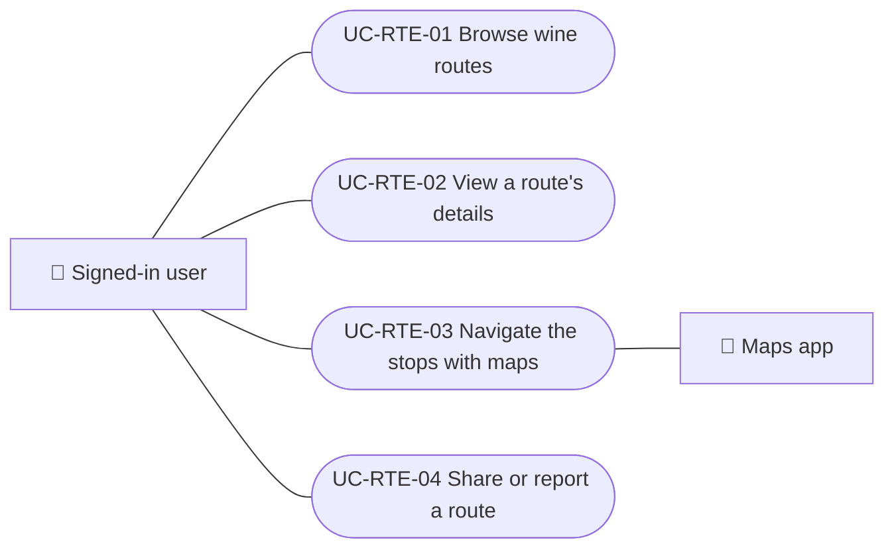

# Use cases

Wine route use cases: exploring published routes, opening their details with the stops, navigating the stops with maps, and sharing or reporting a route. Creating and editing routes is in Administration. Each case applies to the platforms listed.

| ID | Use case | Platforms | Actors |
|---|---|---|---|
| `UC-RTE-01` | [Browse wine routes](uc-rte-01-browse-routes.md) | Web, APK | Signed-in user |
| `UC-RTE-02` | [View a route's details](uc-rte-02-view-route.md) | Web, APK | Signed-in user |
| `UC-RTE-03` | [Navigate the stops with maps](uc-rte-03-navigate-stops.md) | Web, APK | Signed-in user, Maps app |
| `UC-RTE-04` | [Share or report a route](uc-rte-04-share-or-report-route.md) | Web, APK | Signed-in user |

## Use case diagram

[View the full “Use cases · Use case diagram” diagram](https://images.vinnot.com/docs/diagrams/v1/en/modules-wine-routes-use-cases-readme-a4083441d47c.svg)

## Lucidchart mapping

| ID | Lucidchart IDs |
|---|---|
| `UC-RTE-01` | [WEB UC-RTE-01](https://lucid.app/lucidchart/9f11a16b-bb5a-42fc-a9e8-0852b17bd241/edit), [APK UC-RTE-01](https://lucid.app/lucidchart/e095dd25-e8ac-41ba-bf5b-396e1055f217/edit) |
| `UC-RTE-02` | [WEB UC-RTE-02](https://lucid.app/lucidchart/9f11a16b-bb5a-42fc-a9e8-0852b17bd241/edit), [APK UC-RTE-02](https://lucid.app/lucidchart/e095dd25-e8ac-41ba-bf5b-396e1055f217/edit) |
| `UC-RTE-03` | [APK UC-RTE-03](https://lucid.app/lucidchart/e095dd25-e8ac-41ba-bf5b-396e1055f217/edit) |
| `UC-RTE-04` | [APK UC-RTE-04](https://lucid.app/lucidchart/e095dd25-e8ac-41ba-bf5b-396e1055f217/edit) |
