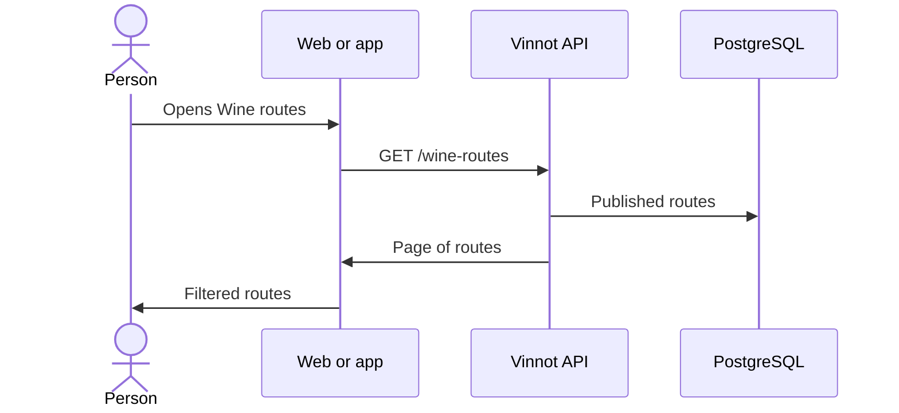

# UC-RTE-01 · Browse wine routes

| Field | Value |
|---|---|
| ID | `UC-RTE-01` |
| Module | [Wine routes](../README.md) |
| Platforms | Web, APK |
| Actors | Signed-in user |
| Lucidchart IDs | [WEB UC-RTE-01](https://lucid.app/lucidchart/9f11a16b-bb5a-42fc-a9e8-0852b17bd241/edit), [APK UC-RTE-01](https://lucid.app/lucidchart/e095dd25-e8ac-41ba-bf5b-396e1055f217/edit) |
| Requirements | [`RF-WEB-RTE-01`](../requirements.md), [`RF-WEB-RTE-02`](../requirements.md), [`RF-APK-RTE-01`](../requirements.md), [`RF-APK-RTE-02`](../requirements.md) |
| Test cases | [`CP-RTE-01`](../testing.md), [`CP-RTE-02`](../testing.md), [`CP-RTE-03`](../testing.md), [`CP-RTE-04`](../testing.md) |

## Preconditions

- The person is signed in.

## Postconditions

- The person sees the published routes and can filter them.

## Main flow

1. The person opens Wine routes.
2. The client calls `GET /wine-routes`, 20 routes at a time.
3. The API returns only published routes.
4. The client shows each route with cover, country, region, length, number of stops, distance and duration.
5. The person filters by text, length, country or region.

## Alternative flows

- 5a. Filters apply to the routes already loaded: on the web, to the current page; on the app, to the pages accumulated with “Load more”.
- 3a. There are no routes: the empty state is shown.
- 2a. More than 100 per page or a text longer than 512 characters: the API answers 422.

## Business rules

- Draft or archived routes do not appear in the list.
- Length is a category (short, medium or long), not a physical difficulty; a route without a length shows no label.
- Duration is shown in hours and minutes; when the route only has an estimate in days, it shows “N days”.
- The API filters by text, length (`difficulty`) and exact country and region; the web sends these filters to the API, while the app still filters the loaded page on the device.

## Diagram

[View the full “UC-RTE-01 · Browse wine routes” diagram](https://images.vinnot.com/docs/diagrams/v1/en/modules-wine-routes-use-cases-uc-rte-01-browse-routes-1e2abafa44b1.svg)

Component diagram in Lucidchart: [WEB UC-RTE-01](https://lucid.app/lucidchart/9f11a16b-bb5a-42fc-a9e8-0852b17bd241/edit), [APK UC-RTE-01](https://lucid.app/lucidchart/e095dd25-e8ac-41ba-bf5b-396e1055f217/edit).

## Code

| Layer | Location |
|---|---|
| Endpoints | `GET /wine-routes` |
| Backend | [`WineRouteController.java`](../../../../../backend/src/main/java/com/vinnot/wineroute/infrastructure/web/controller/WineRouteController.java), [`SearchWineRoutesQueryHandler.java`](../../../../../backend/src/main/java/com/vinnot/wineroute/application/query/handler/SearchWineRoutesQueryHandler.java), [`WineRoutePersistenceAdapter.java`](../../../../../backend/src/main/java/com/vinnot/wineroute/infrastructure/persistence/adapter/WineRoutePersistenceAdapter.java) |
| Web | [`WineRoutesPage.tsx`](../../../../../frontend-react/src/presentation/pages/wine-routes/WineRoutesPage.tsx), [`useWineRoutesViewModel.ts`](../../../../../frontend-react/src/presentation/pages/wine-routes/useWineRoutesViewModel.ts), [`WineRouteCard.tsx`](../../../../../frontend-react/src/presentation/components/features/wineRoute/WineRouteCard.tsx), [`useWineRoutes.ts`](../../../../../frontend-react/src/presentation/hooks/queries/wineRoute/useWineRoutes.ts), [`wineRoutes.service.ts`](../../../../../frontend-react/src/application/services/wineRoutes.service.ts), [`wineRoutes.client.ts`](../../../../../frontend-react/src/infrastructure/api/clients/wineRoutes.client.ts) |
| App | [`WineRoutesScreen.tsx`](../../../../../frontend-mobile/src/presentation/features/wineRoute/WineRoutesScreen.tsx), [`useWineRoutesListViewModel.ts`](../../../../../frontend-mobile/src/presentation/features/wineRoute/useWineRoutesListViewModel.ts), [`WineRouteCard.tsx`](../../../../../frontend-mobile/src/presentation/features/wineRoute/WineRouteCard.tsx), [`wineRoutes.service.ts`](../../../../../frontend-mobile/src/application/services/wineRoutes.service.ts), [`wineRoutes.client.ts`](../../../../../frontend-mobile/src/infrastructure/api/clients/wineRoutes.client.ts) |

## Automated tests

- Backend: [`WineRouteQueryHandlersTest.java`](../../../../../backend/src/test/java/com/vinnot/wineroute/application/query/handler/WineRouteQueryHandlersTest.java)
- Web: [`wineRoutes.service.test.ts`](../../../../../frontend-react/src/application/services/wineRoutes.service.test.ts), [`route.mappers.test.ts`](../../../../../frontend-react/src/domain/route/route.mappers.test.ts)
- App: [`useWineRoutesListViewModel.test.ts`](../../../../../frontend-mobile/src/presentation/features/wineRoute/useWineRoutesListViewModel.test.ts), [`wineRoutes.service.test.ts`](../../../../../frontend-mobile/src/application/services/wineRoutes.service.test.ts), [`wineRoutes.client.test.ts`](../../../../../frontend-mobile/src/infrastructure/api/clients/wineRoutes.client.test.ts)
