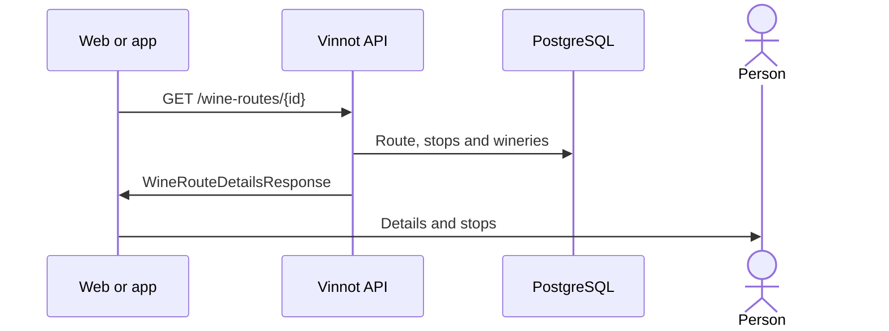

# UC-RTE-02 · View a route's details

| Field | Value |
|---|---|
| ID | `UC-RTE-02` |
| Module | [Wine routes](../README.md) |
| Platforms | Web, APK |
| Actors | Signed-in user |
| Lucidchart IDs | [WEB UC-RTE-02](https://lucid.app/lucidchart/9f11a16b-bb5a-42fc-a9e8-0852b17bd241/edit), [APK UC-RTE-02](https://lucid.app/lucidchart/e095dd25-e8ac-41ba-bf5b-396e1055f217/edit) |
| Requirements | [`RF-WEB-RTE-03`](../requirements.md), [`RF-WEB-RTE-04`](../requirements.md), [`RF-APK-RTE-03`](../requirements.md), [`RF-APK-RTE-04`](../requirements.md) |
| Test cases | [`CP-RTE-05`](../testing.md), [`CP-RTE-06`](../testing.md), [`CP-RTE-07`](../testing.md), [`CP-RTE-13`](../testing.md), [`CP-RTE-14`](../testing.md) |

## Preconditions

- The person is signed in and opens a route from the list, Home or a link.

## Postconditions

- The person sees the route with its stops in order.

## Main flow

1. The client calls `GET /wine-routes/{id}`.
2. The API returns the route with its ordered stops and, for winery stops, the data of the winery with the same name.
3. The client shows cover, description, length, distance, duration and recommended wine types.
4. It shows the stops on a timeline; each stop expands with its description, address and contacts.

## Alternative flows

- 2a. The route is not published and the reader did not create it and is not a moderator or administrator: the API answers 404.
- 3a. The stops have a duration: the total duration is the sum of the stops; otherwise the route's estimate in minutes is used.
- 3b. Neither the stops nor the route have a duration in minutes: the estimate in days is shown (“N days”); with neither, the web shows “—” and the app shows no duration.
- 3c. The route has no length: no length label is shown.

## Business rules

- Durations are in minutes, apart from the estimate in days, and distance in kilometers.
- The server calculates distance with Google Directions when the route is saved, or it is entered by hand ([Administration](../../admin/README.md)).
- The link to the winery is by name and only informative.

## Diagram

[View the full “UC-RTE-02 · View a route's details” diagram](https://images.vinnot.com/docs/diagrams/v1/en/modules-wine-routes-use-cases-uc-rte-02-view-route-3135f948fab4.svg)

Component diagram in Lucidchart: [WEB UC-RTE-02](https://lucid.app/lucidchart/9f11a16b-bb5a-42fc-a9e8-0852b17bd241/edit), [APK UC-RTE-02](https://lucid.app/lucidchart/e095dd25-e8ac-41ba-bf5b-396e1055f217/edit).

## Code

| Layer | Location |
|---|---|
| Endpoints | `GET /wine-routes/{id}` |
| Backend | [`WineRouteController.java`](../../../../../backend/src/main/java/com/vinnot/wineroute/infrastructure/web/controller/WineRouteController.java), [`GetWineRouteByIdQueryHandler.java`](../../../../../backend/src/main/java/com/vinnot/wineroute/application/query/handler/GetWineRouteByIdQueryHandler.java), [`WineryQueryAdapter.java`](../../../../../backend/src/main/java/com/vinnot/wineroute/infrastructure/persistence/adapter/WineryQueryAdapter.java), [`WineRoute.java`](../../../../../backend/src/main/java/com/vinnot/wineroute/domain/model/WineRoute.java) |
| Web | [`WineRouteDetailsPage.tsx`](../../../../../frontend-react/src/presentation/pages/wine-routes/WineRouteDetailsPage.tsx), [`useWineRouteDetailsViewModel.ts`](../../../../../frontend-react/src/presentation/pages/wine-routes/useWineRouteDetailsViewModel.ts), [`RouteStopTimeline.tsx`](../../../../../frontend-react/src/presentation/components/features/wineRoute/RouteStopTimeline.tsx), [`RouteInfoSidebar.tsx`](../../../../../frontend-react/src/presentation/components/features/wineRoute/RouteInfoSidebar.tsx), [`useWineRoute.ts`](../../../../../frontend-react/src/presentation/hooks/queries/wineRoute/useWineRoute.ts), [`wineRoutes.service.ts`](../../../../../frontend-react/src/application/services/wineRoutes.service.ts), [`wineRoutes.client.ts`](../../../../../frontend-react/src/infrastructure/api/clients/wineRoutes.client.ts) |
| App | [`WineRouteDetailScreen.tsx`](../../../../../frontend-mobile/src/presentation/features/wineRoute/WineRouteDetailScreen.tsx), [`useWineRouteDetailViewModel.ts`](../../../../../frontend-mobile/src/presentation/features/wineRoute/useWineRouteDetailViewModel.ts), [`RouteStopTimeline.tsx`](../../../../../frontend-mobile/src/presentation/features/wineRoute/RouteStopTimeline.tsx), [`RouteCoverImage.tsx`](../../../../../frontend-mobile/src/presentation/features/wineRoute/RouteCoverImage.tsx), [`wineRoutes.service.ts`](../../../../../frontend-mobile/src/application/services/wineRoutes.service.ts), [`wineRoutes.client.ts`](../../../../../frontend-mobile/src/infrastructure/api/clients/wineRoutes.client.ts) |

## Automated tests

- Backend: [`GetWineRouteByIdQueryHandlerTest.java`](../../../../../backend/src/test/java/com/vinnot/wineroute/application/query/handler/GetWineRouteByIdQueryHandlerTest.java), [`WineRouteTest.java`](../../../../../backend/src/test/java/com/vinnot/wineroute/domain/model/WineRouteTest.java), [`RouteStopTest.java`](../../../../../backend/src/test/java/com/vinnot/wineroute/domain/model/RouteStopTest.java)
- Web: [`route.mappers.test.ts`](../../../../../frontend-react/src/domain/route/route.mappers.test.ts), [`useWineRouteDetailsViewModel.test.tsx`](../../../../../frontend-react/src/presentation/pages/wine-routes/useWineRouteDetailsViewModel.test.tsx)
- App: [`routeStops.test.tsx`](../../../../../frontend-mobile/src/presentation/features/wineRoute/__tests__/routeStops.test.tsx), [`route.mappers.test.ts`](../../../../../frontend-mobile/src/domain/route/route.mappers.test.ts)
