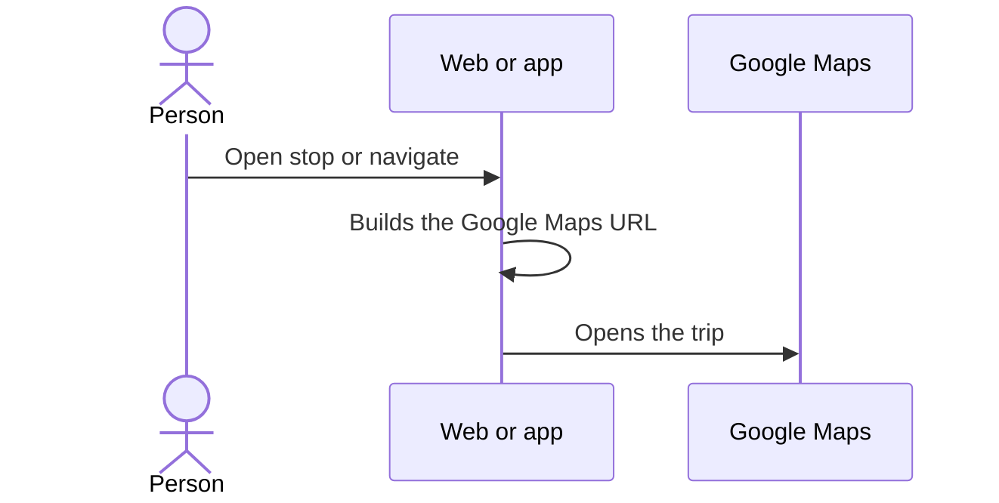

# UC-RTE-03 · Navigate the stops with maps

| Field | Value |
|---|---|
| ID | `UC-RTE-03` |
| Module | [Wine routes](../README.md) |
| Platforms | Web, APK |
| Actors | Signed-in user, Maps app |
| Lucidchart IDs | [APK UC-RTE-03](https://lucid.app/lucidchart/e095dd25-e8ac-41ba-bf5b-396e1055f217/edit) |
| Requirements | [`RF-WEB-RTE-05`](../requirements.md), [`RF-WEB-RTE-06`](../requirements.md), [`RF-APK-RTE-05`](../requirements.md), [`RF-APK-RTE-06`](../requirements.md) |
| Test cases | [`CP-RTE-08`](../testing.md), [`CP-RTE-09`](../testing.md), [`CP-RTE-10`](../testing.md) |

## Preconditions

- The person is on the details of a route with stops.

## Postconditions

- The maps app opens the stop or the full trip.

## Main flow

1. The person sees the stops on a map: on the web, the route's embedded map; on the app, a map with one marker per stop.
2. They choose to open a stop in maps: the client builds the Google Maps address with its coordinates or its address.
3. Or they choose to navigate the full route: the client builds a Google Maps driving trip with origin, destination and intermediate stops in order.
4. The system opens the maps app or page.

## Alternative flows

- 3a. The route has no stops: navigation is disabled.
- 4a. The system cannot open the link: the app shows a notice.

## Business rules

- Vinnot does not track the person's location or record their trip.
- Zero coordinates are valid.

## Diagram

[View the full “UC-RTE-03 · Navigate the stops with maps” diagram](https://images.vinnot.com/docs/diagrams/v1/en/modules-wine-routes-use-cases-uc-rte-03-navigate-stops-3e040e2cf3a5.svg)

Component diagram in Lucidchart: [APK UC-RTE-03](https://lucid.app/lucidchart/e095dd25-e8ac-41ba-bf5b-396e1055f217/edit).

## Code

| Layer | Location |
|---|---|
| Web | [`WineRouteDetailsPage.tsx`](../../../../../frontend-react/src/presentation/pages/wine-routes/WineRouteDetailsPage.tsx), [`useWineRouteDetailsViewModel.ts`](../../../../../frontend-react/src/presentation/pages/wine-routes/useWineRouteDetailsViewModel.ts), [`RouteStopTimeline.tsx`](../../../../../frontend-react/src/presentation/components/features/wineRoute/RouteStopTimeline.tsx) |
| App | [`WineRouteDetailScreen.tsx`](../../../../../frontend-mobile/src/presentation/features/wineRoute/WineRouteDetailScreen.tsx), [`useWineRouteDetailViewModel.ts`](../../../../../frontend-mobile/src/presentation/features/wineRoute/useWineRouteDetailViewModel.ts), [`RouteMap.tsx`](../../../../../frontend-mobile/src/presentation/features/wineRoute/RouteMap.tsx), [`useRouteNavigation.ts`](../../../../../frontend-mobile/src/presentation/features/wineRoute/useRouteNavigation.ts), [`routeNavigation.service.ts`](../../../../../frontend-mobile/src/application/services/routeNavigation.service.ts), [`route.navigation.ts`](../../../../../frontend-mobile/src/domain/route/route.navigation.ts) |

## Automated tests

- Backend: None
- Web: None
- App: [`route.navigation.test.ts`](../../../../../frontend-mobile/src/domain/route/route.navigation.test.ts), [`routeNavigation.service.test.ts`](../../../../../frontend-mobile/src/application/services/routeNavigation.service.test.ts), [`routeStops.test.tsx`](../../../../../frontend-mobile/src/presentation/features/wineRoute/__tests__/routeStops.test.tsx)
