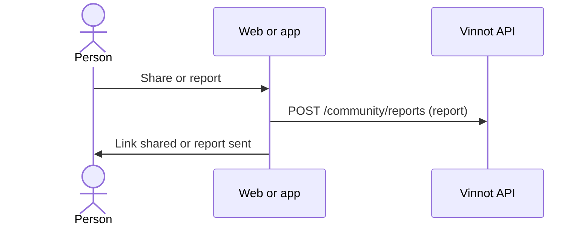

# UC-RTE-04 · Share or report a route

| Field | Value |
|---|---|
| ID | `UC-RTE-04` |
| Module | [Wine routes](../README.md) |
| Platforms | Web, APK |
| Actors | Signed-in user |
| Lucidchart IDs | [APK UC-RTE-04](https://lucid.app/lucidchart/e095dd25-e8ac-41ba-bf5b-396e1055f217/edit) |
| Requirements | [`RF-WEB-RTE-07`](../requirements.md), [`RF-APK-RTE-07`](../requirements.md) |
| Test cases | [`CP-RTE-11`](../testing.md), [`CP-RTE-15`](../testing.md), [`CP-RTE-12`](../testing.md) |

## Preconditions

- The person is on the details of a published route.

## Postconditions

- The route was shared or reported.

## Main flow

1. The person chooses “Share”.
2. The client builds the route's public link and opens the system share sheet or copies the link ([Sharing](../../sharing/README.md)).
3. Or the person chooses “Report” and follows the reporting flow ([Community](../../community/README.md)).

## Alternative flows

- 1a. The route is not published (draft or archived, visible only to its creator and the team): “Share” is not offered.
- 3a. The person cancels the report: nothing is sent.

## Business rules

- The public link only opens published routes, so “Share” only appears on them.
- Blocking accounts is not offered on routes.

## Diagram

[View the full “UC-RTE-04 · Share or report a route” diagram](https://images.vinnot.com/docs/diagrams/v1/en/modules-wine-routes-use-cases-uc-rte-04-share-or-report-route-40447a8cbfba.svg)

Component diagram in Lucidchart: [APK UC-RTE-04](https://lucid.app/lucidchart/e095dd25-e8ac-41ba-bf5b-396e1055f217/edit).

## Code

| Layer | Location |
|---|---|
| Endpoints | `POST /community/reports` |
| Web | [`WineRouteDetailsPage.tsx`](../../../../../frontend-react/src/presentation/pages/wine-routes/WineRouteDetailsPage.tsx), [`useWineRouteDetailsViewModel.ts`](../../../../../frontend-react/src/presentation/pages/wine-routes/useWineRouteDetailsViewModel.ts), [`CommunityActions.tsx`](../../../../../frontend-react/src/presentation/components/features/community/CommunityActions.tsx) |
| App | [`WineRouteDetailScreen.tsx`](../../../../../frontend-mobile/src/presentation/features/wineRoute/WineRouteDetailScreen.tsx), [`useWineRouteDetailViewModel.ts`](../../../../../frontend-mobile/src/presentation/features/wineRoute/useWineRouteDetailViewModel.ts), [`CommunityActions.tsx`](../../../../../frontend-mobile/src/presentation/features/community/CommunityActions.tsx) |

## Automated tests

- Backend: None
- Web: [`CommunityActions.test.tsx`](../../../../../frontend-react/src/presentation/components/features/community/CommunityActions.test.tsx), [`useWineRouteDetailsViewModel.test.tsx`](../../../../../frontend-react/src/presentation/pages/wine-routes/useWineRouteDetailsViewModel.test.tsx), [`publicContent.test.ts`](../../../../../frontend-react/src/domain/sharing/publicContent.test.ts)
- App: [`CommunityActions.test.tsx`](../../../../../frontend-mobile/src/presentation/features/community/CommunityActions.test.tsx), [`useWineRouteDetailViewModel.test.ts`](../../../../../frontend-mobile/src/presentation/features/wineRoute/useWineRouteDetailViewModel.test.ts), [`shareability.test.ts`](../../../../../frontend-mobile/src/domain/sharing/shareability.test.ts)
