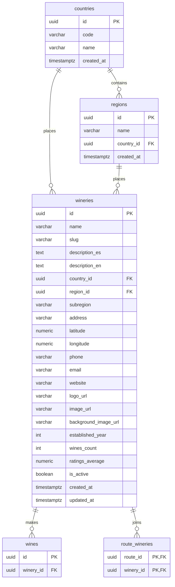

# Wineries and regions

The wineries that make the catalog's wines, and the countries and regions that
place them. Each winery has a page with its description, map, contact details
and wines; countries and regions feed the catalog filters and link wineries,
wines, events and routes. Creating, editing and removing wineries is in
[Administration](../admin/README.md); each winery's wines are read from
[Wines](../wines/README.md).

- Module code: `WRY`.
- Backend: packages [`winery`](../../../../backend/src/main/java/com/vinnot/winery/) and [`region`](../../../../backend/src/main/java/com/vinnot/region/).
- [Use cases](use-cases/README.md) · [Requirements](requirements.md) ·
  [Architecture](architecture.md) · [Testing](testing.md)

## Actors

| Actor | What they do in this module |
|---|---|
| Signed-in user | Opens a winery page, searches wineries in the app and reads countries and regions |
| Geocoding service (Google) | Places on the map a winery that has no coordinates |

## Business rules

| Rule | Detail | Where |
|---|---|---|
| Access | Wineries, countries and regions need a session | [`SecurityConfig.java`](../../../../backend/src/main/java/com/vinnot/shared/infrastructure/config/SecurityConfig.java) |
| Search | By name, ignoring case, with a country filter (name or ISO code) and a region-name filter, both ignoring case; active wineries only | [`SearchWineriesQueryHandler.java`](../../../../backend/src/main/java/com/vinnot/winery/application/query/handler/SearchWineriesQueryHandler.java) |
| Paging | Pages of 20 by default and up to 100 | [`SearchWineriesQueryHandler.java`](../../../../backend/src/main/java/com/vinnot/winery/application/query/handler/SearchWineriesQueryHandler.java) |
| Coordinates | Latitude between -90 and 90 and longitude between -180 and 180; a winery can have an address without coordinates | [`winery/domain`](../../../../backend/src/main/java/com/vinnot/winery/domain/) |
| Geocoding | When coordinates are missing, the page looks them up and the API only saves them with the `WINERY_UPDATE` permission | [`WineryController.java`](../../../../backend/src/main/java/com/vinnot/winery/infrastructure/web/controller/WineryController.java) |
| Countries and regions | Full lists, not paged, ordered by name | [`RegionController.java`](../../../../backend/src/main/java/com/vinnot/region/infrastructure/web/controller/RegionController.java) |
| Usage limits | 180 winery reads per minute and 300 per minute for the rest | [`RateLimitPolicyResolver.java`](../../../../backend/src/main/java/com/vinnot/shared/infrastructure/security/RateLimitPolicyResolver.java) |

## Where it lives

| Part | Location |
|---|---|
| API | [`WineryController`](../../../../backend/src/main/java/com/vinnot/winery/infrastructure/web/controller/WineryController.java) and [`RegionController`](../../../../backend/src/main/java/com/vinnot/region/infrastructure/web/controller/RegionController.java) |
| Web | Page in [`pages/wineries`](../../../../frontend-react/src/presentation/pages/wineries/) and components in [`features/winery`](../../../../frontend-react/src/presentation/components/features/winery/) |
| App | Screens in `frontend-mobile/app/(app)/wineries` and logic in [`features/winery`](../../../../frontend-mobile/src/presentation/features/winery/) |

## Data

Tables created in `V1__baseline_schema.sql`.

[View the full “Wineries and regions · Data” diagram](https://images.vinnot.com/docs/diagrams/v1/en/modules-wineries-readme-c64755aefaf3.svg)

`route_wineries` links wineries with [Wine routes](../wine-routes/README.md).
