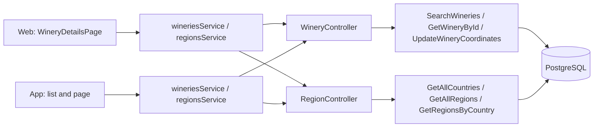
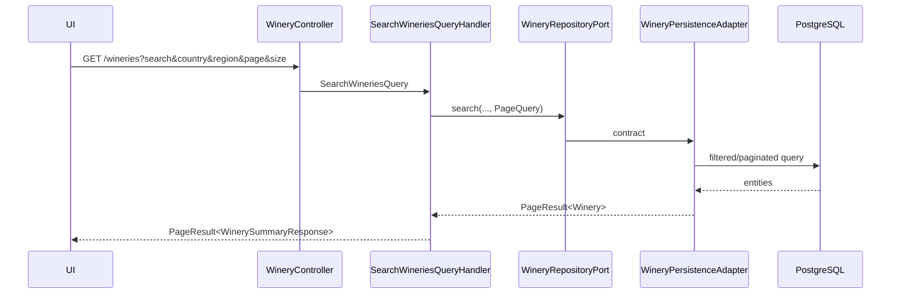
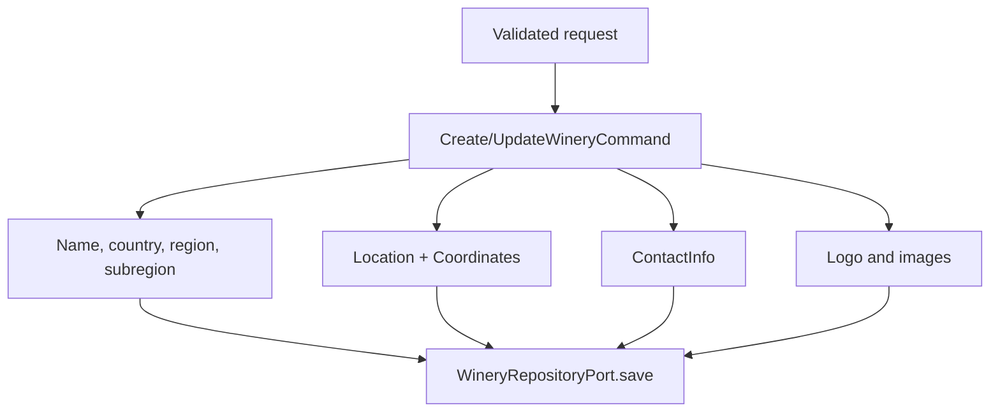

# Architecture

How the module is built in each layer. The backend follows the hexagonal flow
`controller → input port → handler → domain → output port → adapter`;
the web and the app follow `screen → hook → service → API client → HTTP transport`.



[View the full “Architecture” diagram](https://images.vinnot.com/docs/diagrams/v1/en/modules-wineries-architecture-e9f977ed217a.svg)

## Backend

### Scope

The winery catalog represents a producer separately from its wines. The
`winery` module manages public identity, bilingual descriptions, location,
contact, images and imported metrics; `region` provides normalized countries and
regions for filters and relations.

### Domain model

`Winery` is an aggregate with:

- name and derived `slug`;
- `descriptionEs` and `descriptionEn`;
- country, region and subregion;
- `Location` with address and optional `Coordinates`;
- `ContactInfo` with email, phone and website;
- logo, image and background;
- establishment year;
- external-catalog data: SEO/legal name, claim, status and counters;
- `active`, `createdAt` and `updatedAt`.

`Country` and `Region` are owned by `region`. A winery references their UUIDs;
read-model names/codes do not replace the reference.

### Invariants

- Name and `countryId` are required on creation.
- Slug is generated from the name and regenerated when it changes.
- Coordinates enforce latitude `[-90, 90]` and longitude `[-180, 180]`.
- A location may have an address without coordinates.
- ES/EN descriptions are updated explicitly and are never mixed by locale.
- Public search operates on active wineries.
- Country/region filters are applied in persistence before pagination.

### Search and detail



[View the full “Search and detail” diagram](https://images.vinnot.com/docs/diagrams/v1/en/modules-wineries-architecture-4fa6921e0898.svg)

Detail uses `GetWineryByIdQueryHandler` and returns location, contact,
descriptions, images, metrics and timestamps. Winery wines are fetched through
the wine catalog with a `wineryId` filter; they are not loaded through an open
JPA collection in the controller.

## Source references

### Creation and update

`CreateWineryCommandHandler` builds the aggregate and applies value objects only
with valid input. `UpdateWineryCommandHandler` preserves the same separation:
basic data, localized text, location, contact, images and year are changed
through domain methods.



[View the full “Creation and update” diagram](https://images.vinnot.com/docs/diagrams/v1/en/modules-wineries-architecture-679981e3128e.svg)

The public update route uses `PUT`; the admin route uses `PATCH` and its
back-office DTO. Both delegate to the same module and never implement a second
entity.

#### Write contract and ID lookup

Create/update handlers inject only `WineryRepositoryPort`. They construct
`Coordinates` when both values are present, `Location` for address/coordinates,
and `ContactInfo` for email/phone/web. Geography references are resolved in
persistence; the database enforces FKs.

Create returns UUID and update returns void; the controller builds its route's
response. Update rebuilds location/contact from command values; it does not
implicitly retain every omitted field. Descriptions go through
`updateDescriptions`, images through `updateImages`, and year through
`setEstablishedYear`.

`GetWineryByIdQueryHandler` uses `findById`; it does not rerun the public-search
active filter. DTO projection prevents JPA entities from being serialized.

### Incremental geocoding

`PATCH /wineries/{id}/coordinates` completes a winery without coordinates. The
handler:

1. loads the aggregate;
2. returns without writing when coordinates already exist;
3. validates latitude/longitude through `Coordinates`;
4. preserves the current address if none is supplied;
5. saves the new `Location`.

This prevents late navigation/geocoding from overwriting curated data. Frontend
may render a resolved map without owning the rule.

### Regional data

| Endpoint | Use case |
|---|---|
| `GET /regions/countries` | `GetAllCountriesQueryHandler` |
| `GET /regions` | `GetAllRegionsQueryHandler` |
| `GET /regions/country/{countryId}` | `GetRegionsByCountryQueryHandler` |

Catalogs are read-only and require an authenticated session (`SecurityConfig` protects `GET /regions/**`). Writes happen through migrations/imports or
authorized administration tooling, not a generic exposed endpoint.

### Integrations

- Wines store `wineryId` and use `WineryQueryPort` for names/location.
- Wine routes resolve stop wineries through their own port.
- Google Maps/geocoding lives in frontend infrastructure or an external service;
  the domain only knows coordinates.
- Import scripts map country/region before inserting large catalogs.

### Errors and security

- search/detail: authenticated (`GET /wineries/**` requires a session); publication/ownership rules still apply;
- create/update/coordinates/delete: `WINERY_*` authorities;
- back office (`/admin/wineries`): `ADMIN` or `MODERATOR` role; `DELETE` requires `ADMIN`;
- missing ID: `404`;
- invalid coordinates: `400`;
- conflicting slug/relation: `409` when database guards the condition.

### Tests

- domain: name, slug, texts, location/contact and activation;
- handlers: creation, partial update and no coordinate overwrite;
- queries: search, detail and country and region lists;
- integration: exact names and active wine counts with PostgreSQL;
- frontend: winery and region services and mappers, and the app header by language.

### References

- `backend/src/main/java/com/vinnot/winery`
- `backend/src/main/java/com/vinnot/region`
- `frontend-react/src/application/services/wineries.service.ts`
- `frontend-mobile/src/application/services/wineries.service.ts`
- [Data model](../../backend/data/database-model.md)

## Web

```text
WineryDetailsPage → useWineryDetailsViewModel → wineriesService → wineriesClient → http
```

The web only has the `/wineries/:id` page, inside the protected layout of
[`App.tsx`](../../../../frontend-react/src/app/App.tsx); there is no winery list. It is
reached from a wine's detail, a wine route's itinerary and administration.

| Piece | What it does |
|---|---|
| [`WineryDetailsPage.tsx`](../../../../frontend-react/src/presentation/pages/wineries/WineryDetailsPage.tsx) | Logo with a default image, details, contact with `mailto:` and `tel:`, embedded map and wine grid |
| [`useWineryDetailsViewModel.ts`](../../../../frontend-react/src/presentation/pages/wineries/useWineryDetailsViewModel.ts) | Loads the winery and its first 20 wines; shows the description in the active language and, when missing, the other one (`localizedWineryDescription`); when coordinates are missing, it geocodes and asks to store them |
| [`wineries.service.ts`](../../../../frontend-react/src/application/services/wineries.service.ts) | Maps the DTOs; the winery's wines come from `GET /wines?wineryId=` |
| [`regions.service.ts`](../../../../frontend-react/src/application/services/regions.service.ts) | Countries and regions for the wine, event and route filters |

## App

The screens are `frontend-mobile/app/(app)/wineries/index.tsx` (list) and
`frontend-mobile/app/(app)/wineries/[id].tsx` (page). The list opens from a
notification with the `/wineries` destination; the page, from the list and
from other modules.

| Piece | What it does |
|---|---|
| [`useWineriesListViewModel.ts`](../../../../frontend-mobile/src/presentation/features/winery/useWineriesListViewModel.ts) | Search with a 350 ms wait, pages of 20 appended when the end is reached while `hasNext` is true, and pull-to-refresh |
| [`useWineryDetailViewModel.ts`](../../../../frontend-mobile/src/presentation/features/winery/useWineryDetailViewModel.ts) | Loads the winery and its first 20 wines; when coordinates are missing, it geocodes and asks to store them |
| [`WineryHero.tsx`](../../../../frontend-mobile/src/presentation/features/winery/WineryHero.tsx) | Header with the description in the interface language and the other one as fallback |
| [`WineryWineGrid.tsx`](../../../../frontend-mobile/src/presentation/features/winery/WineryWineGrid.tsx) | Grid of the winery's wines |
| [`wineries.service.ts`](../../../../frontend-mobile/src/application/services/wineries.service.ts) | Maps the list DTOs (`items`, `pageNumber`, `pageSize`, `totalItems` and `hasNext` from `PageResponseWrapper`) and the page DTOs; the winery's wines come from `GET /wines?wineryId=`, as on the web |

The winery search is also used to suggest the winery when proposing a wine
([Proposed wines](../wines/submissions.md)).
