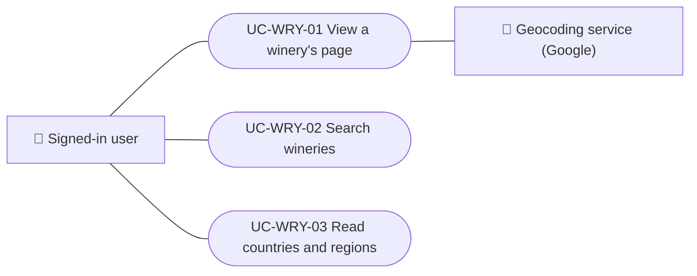

# Use cases

Use cases of the wineries and regions module: viewing a winery's page, searching wineries in the app and reading countries and regions. Each case applies to the platforms listed.

| ID | Use case | Platforms | Actors |
|---|---|---|---|
| `UC-WRY-01` | [View a winery's page](uc-wry-01-view-winery.md) | Web, APK | Signed-in user, Geocoding service (Google) |
| `UC-WRY-02` | [Search wineries](uc-wry-02-search-wineries.md) | APK | Signed-in user |
| `UC-WRY-03` | [Read countries and regions](uc-wry-03-countries-and-regions.md) | Web, APK | Signed-in user |

## Use case diagram

[View the full “Use cases · Use case diagram” diagram](https://images.vinnot.com/docs/diagrams/v1/en/modules-wineries-use-cases-readme-98f30bb0cf1a.svg)

## Lucidchart mapping

| ID | Lucidchart IDs |
|---|---|
| `UC-WRY-01` | [WEB UC-WRY-01](https://lucid.app/lucidchart/9f11a16b-bb5a-42fc-a9e8-0852b17bd241/edit), [APK UC-WINERY-02](https://lucid.app/lucidchart/e095dd25-e8ac-41ba-bf5b-396e1055f217/edit) |
| `UC-WRY-02` | [APK UC-WINERY-01](https://lucid.app/lucidchart/e095dd25-e8ac-41ba-bf5b-396e1055f217/edit) |
| `UC-WRY-03` | None |
