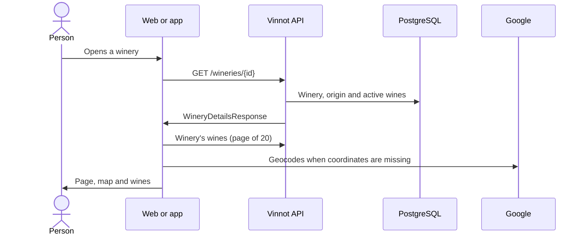

# UC-WRY-01 · View a winery's page

| Field | Value |
|---|---|
| ID | `UC-WRY-01` |
| Module | [Wineries and regions](../README.md) |
| Platforms | Web, APK |
| Actors | Signed-in user, Geocoding service (Google) |
| Lucidchart IDs | [WEB UC-WRY-01](https://lucid.app/lucidchart/9f11a16b-bb5a-42fc-a9e8-0852b17bd241/edit), [APK UC-WINERY-02](https://lucid.app/lucidchart/e095dd25-e8ac-41ba-bf5b-396e1055f217/edit) |
| Requirements | [`RF-WEB-WRY-01`](../requirements.md), [`RF-WEB-WRY-02`](../requirements.md), [`RF-WEB-WRY-03`](../requirements.md), [`RF-WEB-WRY-04`](../requirements.md), [`RF-APK-WRY-01`](../requirements.md), [`RF-APK-WRY-02`](../requirements.md), [`RF-APK-WRY-03`](../requirements.md), [`RF-APK-WRY-04`](../requirements.md) |
| Test cases | [`CP-WRY-01`](../testing.md), [`CP-WRY-02`](../testing.md), [`CP-WRY-03`](../testing.md), [`CP-WRY-04`](../testing.md), [`CP-WRY-05`](../testing.md) |

## Preconditions

- The person is signed in.

## Postconditions

- The winery's page is shown with its wines, its location and its contact details.

## Main flow

1. The person opens a winery from a wine, a wine route or the app list.
2. The client calls `GET /wineries/{id}`.
3. The API returns the winery with its origin, contact, coordinates and number of active wines.
4. The client shows logo, name, location, founding year, description (in the interface language or, when missing, in the other one), website, email and phone.
5. The client shows a map with the coordinates or, when missing, with the address or the name.
6. It asks separately for the first page of 20 of the winery's wines and shows them in a grid that leads to each wine.

## Alternative flows

- 3a. The winery does not exist: the API answers 404 and the client shows it was not found.
- 5a. The winery has no coordinates: the client looks them up by geocoding with name, region and country, and asks to store them with `PATCH /wineries/{id}/coordinates`; the API only stores them when the viewer has the `WINERY_UPDATE` permission and the winery still has no coordinates.
- 6a. The winery has no published wines: the empty state is shown.
- 4a. The image is missing: a default image is shown; another field is missing: that block is not shown.

## Business rules

- The page and its wines are separate reads: an error in the wines does not hide the winery.
- Only active wines are counted and listed.
- Stored coordinates are never overwritten from a page: the PATCH does not write when they already exist.
- Latitude between -90 and 90, longitude between -180 and 180 and an address of up to 500 characters.

## Diagram

[View the full “UC-WRY-01 · View a winery's page” diagram](https://images.vinnot.com/docs/diagrams/v1/en/modules-wineries-use-cases-uc-wry-01-view-winery-9fa1aaeb9d96.svg)

Component diagram in Lucidchart: [WEB UC-WRY-01](https://lucid.app/lucidchart/9f11a16b-bb5a-42fc-a9e8-0852b17bd241/edit), [APK UC-WINERY-02](https://lucid.app/lucidchart/e095dd25-e8ac-41ba-bf5b-396e1055f217/edit).

## Code

| Layer | Location |
|---|---|
| Endpoints | `GET /wineries/{id}`, `GET /wines?wineryId=`, `PATCH /wineries/{id}/coordinates` |
| Backend | [`WineryController.java`](../../../../../backend/src/main/java/com/vinnot/winery/infrastructure/web/controller/WineryController.java), [`GetWineryByIdQueryHandler.java`](../../../../../backend/src/main/java/com/vinnot/winery/application/query/handler/GetWineryByIdQueryHandler.java), [`UpdateWineryCoordinatesCommandHandler.java`](../../../../../backend/src/main/java/com/vinnot/winery/application/command/handler/UpdateWineryCoordinatesCommandHandler.java) |
| Web | [`WineryDetailsPage.tsx`](../../../../../frontend-react/src/presentation/pages/wineries/WineryDetailsPage.tsx), [`useWineryDetailsViewModel.ts`](../../../../../frontend-react/src/presentation/pages/wineries/useWineryDetailsViewModel.ts), [`WineryWineCard.tsx`](../../../../../frontend-react/src/presentation/components/features/winery/WineryWineCard.tsx), [`wineries.service.ts`](../../../../../frontend-react/src/application/services/wineries.service.ts), [`wineries.client.ts`](../../../../../frontend-react/src/infrastructure/api/clients/wineries.client.ts) |
| App | `frontend-mobile/app/(app)/wineries/[id].tsx`, [`useWineryDetailViewModel.ts`](../../../../../frontend-mobile/src/presentation/features/winery/useWineryDetailViewModel.ts), [`WineryHero.tsx`](../../../../../frontend-mobile/src/presentation/features/winery/WineryHero.tsx), [`WineryWineGrid.tsx`](../../../../../frontend-mobile/src/presentation/features/winery/WineryWineGrid.tsx), [`wineries.service.ts`](../../../../../frontend-mobile/src/application/services/wineries.service.ts) |

## Automated tests

- Backend: [`GetWineryByIdQueryHandlerTest.java`](../../../../../backend/src/test/java/com/vinnot/winery/application/query/handler/GetWineryByIdQueryHandlerTest.java), [`WineryTest.java`](../../../../../backend/src/test/java/com/vinnot/winery/domain/model/WineryTest.java), [`WineryExactNamesPostgresIntegrationTest.java`](../../../../../backend/src/test/java/com/vinnot/winery/infrastructure/persistence/WineryExactNamesPostgresIntegrationTest.java)
- Web: [`wineries.service.test.ts`](../../../../../frontend-react/src/application/services/wineries.service.test.ts), [`winery.mappers.test.ts`](../../../../../frontend-react/src/domain/winery/winery.mappers.test.ts), [`useWineryDetailsViewModel.test.tsx`](../../../../../frontend-react/src/presentation/pages/wineries/useWineryDetailsViewModel.test.tsx)
- App: [`WineryHero.test.tsx`](../../../../../frontend-mobile/src/presentation/features/winery/WineryHero.test.tsx), [`wineries.service.test.ts`](../../../../../frontend-mobile/src/application/services/wineries.service.test.ts), [`winery.mappers.test.ts`](../../../../../frontend-mobile/src/domain/winery/winery.mappers.test.ts), [`wineDetailRoute.test.tsx`](../../../../../frontend-mobile/src/presentation/features/wine/__tests__/wineDetailRoute.test.tsx)
