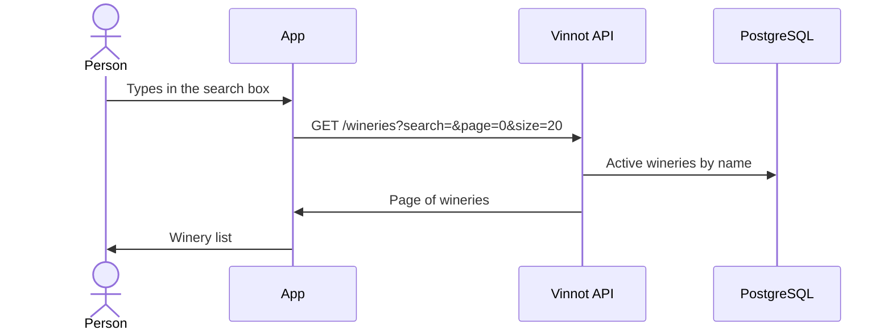

# UC-WRY-02 · Search wineries

| Field | Value |
|---|---|
| ID | `UC-WRY-02` |
| Module | [Wineries and regions](../README.md) |
| Platforms | APK |
| Actors | Signed-in user |
| Lucidchart IDs | [APK UC-WINERY-01](https://lucid.app/lucidchart/e095dd25-e8ac-41ba-bf5b-396e1055f217/edit) |
| Requirements | [`RF-APK-WRY-05`](../requirements.md) |
| Test cases | [`CP-WRY-06`](../testing.md), [`CP-WRY-07`](../testing.md), [`CP-WRY-13`](../testing.md), [`CP-WRY-08`](../testing.md), [`CP-WRY-09`](../testing.md) |

## Preconditions

- The person is signed in on the app and opened the winery list from a notification with that destination.

## Postconditions

- The active wineries matching the search are shown.

## Main flow

1. The app shows the active wineries ordered by name.
2. The person types in the search box.
3. The app waits for 350 ms without changes and calls `GET /wineries` with the text and pages of 20.
4. The API searches for the text within each winery's name, legal name or SEO name.
5. The person picks a winery and the app opens its page ([UC-WRY-01](uc-wry-01-view-winery.md)).

## Alternative flows

- 2a. The person pulls down: the list reloads.
- 2b. The person reaches the end of the list: the app asks for the next page and appends it, while the API says there are more (`hasNext`).
- 4a. There are no results: the empty state is shown.
- 3a. A text longer than 512 characters answers 422 `INVALID_SEARCH`.

## Business rules

- The search ignores case; it also takes a country filter, by name (`Argentina`, as the staff web and app send it) or by ISO code (`ar`), and a region-name filter; both filters ignore case.
- The page size goes from 1 to 100; outside that range it answers 422 `INVALID_PAGINATION`.
- The web has no winery list: each page is reached from wines and routes.

## Diagram

[View the full “UC-WRY-02 · Search wineries” diagram](https://images.vinnot.com/docs/diagrams/v1/en/modules-wineries-use-cases-uc-wry-02-search-wineries-77d2b35093d2.svg)

Component diagram in Lucidchart: [APK UC-WINERY-01](https://lucid.app/lucidchart/e095dd25-e8ac-41ba-bf5b-396e1055f217/edit).

## Code

| Layer | Location |
|---|---|
| Endpoints | `GET /wineries?search=&page=&size=20` |
| Backend | [`WineryController.java`](../../../../../backend/src/main/java/com/vinnot/winery/infrastructure/web/controller/WineryController.java), [`SearchWineriesQueryHandler.java`](../../../../../backend/src/main/java/com/vinnot/winery/application/query/handler/SearchWineriesQueryHandler.java), [`WineryJpaRepository.java`](../../../../../backend/src/main/java/com/vinnot/winery/infrastructure/persistence/jpa/WineryJpaRepository.java) |
| App | `frontend-mobile/app/(app)/wineries/index.tsx`, [`useWineriesListViewModel.ts`](../../../../../frontend-mobile/src/presentation/features/winery/useWineriesListViewModel.ts), [`WineryCard.tsx`](../../../../../frontend-mobile/src/presentation/features/winery/WineryCard.tsx) |

## Automated tests

- Backend: [`SearchWineriesQueryHandlerTest.java`](../../../../../backend/src/test/java/com/vinnot/winery/application/query/handler/SearchWineriesQueryHandlerTest.java), [`SearchInputLimitsTest.java`](../../../../../backend/src/test/java/com/vinnot/shared/application/util/SearchInputLimitsTest.java), [`WinerySearchPostgresIntegrationTest.java`](../../../../../backend/src/test/java/com/vinnot/winery/infrastructure/persistence/WinerySearchPostgresIntegrationTest.java)
- Web: None
- App: [`wineries.service.test.ts`](../../../../../frontend-mobile/src/application/services/wineries.service.test.ts)
