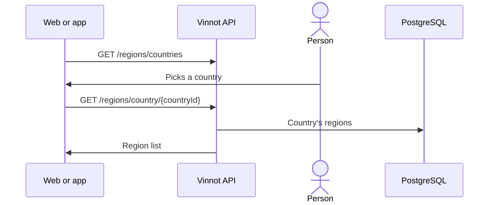

# UC-WRY-03 · Read countries and regions

| Field | Value |
|---|---|
| ID | `UC-WRY-03` |
| Module | [Wineries and regions](../README.md) |
| Platforms | Web, APK |
| Actors | Signed-in user |
| Lucidchart IDs | None |
| Requirements | None |
| Test cases | [`CP-WRY-10`](../testing.md), [`CP-WRY-11`](../testing.md), [`CP-WRY-12`](../testing.md) |

## Preconditions

- The person is signed in and opens a screen with a country and region filter or picker.

## Postconditions

- The picker offers the countries and the regions of the chosen country.

## Main flow

1. The client asks for the list of countries.
2. The person picks a country.
3. The client asks for that country's regions.
4. The person picks a region.

## Alternative flows

- 2a. The person changes the country: the chosen region is cleared and the new country's are loaded.
- 3a. The country has no regions or does not exist: the API returns an empty list.

## Business rules

- The lists are not paged and come ordered by name, ignoring case.
- Countries and regions are loaded by the reference migrations and are not edited from the application.
- The web caches these lists for 30 minutes.
- They are used by the [wines](../../wines/README.md), [events](../../events/README.md) and [wine routes](../../wine-routes/README.md) filters.

## Diagram

[View the full “UC-WRY-03 · Read countries and regions” diagram](https://images.vinnot.com/docs/diagrams/v1/en/modules-wineries-use-cases-uc-wry-03-countries-and-regions-6907c2cda52c.svg)

## Code

| Layer | Location |
|---|---|
| Endpoints | `GET /regions/countries`, `GET /regions`, `GET /regions/country/{countryId}` |
| Backend | [`RegionController.java`](../../../../../backend/src/main/java/com/vinnot/region/infrastructure/web/controller/RegionController.java), [`GetAllCountriesQueryHandler.java`](../../../../../backend/src/main/java/com/vinnot/region/application/query/GetAllCountriesQueryHandler.java), [`GetAllRegionsQueryHandler.java`](../../../../../backend/src/main/java/com/vinnot/region/application/query/GetAllRegionsQueryHandler.java), [`GetRegionsByCountryQueryHandler.java`](../../../../../backend/src/main/java/com/vinnot/region/application/query/GetRegionsByCountryQueryHandler.java) |
| Web | [`useCountries.ts`](../../../../../frontend-react/src/presentation/hooks/queries/wine/useCountries.ts), [`useRegions.ts`](../../../../../frontend-react/src/presentation/hooks/queries/wine/useRegions.ts), [`regions.service.ts`](../../../../../frontend-react/src/application/services/regions.service.ts), [`regions.client.ts`](../../../../../frontend-react/src/infrastructure/api/clients/regions.client.ts) |
| App | [`regions.client.ts`](../../../../../frontend-mobile/src/infrastructure/api/clients/regions.client.ts) |

## Automated tests

- Backend: [`GetAllCountriesQueryHandlerTest.java`](../../../../../backend/src/test/java/com/vinnot/region/application/query/GetAllCountriesQueryHandlerTest.java), [`GetAllRegionsQueryHandlerTest.java`](../../../../../backend/src/test/java/com/vinnot/region/application/query/GetAllRegionsQueryHandlerTest.java), [`GetRegionsByCountryQueryHandlerTest.java`](../../../../../backend/src/test/java/com/vinnot/region/application/query/GetRegionsByCountryQueryHandlerTest.java)
- Web: [`regions.service.test.ts`](../../../../../frontend-react/src/application/services/regions.service.test.ts)
- App: [`regions.service.test.ts`](../../../../../frontend-mobile/src/application/services/regions.service.test.ts)
