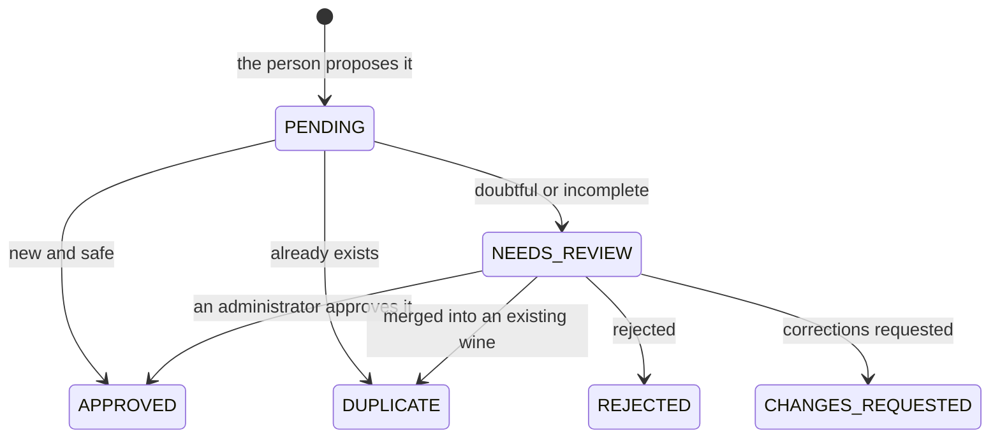
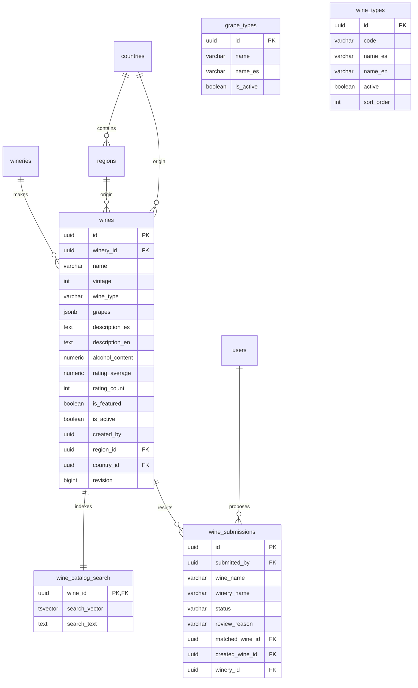

# Wines

The Vinnot wine catalog: searching and filtering it, paging through it and
viewing each wine's page. The app adds the label scanner, which recognizes a
wine with the camera, and the flow to propose wines that are not in the catalog
yet. Creating and editing wines by the team lives in
[Administration](../admin/README.md); the AI profile and comparisons, in
[AI profiles and comparisons](../ai/README.md); reviews, in
[Reviews](../reviews/README.md).

- Module code: `WIN`.
- Backend: package [`wine`](../../../../backend/src/main/java/com/vinnot/wine/).
- [Use cases](use-cases/README.md) · [Requirements](requirements.md) ·
  [Architecture](architecture.md) · [Proposed wines](submissions.md) ·
  [Testing](testing.md)

## Actors

| Actor | What they do in this module |
|---|---|
| Signed-in user | Searches, filters and opens wines; in the app scans labels and proposes wines |
| Location service | Suggests the device country as the initial filter |
| Recognition provider | OpenAI reads the label when the on-device text is not enough and picks among the scan candidates |
| Image embedding provider | Google Gemini turns catalog label images and the scanned photo into vectors for visual search |
| Email service | Tells the proposer about every status change |

## Business rules

| Rule | Detail | Where |
|---|---|---|
| Access | The catalog, the detail, grapes and reference types require a session | [`SecurityConfig.java`](../../../../backend/src/main/java/com/vinnot/shared/infrastructure/config/SecurityConfig.java) |
| Visible wines | The catalog shows only active wines; an inactive wine's detail is visible only to catalog staff and its creator | [`ResourceReader.java`](../../../../backend/src/main/java/com/vinnot/shared/domain/valueobject/ResourceReader.java) |
| Paging | Pages of up to 20 and only the first 500 results | [`PublicWineCatalogAccessPolicy.java`](../../../../backend/src/main/java/com/vinnot/wine/infrastructure/web/policy/PublicWineCatalogAccessPolicy.java) |
| Search text | Up to 512 characters; prefix and containment, and similarity when nothing matches; accents and case are ignored ("septima" finds "Séptima") | [`WineSearchNativeRepository.java`](../../../../backend/src/main/java/com/vinnot/wine/infrastructure/persistence/search/WineSearchNativeRepository.java) |
| Wine types | `RED`, `WHITE`, `ROSE`, `SPARKLING`, `DESSERT`, `FORTIFIED` y `ORANGE` | [`WineType.java`](../../../../backend/src/main/java/com/vinnot/wine/domain/valueobject/WineType.java) |
| Label photo | JPEG or PNG, up to 8 MiB and 24 Mpx, with minimum sides of 320 and 720 px and enough light and focus | [`WineLabelUploadValidator.java`](../../../../backend/src/main/java/com/vinnot/wine/infrastructure/web/WineLabelUploadValidator.java) |
| Scanning | Answer within 18 seconds at most; the photo is not stored; text search, visual search and a vision-model pick among candidates | [`ScanWineLabelCommandHandler.java`](../../../../backend/src/main/java/com/vinnot/wine/application/command/handler/ScanWineLabelCommandHandler.java) |
| Barcodes | A barcode confirmed (`CONFIRMED` verdicts) for one active wine by at least two members, and by more members than any other wine, answers the scan as an exact match without AI | [`JdbcWineBarcodeConfirmations.java`](../../../../backend/src/main/java/com/vinnot/wine/infrastructure/persistence/adapter/JdbcWineBarcodeConfirmations.java) |
| Scan feedback | One verdict per scan (`CONFIRMED`, `CORRECTED`, `NOT_IN_CATALOG`); a corrected exact match files a catalog quality report and never edits the catalog | [`SubmitWineLabelScanFeedbackCommandHandler.java`](../../../../backend/src/main/java/com/vinnot/wine/application/command/handler/SubmitWineLabelScanFeedbackCommandHandler.java) |
| Usage limits | Per user: 60 catalog requests per minute, 30 scans per hour and 10 proposals or photos per day | [`RateLimitPolicyResolver.java`](../../../../backend/src/main/java/com/vinnot/shared/infrastructure/security/RateLimitPolicyResolver.java) |
| Proposals | Published without review only when recognition, deduplication and moderation are safe | [Proposed wines](submissions.md) |

## States of a proposed wine

[View the full “States of a proposed wine” diagram](https://images.vinnot.com/docs/diagrams/v1/en/modules-wines-readme-f839a917f1c7.svg)

## Where it lives

| Part | Location |
|---|---|
| API | [`WineReadController`](../../../../backend/src/main/java/com/vinnot/wine/infrastructure/web/controller/WineReadController.java), [`WineLabelScanController`](../../../../backend/src/main/java/com/vinnot/wine/infrastructure/web/controller/WineLabelScanController.java), [`WineSubmissionController`](../../../../backend/src/main/java/com/vinnot/wine/infrastructure/web/controller/WineSubmissionController.java) and [`GrapeTypeController`](../../../../backend/src/main/java/com/vinnot/wine/infrastructure/web/controller/GrapeTypeController.java) |
| Web | Pages in [`pages/wines`](../../../../frontend-react/src/presentation/pages/wines/) |
| App | Screens in `frontend-mobile/app/(app)/(tabs)/wines`, logic in [`features/wine`](../../../../frontend-mobile/src/presentation/features/wine/) and camera in [`device/camera`](../../../../frontend-mobile/src/infrastructure/device/camera/) |

## Data

Tables created in `V1__baseline_schema.sql` and extended by the search indexes
(`V3`, `V4`, `V14`, `V15`, `V16`, `V61`, `V85`, `V86`, `V90`), the catalog version (`V19`), the
proposals (`V10`, `V41`) and label scanning (`V91`, `V92`).

[View the full “Wines · Data” diagram](https://images.vinnot.com/docs/diagrams/v1/en/modules-wines-readme-2dcdcfe55352.svg)

`grape_types` and `wine_types` are reference catalogs with no direct relation:
`wines.grapes` stores the grape names and `wines.wine_type` the type code.

Label scanning adds three structures, outside the diagram:

| Table or column | Content |
|---|---|
| `V90` search functions | `catalog_search_unaccent` (an `IMMUTABLE` wrapper of `unaccent`) and the build functions of `wine_catalog_search`, which store unaccented, lower-cased text; rows indexed earlier are rewritten after startup by `CatalogSearchAccentNormalizer` |
| `wine_image_embeddings` (`V91`) | One vector per wine whose label image Vinnot hosts: `wine_id` (primary key, `ON DELETE CASCADE`), `image_url`, `model`, `dimensions`, `scale` and `embedding` (int8 bytes); partial index `idx_wines_hosted_label_image` on `wines` |
| `wine_label_scans` (`V92`) | Adds `barcode`, `feedback` (`CONFIRMED`, `CORRECTED` or `NOT_IN_CATALOG`), `feedback_wine_id` and `feedback_at` |
| `wine_barcode_confirmations` (`V92`) | One confirmation per member and barcode (primary key `(barcode, user_id)`, the latest wins) with `wine_id` and `confirmed_at` |

See [Database model](../../backend/data/database-model.md) and [Architecture](architecture.md#label-scan-accuracy).
